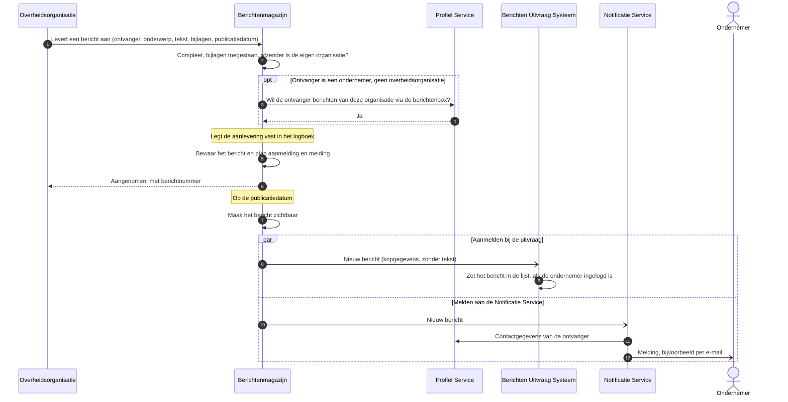

# Use case 1: Bericht versturen en melden

Een organisatie verstuurt een bericht via haar berichtenmagazijn, en de ondernemer krijgt daar een
melding van.

| | |
|---|---|
| **Actor** | Een overheidsorganisatie |
| **Aanleiding** | De organisatie heeft een bericht voor een ondernemer, bijvoorbeeld een besluit of een aanslag |
| **Resultaat** | Het bericht staat in het magazijn van de organisatie. Vanaf de publicatiedatum ziet de ondernemer het in zijn berichtenbox, en krijgt hij er een melding van |

## Verloop

1. De organisatie levert het bericht aan bij haar eigen magazijn: ontvanger, onderwerp, tekst,
   eventueel bijlagen, en eventueel een publicatiedatum.
2. Het magazijn controleert het bericht: is het compleet, zijn de bijlagen toegestaan en niet te
   groot, en komt het van de eigen organisatie?
3. Het magazijn vraagt de Profiel Service of de ondernemer berichten van deze organisatie via de
   berichtenbox wil ontvangen. Is de ontvanger zelf een overheidsorganisatie, dan vervalt deze stap.
4. Het magazijn legt de aanlevering vast in zijn logboek, bewaart het bericht, en plant de
   aanmelding en de melding.
5. De organisatie krijgt meteen antwoord: het bericht is aangenomen, met een berichtnummer.
6. Op de publicatiedatum (zonder datum: meteen) wordt het bericht zichtbaar in de berichtenbox. Het
   magazijn meldt het nieuwe bericht aan bij de uitvraag, en geeft het door aan de Notificatie
   Service.
7. Is de ondernemer op dat moment ingelogd, dan verschijnt het bericht in zijn geopende
   berichtenbox (use case 3). Anders ziet hij het de volgende keer dat hij inlogt.
8. De Notificatie Service zoekt de contactgegevens van de ondernemer op en stuurt hem een melding,
   bijvoorbeeld per e-mail. Dat deel hoort bij MijnOverheid Zakelijk, niet bij het berichtenstelsel.

De aanmelding en de melding bevatten alleen wat nodig is. Persoonsgegevens gaan versleuteld mee, of
worden apart bij het magazijn opgehaald.

## Sequence diagram

## Als het misgaat

| Situatie | Wat het stelsel doet | Wat de actor merkt |
|---|---|---|
| Het bericht is onvolledig, een bijlage is van een niet-toegestaan type, of het bericht is te groot | Het magazijn weigert het bericht en bewaart niets | De organisatie krijgt een foutmelding met de reden |
| Het bericht komt niet van de organisatie van dit magazijn | Het magazijn weigert het bericht | Een foutmelding |
| De ondernemer wil geen berichten van deze organisatie via de berichtenbox, of is daar niet bekend | Het magazijn weigert het bericht en bewaart niets | De organisatie hoort dat de ontvanger niet digitaal bereikbaar is, en moet het bericht langs een andere weg sturen |
| De Profiel Service is niet bereikbaar | Het magazijn probeert het een paar keer opnieuw en weigert daarna. Houdt de storing aan, dan weigert het een korte tijd elke aanlevering meteen | "Tijdelijk niet beschikbaar"; later opnieuw aanleveren |
| De opslag of het logboek van het magazijn werkt niet | Het magazijn bewaart niets: er blijft geen half bericht achter | Een foutmelding; later opnieuw aanleveren |
| De organisatie levert hetzelfde bericht twee keer aan, bijvoorbeeld omdat het antwoord uitbleef | Het magazijn herkent dat niet, en bewaart twee berichten | De ondernemer ziet het bericht dubbel |
| De uitvraag of de Notificatie Service is niet bereikbaar | Het magazijn probeert het enkele minuten opnieuw, en geeft het daarna op. Een storing bij de ene houdt de andere niet tegen | De organisatie merkt niets. De ondernemer ziet het bericht bij de volgende keer inloggen, maar krijgt bij een langere storing geen melding |
| De ondernemer is niet ingelogd | De uitvraag doet niets met de aanmelding | Niets: het bericht verschijnt bij de volgende keer inloggen |
| Een aanmelding komt twee keer binnen | De uitvraag herkent de herhaling | Niets |

## Nog niet gerealiseerd

- Een bericht is nu al vóór zijn publicatiedatum te zien in de berichtenbox. Alleen de aanmelding
  en de melding wachten op die datum.
- Het magazijn controleert nog niet of het bericht van de eigen organisatie komt.
- De aanmelding en de melding bevatten het nummer van de ontvanger en het onderwerp nog leesbaar.
- Als bijlage is nu alleen PDF toegestaan. Het model noemt een grens aan het aantal bijlagen; die
  is er nog niet, en het magazijn kijkt alleen naar het opgegeven bestandstype, niet naar de
  inhoud.
- Is de Profiel Service niet bereikbaar, dan krijgt de organisatie nu een algemene serverfout, niet
  "tijdelijk niet beschikbaar". Ze kan dan niet zien dat later opnieuw aanleveren zin heeft.

## Open vragen

- Moet het magazijn een dubbele aanlevering herkennen, bijvoorbeeld aan een kenmerk dat de
  organisatie meegeeft?
- Hoe lang moet het magazijn blijven proberen de aanmelding en de melding af te leveren? Nu is dat
  enkele minuten.
- Mag een organisatie een bericht digitaal sturen als de ondernemer daar niet voor gekozen heeft?
  Nu weigert het magazijn dat. Of de wetgeving daar iets anders over zegt, wordt uitgezocht. De
  afspraak is dat die beslissing bij het magazijn ligt, niet bij de berichtenbox.
- Heeft een bedrijf één berichtenbox, of hebben afdelingen hun eigen magazijn? Navragen bij de
  Belastingdienst.
- Wie krijgt een melding bij een bericht voor een bedrijf: ook gemachtigden of helpers? Dan komen
  er meer contactgegevens uit de Profiel Service. Navragen bij de afnemers.
