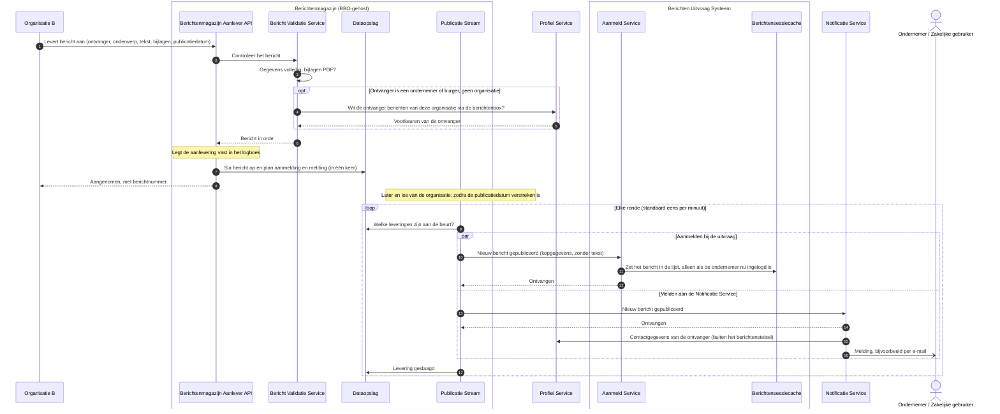

# Use case 1: Bericht aanleveren en melden

Een organisatie levert een bericht aan bij haar berichtenmagazijn, en de ondernemer krijgt daar een
melding van.

| | |
|---|---|
| **Actor** | Een overheidsorganisatie (hier: Organisatie B, die haar magazijn bij BBO afneemt) |
| **Aanleiding** | De organisatie heeft een bericht voor een ondernemer, bijvoorbeeld een besluit of een aanslag |
| **Resultaat** | Het bericht staat in het magazijn van de organisatie. Vanaf de publicatiedatum krijgt de ondernemer een melding, en ziet hij het bericht in zijn berichtenbox |

## Verloop

1. De organisatie levert het bericht aan bij haar magazijn: ontvanger, onderwerp, tekst, eventueel
   bijlagen, en eventueel een publicatiedatum.
2. Het magazijn controleert het bericht: zijn de gegevens volledig en zijn de bijlagen PDF's?
3. Het magazijn vraagt de Profiel Service of de ondernemer berichten van deze organisatie via de
   berichtenbox wil ontvangen. Is de ontvanger zelf een organisatie (OIN), dan slaat het magazijn
   deze stap over.
4. Het magazijn legt de aanlevering vast in zijn logboek, slaat het bericht op en plant in dezelfde
   stap de twee leveringen die volgen: een aanmelding bij de uitvraag en een melding aan de
   Notificatie Service.
5. De organisatie krijgt direct antwoord: het bericht is aangenomen, met het berichtnummer.
6. Daarna, los van de organisatie: zodra de publicatiedatum verstreken is (zonder datum: meteen),
   pakt de Publicatie Stream van het magazijn de geplande leveringen op. Dat gebeurt in rondes,
   standaard eens per minuut.
7. De Publicatie Stream meldt het nieuwe bericht aan bij de uitvraag. Is de ondernemer op dat moment
   ingelogd en heeft hij zijn berichten al opgehaald, dan zet de uitvraag het bericht in zijn lijst
   (en ziet hij het verschijnen, zie use case 3). Is hij niet ingelogd, dan gebeurt er niets: hij
   ziet het bericht bij de volgende keer inloggen.
8. De Publicatie Stream stuurt dezelfde gebeurtenis naar de Notificatie Service. Die zoekt de
   contactgegevens van de ondernemer op en stuurt hem een melding. Dat deel hoort niet bij het
   berichtenstelsel.

## Sequence diagram

## Als het misgaat

| Situatie | Wat het stelsel doet | Wat de actor merkt |
|---|---|---|
| Gegevens onvolledig of ongeldig, of een bijlage is geen PDF | Het magazijn weigert het bericht en slaat niets op | De organisatie krijgt een foutmelding met de reden |
| De ondernemer heeft geen profiel, of wil geen berichten van deze organisatie via de berichtenbox | Het magazijn weigert het bericht en slaat niets op | De organisatie krijgt een weigering: de ontvanger is niet digitaal bereikbaar |
| De Profiel Service is onbereikbaar of antwoordt met een fout | Is hij onbereikbaar, dan probeert het magazijn het twee keer opnieuw. Daarna weigert het de aanlevering. Gaat dat vaak mis, dan weigert het magazijn een paar seconden lang elke aanlevering meteen | De organisatie krijgt een serverfout of "tijdelijk niet beschikbaar", en moet later opnieuw aanleveren |
| De opslag van het magazijn is onbereikbaar | Het magazijn weigert de aanlevering. Bij herhaalde fouten weigert het een paar seconden lang elke aanlevering meteen, zodat er nooit een bericht verloren gaat dat als aangenomen is gemeld | "Tijdelijk niet beschikbaar"; later opnieuw aanleveren |
| Het logboek kan de aanlevering niet vastleggen | Het magazijn slaat het bericht niet op | Een serverfout; later opnieuw aanleveren |
| De organisatie levert hetzelfde bericht twee keer aan, bijvoorbeeld na een time-out | Het magazijn herkent dat niet: er ontstaan twee berichten | De ondernemer ziet het bericht dubbel |
| De uitvraag of de Notificatie Service is onbereikbaar | De Publicatie Stream probeert het opnieuw, met een steeds langere pauze (tot een uur), maximaal vijf keer per bestemming. Daarna geeft hij die levering op. Een storing bij de ene bestemming houdt de andere niet op | De organisatie merkt niets: haar aanlevering was al aangenomen. De ondernemer krijgt de melding later, of niet |
| De ondernemer is niet ingelogd | De uitvraag neemt de aanmelding aan en doet er niets mee | Niets. Het bericht verschijnt bij de volgende keer inloggen, omdat de uitvraag dan alle magazijnen bevraagt |
| Een aanmelding komt twee keer binnen | De uitvraag herkent de herhaling (een dag lang) en zet het bericht niet dubbel in de lijst | Niets |
| Het bericht is verwijderd voordat het gepubliceerd werd | De Publicatie Stream levert het niet meer | Geen melding |

## Doelarchitectuur

- **Verbinding via FSC.** In het doelbeeld lopen alle verbindingen tussen organisaties via FSC, met
  wederzijds vertrouwen op basis van PKIoverheid-certificaten. Nu is dat per bestemming in te
  stellen, en loopt het aanmelden bij de uitvraag direct.
- **Wie mag aanleveren.** In het doelbeeld controleert het magazijn wie aanlevert. Nu ligt die
  controle bij de netwerkrand vóór het magazijn, niet in het magazijn zelf.
- **Controle op bijlagen.** Het model noemt ook een controle op grootte en aantal bijlagen. Nu
  gelden alleen de grenzen uit de koppelvlakspecificatie.

## Open vragen

Uit het overleg met Logius over de use cases:

- Mag een organisatie een bericht digitaal sturen als de ondernemer daar niet voor gekozen heeft?
  Nu weigert het magazijn dat. Of de wetgeving daar iets anders over zegt, wordt uitgezocht. De
  afspraak is dat die beslissing bij het magazijn ligt, niet bij de berichtenbox.
- Heeft een bedrijf één berichtenbox, of hebben afdelingen hun eigen magazijn? Dat zit niet in deze
  opstelling; navragen bij de Belastingdienst.
- Wie krijgt een melding bij een bericht voor een bedrijf: ook gemachtigden of helpers? Dan komen er
  meer e-mailadressen uit de Profiel Service. Navragen bij de afnemers.

## Technische verwijzing

| Stap | Koppelvlak | Opmerking |
|---|---|---|
| Aanleveren | `POST /api/v1/aanleveringen` op het magazijn (`berichtenmagazijn-api.yaml`) | `201` met `berichtId`. Fouten: `400` (ongeldig, bijlage geen `application/pdf`), `403` (geen profiel of geen opt-in), `500` (logboek, Profiel Service onbereikbaar na twee retries), `503` (circuit breaker open, of onduidelijk antwoord van de Profiel Service, met `Retry-After`) |
| Toestemming | `POST /api/profielservice/v1/partij` op de Profiel Service | Voorkeur `OntvangViaBerichtenbox` voor de afzender-OIN. Niet bij een OIN-ontvanger |
| Opslaan en plannen | Eén transactie: bericht, bijlagen, en per bestemming een outbox-rij | Circuit breakers rond de Profiel Service en de database |
| Publiceren | `PublicatieStream` | `magazijn.publicatie.polling.interval` (60s), per bestemming `max-pogingen` 5 en backoff 1s tot 1u, `Retry-After` heeft voorrang |
| Aanmelden | `POST /api/v1/aanmeldingen` op de uitvraag, CloudEvent `nl.rijksoverheid.fbs.bericht.gepubliceerd` | `202` ook als er niets geschreven is. Ontdubbeld op magazijn en event-id, 24 uur |
| Melden | CloudEvent naar `NOTIFICATIE_URL` | In de lokale ontwikkelomgeving een stub |
| Logboek | Magazijn: `aanleveren-bericht`, en per poging per bestemming `publicatie-<doel>`. Uitvraag: `uitvraag-aanmelding` | |
