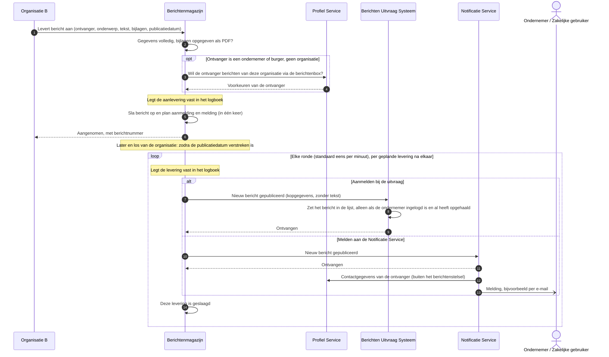

# Use case 1: Bericht aanleveren en melden

Een organisatie levert een bericht aan bij haar berichtenmagazijn, en de ondernemer krijgt daar een
melding van.

| | |
|---|---|
| **Actor** | Een overheidsorganisatie (in het diagram: Organisatie B) |
| **Aanleiding** | De organisatie heeft een bericht voor een ondernemer, bijvoorbeeld een besluit of een aanslag |
| **Resultaat** | Het bericht staat in het magazijn van de organisatie, en de ondernemer ziet het de volgende keer dat hij zijn berichten ophaalt. Vanaf de publicatiedatum krijgt hij er een melding van |

## Verloop

1. De organisatie levert het bericht aan bij haar magazijn: ontvanger, onderwerp, tekst, eventueel
   bijlagen, en eventueel een publicatiedatum.
2. Het magazijn controleert het bericht: zijn de gegevens volledig, en zijn de bijlagen opgegeven
   als PDF?
3. Het magazijn vraagt de Profiel Service of de ondernemer berichten van deze organisatie via de
   berichtenbox wil ontvangen. Is de ontvanger zelf een organisatie (OIN), dan slaat het magazijn
   deze stap over.
4. Het magazijn legt de aanlevering vast in zijn logboek, slaat het bericht op en plant in dezelfde
   stap de twee leveringen die volgen: een aanmelding bij de uitvraag en een melding aan de
   Notificatie Service.
5. De organisatie krijgt direct antwoord: het bericht is aangenomen, met het berichtnummer.
6. Daarna, los van de organisatie: zodra de publicatiedatum verstreken is (zonder datum: meteen),
   pakt het magazijn de geplande leveringen op. Dat gebeurt in rondes,
   standaard eens per minuut, en per levering na elkaar.
7. Het magazijn meldt het nieuwe bericht aan bij de uitvraag. Is de ondernemer op dat moment
   ingelogd en heeft hij zijn berichten al opgehaald, dan zet de uitvraag het bericht in zijn lijst
   (en ziet hij het verschijnen, zie use case 3). Is hij niet ingelogd, dan gebeurt er niets: hij
   ziet het bericht bij de volgende keer inloggen.
8. Het magazijn stuurt dezelfde gebeurtenis naar de Notificatie Service. Die zoekt de
   contactgegevens van de ondernemer op en stuurt hem een melding. Dat deel hoort niet bij het
   berichtenstelsel.

**Let op de publicatiedatum.** Alleen de aanmelding en de melding wachten op de publicatiedatum. Het
bericht zelf staat vanaf het aanleveren in het magazijn, en het magazijn geeft het mee zodra de
uitvraag de berichten van deze ondernemer ophaalt (use case 2). Logt de ondernemer vóór de
publicatiedatum in, dan ziet hij het bericht dus al, zonder melding.

## Sequence diagram

## Als het misgaat

| Situatie | Wat het stelsel doet | Wat de actor merkt |
|---|---|---|
| Gegevens onvolledig of ongeldig, of een bijlage is niet opgegeven als PDF | Het magazijn weigert het bericht en slaat niets op | De organisatie krijgt een foutmelding met de reden |
| Een bijlage is groter dan 25 MB, of de hele aanlevering groter dan 40 MB zoals verstuurd. Bijlagen gaan gecodeerd mee en wegen dan een derde zwaarder, dus samen passen er ongeveer 30 MB aan bestanden in | Het magazijn weigert het bericht en slaat niets op | Een foutmelding |
| De ondernemer heeft geen profiel, of wil geen berichten van deze organisatie via de berichtenbox | Het magazijn weigert het bericht en slaat niets op | De organisatie krijgt een weigering: de ontvanger is niet digitaal bereikbaar |
| De Profiel Service is onbereikbaar of antwoordt met een fout | Is hij onbereikbaar, dan probeert het magazijn het twee keer opnieuw. Daarna weigert het de aanlevering. Gaat dat vaak mis, dan weigert het magazijn een paar seconden lang elke aanlevering meteen | De organisatie krijgt een serverfout of "tijdelijk niet beschikbaar", en moet later opnieuw aanleveren |
| De opslag van het magazijn is onbereikbaar | Het magazijn weigert de aanlevering; omdat opslaan en plannen één geheel zijn, blijft er niets half achter. Mislukt de helft of meer van de laatste twintig aanleveringen, dan weigert het magazijn een paar seconden lang elke aanlevering meteen | Eerst een serverfout, daarna "tijdelijk niet beschikbaar"; later opnieuw aanleveren |
| Het logboek kan de aanlevering niet vastleggen | Het magazijn slaat het bericht niet op | Een serverfout; later opnieuw aanleveren |
| De organisatie levert hetzelfde bericht twee keer aan, bijvoorbeeld na een time-out | Het magazijn herkent dat niet: er ontstaan twee berichten | De ondernemer ziet het bericht dubbel |
| De uitvraag of de Notificatie Service is onbereikbaar | Het magazijn probeert het nog vier keer, ongeveer eens per minuut, en geeft die levering daarna op. Vraagt de bestemming zelf om later terug te komen, dan wacht hij zo lang (hooguit een uur). Een storing bij de ene bestemming houdt de andere niet tegen, maar een bestemming die niet antwoordt, kan de andere vertragen | De organisatie merkt niets: haar aanlevering was al aangenomen. Duurt de storing langer dan een paar minuten, dan krijgt de ondernemer geen melding |
| De ondernemer is niet ingelogd | De uitvraag neemt de aanmelding aan en doet er niets mee | Niets. Het bericht verschijnt bij de volgende keer inloggen, omdat de uitvraag dan het magazijn van deze organisatie opnieuw bevraagt |
| Een aanmelding komt twee keer binnen | De uitvraag herkent de herhaling (een dag lang) en zet het bericht niet dubbel in de lijst | Niets |
| Het bericht is verwijderd voordat het gepubliceerd werd | Het magazijn levert het niet meer | Geen melding |

## Doelarchitectuur

- **Verbinding via FSC.** In het doelbeeld lopen alle verbindingen tussen organisaties via FSC, met
  wederzijds vertrouwen op basis van PKIoverheid-certificaten. Nu is dat per bestemming in te
  stellen, en loopt het aanmelden bij de uitvraag direct.
- **Wie mag aanleveren.** In het doelbeeld controleert het magazijn wie aanlevert. Nu ligt die
  controle bij de netwerkrand vóór het magazijn. Het magazijn controleert ook niet of de opgegeven
  afzender de organisatie van dit magazijn is; de uitvraag kiest bij een aanmelding het magazijn
  op basis van die afzender.
- **Controle op bijlagen.** Het model noemt een controle op grootte en aantal bijlagen. Nu gelden
  25 MB per bijlage en 40 MB per aanlevering; het aantal bijlagen is niet begrensd, en het magazijn
  kijkt alleen naar het opgegeven bestandstype, niet naar de inhoud.
- **Persoonsgegevens in aanmelding en melding.** De aanmelding bij de uitvraag en de melding aan de
  Notificatie Service bevatten het identificatienummer van de ontvanger en het onderwerp, leesbaar.
  De afspraken voor zulke meldingen vragen om gevoelige gegevens daarin te versleutelen, of ze
  alleen op te laten halen.

## Open vragen

- Mag een bericht vóór zijn publicatiedatum al in de berichtenbox staan? Het model zegt alleen dat
  het aanmelden wacht tot de publicatiedatum; nu is het bericht meteen op te halen.

Uit het overleg met Logius over de use cases:

- Mag een organisatie een bericht digitaal sturen als de ondernemer daar niet voor gekozen heeft?
  Nu weigert het magazijn dat. Of de wetgeving daar iets anders over zegt, wordt uitgezocht. De
  afspraak is dat die beslissing bij het magazijn ligt, niet bij de berichtenbox.
- Heeft een bedrijf één berichtenbox, of hebben afdelingen hun eigen magazijn? Dat zit niet in deze
  opstelling; navragen bij de Belastingdienst.
- Wie krijgt een melding bij een bericht voor een bedrijf: ook gemachtigden of helpers? Dan komen er
  meer e-mailadressen uit de Profiel Service. Navragen bij de afnemers.

## Technische verwijzing

| Stap | Koppelvlak | Opmerking |
|---|---|---|
| Aanleveren | `POST /api/v1/aanleveringen` op het magazijn (`berichtenmagazijn-api.yaml`) | `201` met `berichtId`. Fouten: `400` (ongeldig, bijlage niet `application/pdf` of groter dan `Bijlage.MAX_CONTENT_BYTES`, 25 MiB), `403` (geen profiel of geen opt-in), `500` (logboek, opslag, Profiel Service onbereikbaar na twee retries), `503` (circuit breaker open, zonder `Retry-After`, of onduidelijk antwoord van de Profiel Service, met `Retry-After: 30`). Body boven `quarkus.http.limits.max-body-size` (40M, dus 40 MiB JSON met Base64-bijlagen): `413` |
| Toestemming | `POST /api/profielservice/v1/partij` op de Profiel Service | Voorkeur `OntvangViaBerichtenbox` voor de afzender-OIN. Niet bij een OIN-ontvanger |
| Opslaan en plannen | Eén transactie: bericht, bijlagen, en per bestemming een outbox-rij | Circuit breakers rond de Profiel Service en de database (venster van 20 verzoeken, open bij 50% fout of meer, 5s open) |
| Publiceren | `PublicatieStream`, één claim per transactie | `magazijn.publicatie.polling.interval` (60s). Per bestemming `max-pogingen` 5 in totaal, backoff vanaf 1s (in de praktijk begrensd door de polling), `Retry-After` heeft voorrang tot 1u. Lijst en detail in het magazijn filteren niet op `publicatietijdstip` (`BerichtRepository`) |
| Aanmelden | `POST /api/v1/aanmeldingen` op de uitvraag, CloudEvent `nl.rijksoverheid.fbs.bericht.gepubliceerd` | `202` ook als er niets geschreven is. Ontdubbeld op magazijn en event-id, 24 uur. Magazijn afgeleid uit de afzender-OIN |
| Melden | CloudEvent naar `NOTIFICATIE_URL` | `data` bevat `ontvanger` en `onderwerp` onversleuteld; het NL GOV-profiel voor CloudEvents wijst daarvoor versleuteling van `data` of een claim-check via `dataref` aan. In de ontwikkel- en testomgevingen een WireMock-stub |
| Logboek | Magazijn: `aanleveren-bericht`, en per poging per bestemming `publicatie-<doel>`. Uitvraag: `uitvraag-aanmelding` | Een geweigerde aanlevering staat in het logboek zonder ontvanger: die wordt pas na de controle vastgelegd |
