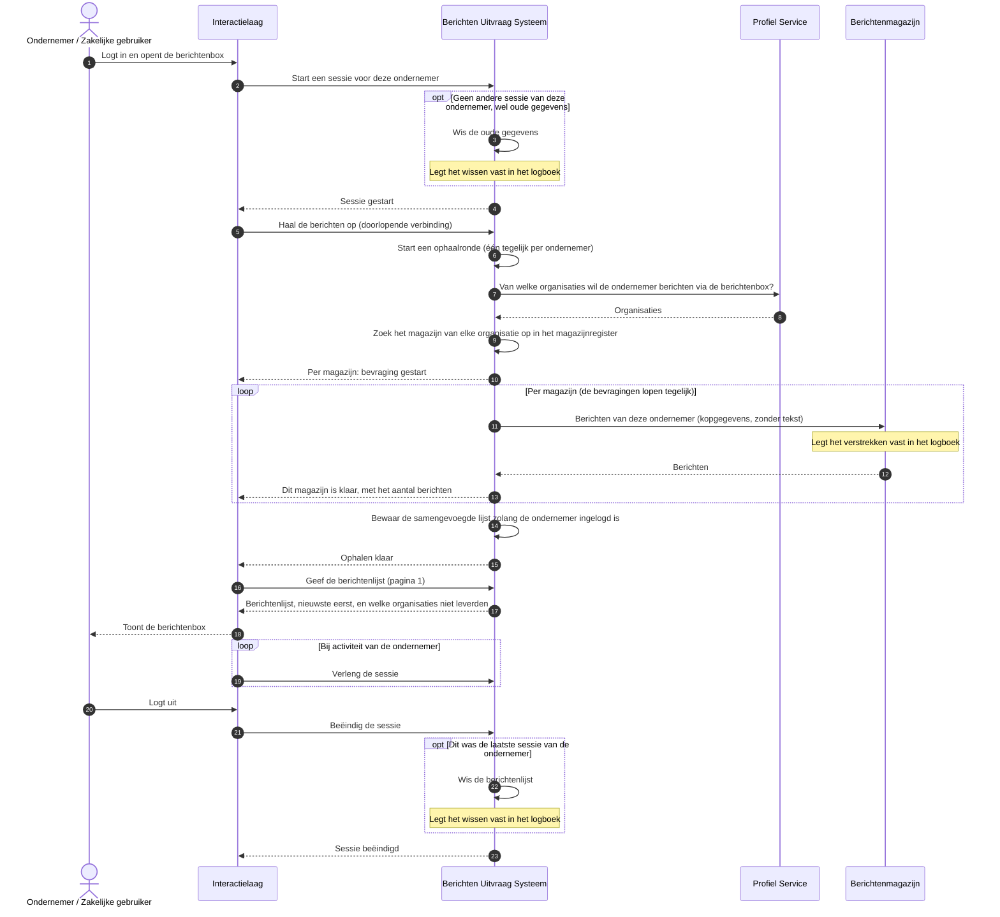

# Use case 2: Berichtenbox openen

Een ondernemer opent de berichtenbox en ziet de berichten uit alle magazijnen bij elkaar.

| | |
|---|---|
| **Actor** | Een ondernemer, in het portaal |
| **Aanleiding** | De ondernemer logt in en wil zijn berichten zien, bijvoorbeeld na een melding uit use case 1 |
| **Resultaat** | De ondernemer ziet één lijst met de berichten van alle organisaties waarvan hij berichten via de berichtenbox ontvangt, nieuwste eerst. Leverde een organisatie niet, dan ziet hij welke |

## Verloop

1. De ondernemer logt in op het portaal. Het portaal start een sessie bij de uitvraag. Had de
   ondernemer nog gegevens staan van een eerdere sessie die niet netjes is afgesloten, dan wist de
   uitvraag die eerst, en legt dat vast in het logboek.
2. Het portaal vraagt de uitvraag de berichten op te halen. Het antwoord komt over een doorlopende
   verbinding binnen, zodat het portaal de voortgang per organisatie kan tonen.
3. De uitvraag vraagt de Profiel Service van welke organisaties de ondernemer berichten via de
   berichtenbox wil ontvangen, en zoekt in het magazijnregister het magazijn van elk van die
   organisaties op.
4. De uitvraag bevraagt al die magazijnen tegelijk. Elk magazijn geeft de kopgegevens van de
   berichten van deze ondernemer: afzender, onderwerp, datum, map, gelezen of niet. De tekst en de
   bijlagen blijven in het magazijn.
5. Per magazijn meldt de uitvraag aan het portaal of het gelukt is, en hoeveel berichten het waren.
6. Als alle magazijnen geantwoord hebben (of te laat zijn), bewaart de uitvraag de samengevoegde
   lijst zolang de ondernemer ingelogd is, en meldt dat het ophalen klaar is.
7. Het portaal vraagt de lijst op, per pagina, en toont hem.
8. Zolang de ondernemer actief is, verlengt het portaal de sessie. Logt hij uit, dan beëindigt het
   portaal de sessie. Was dat zijn laatste sessie, dan wist de uitvraag de lijst en legt dat vast
   in het logboek.

## Sequence diagram

## Als het misgaat

| Situatie | Wat het stelsel doet | Wat de ondernemer merkt |
|---|---|---|
| Eén magazijn antwoordt met een fout, of niet binnen 10 seconden | De uitvraag gaat door met de andere magazijnen. Het magazijn staat in de lijst als "niet geleverd", en het logboek legt vast hoeveel organisaties mislukten | Hij ziet de berichten van de andere organisaties, plus de melding welke organisatie niet leverde. Dat blijft zo bij doorbladeren en verversen, tot hij opnieuw ophaalt |
| Een magazijn faalt herhaaldelijk | Na drie storingen op rij slaat de uitvraag dat magazijn 30 seconden lang meteen over, en probeert het daarna één keer | Als hierboven, maar sneller |
| Er lopen te veel bevragingen tegelijk, over alle ondernemers samen | Een magazijn dat binnen 15 seconden niet aan de beurt komt, wordt niet bevraagd | Die organisatie staat als niet geleverd |
| Een magazijn heeft meer dan 500 berichten voor deze ondernemer | De uitvraag neemt de eerste 500 en markeert de lijst als afgekapt | Hij ziet dat er meer berichten zijn dan getoond |
| De Profiel Service is onbereikbaar of antwoordt met een fout | Is hij onbereikbaar, dan probeert de uitvraag het twee keer opnieuw. Lukt het niet, dan mislukt de hele ophaalronde. Een eerder opgehaalde lijst blijft bewaard, maar is niet meer op te vragen | Een foutmelding "probeer het opnieuw". Ook de lijst en het zoeken geven die melding, tot er opnieuw is opgehaald |
| De ondernemer heeft geen profiel bij de Profiel Service | De uitvraag bevraagt geen enkel magazijn | Een lege berichtenbox |
| De ondernemer heeft een voorkeur voor een organisatie die niet in het magazijnregister staat | De uitvraag slaat die organisatie over. Staat geen enkele organisatie in het register, dan mislukt de ronde | Berichten van die organisatie ontbreken, of hij krijgt een foutmelding |
| Het ophalen loopt al, bijvoorbeeld in een tweede tabblad | De uitvraag start geen tweede ronde | Een melding dat het ophalen al bezig is |
| Het portaal vraagt de lijst op voordat er is opgehaald | De uitvraag weigert | Het portaal start eerst het ophalen |
| De ondernemer is al op vijf plekken tegelijk ingelogd | De uitvraag start geen nieuwe sessie | "U bent op te veel plekken tegelijk ingelogd", met de tijd tot een plek vrijkomt |
| De sessie is verlopen (15 minuten zonder activiteit, of uiterlijk 12 uur) | De uitvraag weigert elk verzoek. Binnen een halve minuut wist hij de berichtenlijst en legt dat vast in het logboek | "Uw sessie is verlopen of ongeldig. Log opnieuw in." Na opnieuw inloggen worden de berichten opnieuw opgehaald |
| De ondernemer sluit het venster tijdens het ophalen | Het ophalen loopt door en vult de lijst | Bij terugkomen staat de lijst klaar |
| Het tijdelijke geheugen van de uitvraag is onbereikbaar | De uitvraag weigert | "Probeer het straks nog eens" |

## Doelarchitectuur

- **Inloggen.** In het doelbeeld logt de ondernemer in met eHerkenning, en bewijst een token bij elk
  verzoek wie hij is en namens welke onderneming hij handelt. Nu geeft het portaal de ondernemer mee
  als gegeven, en vertrouwt de uitvraag dat.
- **Pseudoniemen.** In het doelbeeld krijgt elk magazijn een eigen versleuteld pseudoniem van de
  ondernemer (via BSNk), niet het nummer zelf. Nu krijgt elk magazijn het identificatienummer.
- **Machtigingen.** In het doelbeeld bepalen ook de machtigingen van de gebruiker welke magazijnen
  bevraagd worden. Nu bepalen alleen de voorkeuren in de Profiel Service dat. Is de ontvanger een
  organisatie (OIN), dan bevraagt de uitvraag alle magazijnen uit het register.
- **FSC.** In het doelbeeld loopt het bevragen van magazijnen via FSC. Nu is dat per magazijn in te
  stellen.

## Technische verwijzing

| Stap | Koppelvlak | Opmerking |
|---|---|---|
| Sessie starten | `POST /api/v1/sessies` | `201`, `sessieId` als `X-Sessie` op elk volgend verzoek. `429 te-veel-sessies` bij 5 lopende sessies. Wissen van resten: logregel `uitvraag-sessie-opruimen`, `aanleiding=nieuwe-start` |
| Ophalen | `GET /api/v1/berichten/_ophalen` (SSE) | Events `magazijn-bevraging-gestart`, `magazijn-bevraging-voltooid` (`OK`, `FOUT`, `TIMEOUT`, `NIET_OPGEHAALD`), `ophalen-gereed`, `ophalen-fout`. Een tweede ronde geeft `409` (`type` `urn:fbs:fout:conflict`). Profiel-storing: `503` met `Retry-After: 30` |
| Voorkeuren | `POST /api/profielservice/v1/partij` | Voorkeur `OntvangViaBerichtenbox` per OIN. 30 seconden in het geheugen. `404` op de partij geeft een lege set |
| Magazijn bevragen | `GET /api/v1/berichten?page&pageSize=100` op elk magazijn | Doorbladeren tot 500 berichten. Query-timeout 10s, geen retry. Circuit breaker per magazijn (3 storingen, 30s open). Bulkhead 50 gelijktijdig, 15s wachten |
| Lijst | `GET /api/v1/berichten?pagina&paginaGrootte` | `nietGeleverd`, `afgekapt`, `aantalNietGeleverd`. `409 nog-niet-opgehaald`, `409 ophalen-bezig`, `503 ophalen-mislukt` |
| Verlengen | `POST /api/v1/sessies/huidige/_verlengen` | Ook elk verzoek onder `/berichten` (behalve `_volgen`) verlengt |
| Uitloggen | `DELETE /api/v1/sessies/huidige` | `204`, ook voor een al verlopen of onbekende sessie; `401` alleen bij een ontbrekende of misvormde `X-Sessie`, `400` bij een ongeldige `X-Ontvanger`. Wissen bij de laatste sessie: `uitvraag-sessie-opruimen`, `aanleiding=uitgelogd` |
| Verlopen | `SessieVeger`, elke 30s | `uitvraag-sessie-opruimen`, `aanleiding=verlopen` |
| Logboek | `uitvraag-sessie-start`, `uitvraag-sessie-einde`, `uitvraag-ophalen-sse`, `uitvraag-lijst`. Magazijn: `ophalen-berichtenlijst` | |
