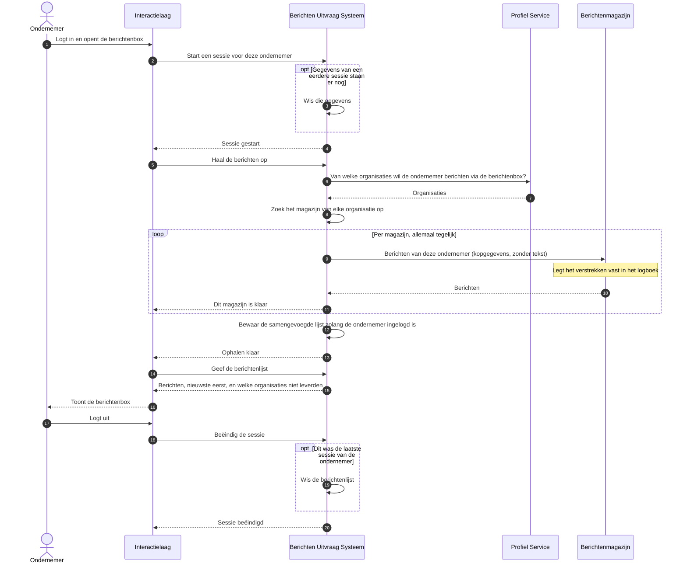

# Use case 2: Berichtenbox openen

Een ondernemer opent de berichtenbox en ziet de berichten van alle organisaties bij elkaar.

| | |
|---|---|
| **Actor** | Een ondernemer, in het portaal |
| **Aanleiding** | De ondernemer wil zijn berichten zien, bijvoorbeeld na een melding uit use case 1 |
| **Resultaat** | De ondernemer ziet één lijst met de berichten van alle organisaties waarvan hij berichten via de berichtenbox ontvangt, nieuwste eerst. Leverde een organisatie niet, dan ziet hij welke |

## Verloop

1. De ondernemer logt in op het portaal. Het portaal start een sessie bij de uitvraag. Staan er nog
   gegevens van een eerdere sessie die niet netjes is afgesloten, dan wist de uitvraag die eerst.
2. Het portaal vraagt de uitvraag de berichten op te halen, en toont intussen de voortgang per
   organisatie.
3. De uitvraag vraagt de Profiel Service van welke organisaties de ondernemer berichten via de
   berichtenbox wil ontvangen, en zoekt het magazijn van elk van die organisaties op.
4. De uitvraag bevraagt al die magazijnen tegelijk. Elk magazijn geeft de kopgegevens van de
   berichten van deze ondernemer: afzender, onderwerp, datum, map, en of hij het gelezen heeft. De
   tekst en de bijlagen blijven in het magazijn.
5. Als alle magazijnen geantwoord hebben, of te laat zijn, bewaart de uitvraag de samengevoegde
   lijst zolang de ondernemer ingelogd is.
6. Het portaal toont de lijst, nieuwste eerst, en noemt de organisaties die niet leverden.
7. Zolang de ondernemer actief is, blijft de sessie lopen. Logt hij uit en was dat zijn laatste
   sessie, dan wist de uitvraag de lijst.

Elke stap waarin persoonsgegevens verwerkt worden, staat in het logboek van de dienst die hem
uitvoert: het starten en eindigen van de sessie, het ophalen, het verstrekken van de lijst door
elk magazijn, en het wissen.

## Sequence diagram

## Als het misgaat

| Situatie | Wat het stelsel doet | Wat de ondernemer merkt |
|---|---|---|
| Eén magazijn antwoordt niet, of niet op tijd | De uitvraag gaat door met de andere magazijnen | Hij ziet de berichten van de andere organisaties, plus de melding welke organisatie niet leverde. Dat blijft zo tot hij opnieuw ophaalt |
| Een magazijn faalt steeds | De uitvraag slaat dat magazijn telkens even over, zodat de berichtenbox niet blijft wachten | Als hierboven, maar sneller. Zie use case 11 |
| Een magazijn heeft heel veel berichten voor deze ondernemer (meer dan 500) | De uitvraag neemt de eerste 500 | Hij ziet dat er meer berichten zijn dan getoond |
| De Profiel Service is niet bereikbaar | De uitvraag probeert het een paar keer opnieuw. Lukt het niet, dan mislukt het ophalen | "Probeer het opnieuw." Tot het ophalen lukt, ziet hij geen berichten |
| De ondernemer heeft niet aangegeven van welke organisaties hij berichten wil ontvangen | De uitvraag bevraagt geen enkel magazijn | Een lege berichtenbox |
| De ondernemer wil berichten van een organisatie waarvan het magazijn niet bekend is | De uitvraag slaat die organisatie over | Berichten van die organisatie ontbreken |
| Het ophalen loopt al, bijvoorbeeld in een tweede tabblad | De uitvraag start niet nog een keer | Een melding dat het ophalen al bezig is |
| De ondernemer is al op vijf plekken tegelijk ingelogd | De uitvraag start geen nieuwe sessie | "U bent op te veel plekken tegelijk ingelogd" |
| De sessie is verlopen | De uitvraag weigert elk verzoek, en wist kort daarna de berichtenlijst | "Uw sessie is verlopen. Log opnieuw in." Daarna worden de berichten opnieuw opgehaald |
| De ondernemer sluit het venster tijdens het ophalen | Het ophalen loopt door | Bij terugkomen staat de lijst klaar |

## Nog niet gerealiseerd

- Wat in het overzicht voor alle use cases staat: inloggen met eHerkenning, pseudoniemen per
  magazijn, machtigingen en FSC.
- Machtigingen bepalen nog niet welke magazijnen bevraagd worden; alleen de voorkeuren in de Profiel
  Service doen dat.
- Loopt het ophalen al, dan geeft de uitvraag nu een algemeen conflict terug. Het portaal kan daaruit
  niet opmaken dat het ophalen al bezig is.
- Een organisatie waarvan het magazijn niet bekend is, wordt stil overgeslagen. De ondernemer ziet
  niet dat er een organisatie ontbreekt.

## Open vragen

- Wat moet de ondernemer zien als een organisatie waarvan hij berichten wil ontvangen geen bekend
  magazijn heeft?
