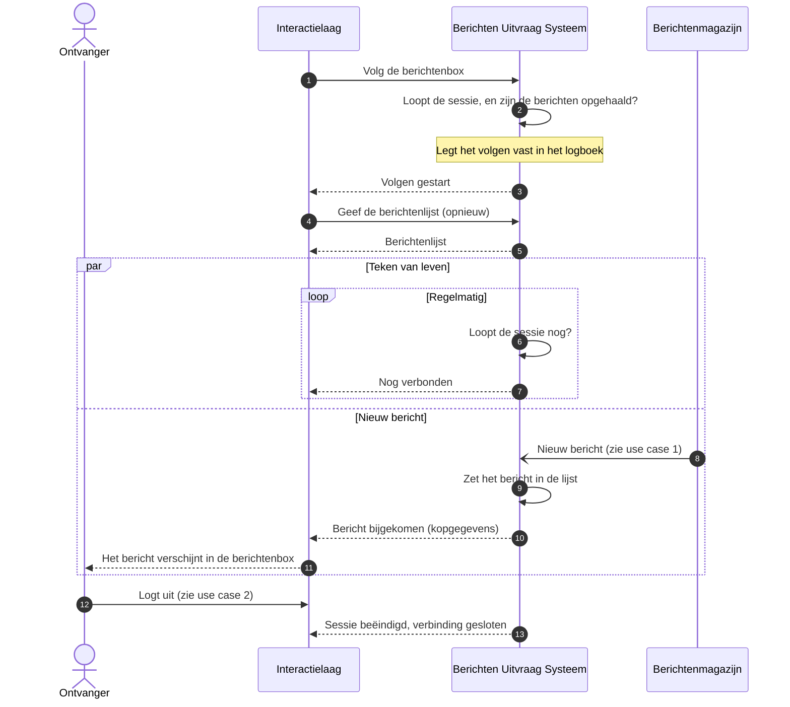

# Use case 3: Nieuwe berichten volgen

Nieuwe berichten verschijnen terwijl de berichtenbox openstaat.

| | |
|---|---|
| **Actor** | Een ontvanger (burger of ondernemer) met een geopende berichtenbox |
| **Aanleiding** | Een organisatie publiceert een bericht voor de ontvanger, terwijl de ontvanger ingelogd is (use case 1) |
| **Resultaat** | Het bericht verschijnt in de geopende berichtenbox, zonder dat de ontvanger hoeft te verversen |

## Verloop

1. Nadat de berichten zijn opgehaald (use case 2), houdt het portaal een verbinding met de uitvraag
   open om nieuwe berichten te horen.
2. De uitvraag meldt dat het volgen begonnen is. Het portaal leest de lijst dan nog één keer, zodat
   er niets verloren gaat tussen ophalen en volgen.
3. Zolang de verbinding openstaat, geeft de uitvraag regelmatig een teken van leven, en controleert
   de uitvraag of de sessie nog loopt.
4. Een magazijn meldt een nieuw bericht aan (use case 1). De uitvraag zet het in de lijst van de
   ontvanger en geeft de kopgegevens door aan het portaal.
5. Het portaal toont het nieuwe bericht op zijn plek in de lijst.
6. Eindigt de sessie, door uitloggen of verlopen, dan meldt de uitvraag dat en sluit de verbinding.

Een openstaande verbinding houdt de sessie niet in leven: alleen activiteit van de ontvanger doet
dat.

## Sequence diagram

## Als het misgaat

| Situatie | Wat het stelsel doet | Wat de ontvanger merkt |
|---|---|---|
| De ontvanger is niet ingelogd | De uitvraag doet niets met het nieuwe bericht | Niets. Het bericht verschijnt bij de volgende keer inloggen |
| Er staan te veel berichtenboxen tegelijk open, voor deze ontvanger of in totaal | De uitvraag weigert de verbinding | Het portaal probeert het even later opnieuw. Tot dan verschijnen nieuwe berichten pas na verversen |
| De sessie eindigt | De uitvraag meldt dat en sluit de verbinding | Het portaal vraagt om opnieuw in te loggen |
| De verbinding valt weg, of staat lang open | De verbinding wordt gesloten | Het portaal verbindt opnieuw en leest de lijst opnieuw |
| Het doorgeven van één nieuw bericht mislukt | Het bericht staat wel in de lijst, maar het portaal hoort het niet | Het bericht verschijnt pas na verversen |
| Hetzelfde bericht komt twee keer door | De uitvraag ontdubbelt niet op de verbinding | Het portaal toont het één keer |

## Nog niet gerealiseerd

Wat in het overzicht voor alle use cases staat. Het volgen zelf werkt zoals beschreven.

## Open vragen

- Een nieuw bericht verschijnt alleen meteen als de ontvanger ingelogd is. Anders is de ontvanger
  aangewezen op de melding uit use case 1. Is dat voldoende? (Uit het overleg met Logius.)
