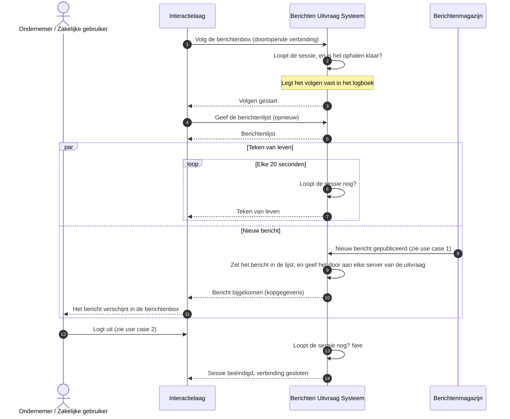

# Use case 3: Nieuwe berichten volgen

Nieuwe berichten verschijnen terwijl de berichtenbox openstaat.

| | |
|---|---|
| **Actor** | Een ondernemer met een geopende berichtenbox |
| **Aanleiding** | Een organisatie publiceert een bericht voor de ondernemer terwijl hij ingelogd is (use case 1) |
| **Resultaat** | Het bericht verschijnt in de geopende berichtenbox, zonder dat de ondernemer hoeft te verversen |

## Verloop

1. Nadat de berichten zijn opgehaald (use case 2), opent het portaal een doorlopende verbinding met
   de uitvraag om de berichtenbox te volgen.
2. De uitvraag controleert dat de sessie loopt en dat het ophalen klaar is, en meldt dat het volgen
   begonnen is. Op dat moment leest het portaal de lijst opnieuw, zodat er niets tussen ophalen en
   volgen verloren gaat.
3. Om de 20 seconden controleert de uitvraag of de sessie nog loopt, en stuurt een teken van leven.
   Een openstaande verbinding verlengt de sessie niet: alleen activiteit van de ondernemer doet dat.
4. Een magazijn meldt een nieuw bericht aan (use case 1, stap 7). De uitvraag zet het in de lijst van
   de ondernemer.
5. De uitvraag draait op meerdere servers tegelijk. De server die de aanmelding ontving, laat via
   het tijdelijke geheugen alle andere servers weten dat er een nieuw bericht is. De server waarmee
   het portaal verbonden is, stuurt de kopgegevens naar het portaal.
6. Het portaal toont het nieuwe bericht. In de lijst van de uitvraag staat een bericht dat tijdens de
   sessie bijkomt achteraan, niet bij de nieuwste: het portaal zet het zelf op zijn plek.
7. Eindigt de sessie, door uitloggen of verlopen, dan meldt de uitvraag dat bij de eerstvolgende
   controle en sluit de verbinding.

## Sequence diagram

## Als het misgaat

| Situatie | Wat het stelsel doet | Wat de ondernemer merkt |
|---|---|---|
| De ondernemer is niet ingelogd, of heeft zijn berichten nog niet opgehaald | De uitvraag zet het bericht nergens in | Niets. Het bericht verschijnt bij het volgende ophalen |
| Het portaal wil volgen voordat er is opgehaald | De uitvraag weigert | Het portaal haalt eerst op |
| Er staan te veel berichtenboxen open: meer dan 5 voor dezelfde ondernemer of meer dan 2000 in totaal, geteld per server | De uitvraag weigert de verbinding | Het portaal probeert het na 30 seconden opnieuw. Tot dan verschijnen nieuwe berichten pas na verversen |
| De sessie eindigt | Bij de eerstvolgende controle meldt de uitvraag dat en sluit de verbinding | Uiterlijk 20 seconden later sluit het volgen. Het portaal vraagt om opnieuw in te loggen |
| De verbinding staat een uur open | De uitvraag sluit hem zonder melding | Het portaal verbindt opnieuw en leest de lijst opnieuw |
| De server waarmee het portaal verbonden is, stopt (bijvoorbeeld bij een nieuwe versie) | De verbinding wordt gesloten | Het portaal verbindt opnieuw |
| Het doorgeven tussen de servers valt weg | Na een minuut zonder signaal sluit de uitvraag alle verbindingen van die server | Het portaal verbindt opnieuw en leest de lijst opnieuw |
| Het doorgeven van één aanmelding mislukt | Het bericht staat wel in de lijst, maar de geopende berichtenbox hoort het niet | Het bericht verschijnt pas na verversen |
| Een bericht wordt dubbel doorgegeven, of komt binnen voordat het volgen gemeld is | De uitvraag ontdubbelt niet op de verbinding | Het portaal ontdubbelt, op organisatie en berichtnummer |

## Doelarchitectuur

Het volgen zelf wijkt in het doelbeeld niet af van wat er nu draait. Inloggen, pseudoniemen en
machtigingen wel, en die gelden hier ook, omdat volgen pas kan na het ophalen: zie use case 2.

## Open vragen

Uit het overleg met Logius: de ondernemer ziet een nieuw bericht alleen meteen als hij online is;
anders gebeurt er in de berichtenbox niets en is hij aangewezen op de melding uit use case 1. Is dat
voldoende?

## Technische verwijzing

| Stap | Koppelvlak | Opmerking |
|---|---|---|
| Volgen | `GET /api/v1/berichten/_volgen` (SSE) | Events `volgen-gestart`, `bericht-bijgekomen`, `hartslag`, `sessie-verlopen`. `409 nog-niet-opgehaald` of `ophalen-bezig`, `503 ophalen-mislukt`, `503 te-veel-open-berichtenboxen` met `Retry-After: 30`. Verlengt de sessie niet |
| Hartslag | `SessieVolger` | Elke 20s. Maximale duur van een verbinding 1u |
| Doorgeven tussen servers (instanties) | Redis pub/sub, één abonnement per instantie | Alleen ontvanger-sleutel, berichtnummer en magazijn over het kanaal. Probe elke 30s, na twee gemiste probes worden alle streams van die instantie afgebroken |
| Aanmelden | `POST /api/v1/aanmeldingen` | Zie use case 1 |
| Logboek | `uitvraag-volgen-sse` bij het openen | Losse events worden niet vastgelegd |
