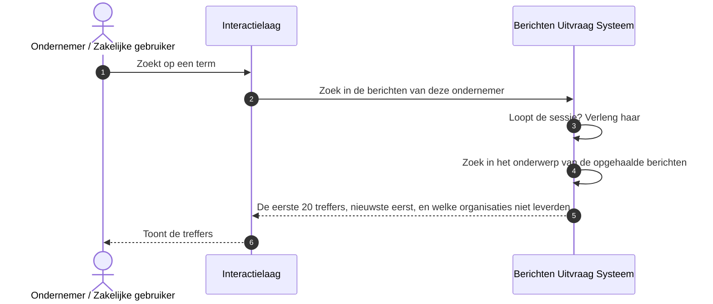

# Use case 4: Zoeken in de eigen berichten

Een ondernemer zoekt in de eigen berichten.

| | |
|---|---|
| **Actor** | Een ondernemer met een geopende berichtenbox |
| **Aanleiding** | De ondernemer zoekt een bericht terug, bijvoorbeeld op "aanslag" |
| **Resultaat** | De ondernemer ziet de berichten met een woord in het onderwerp dat overeenkomt met de zoekterm, nieuwste eerst |

## Verloop

1. De ondernemer typt een zoekterm in het portaal.
2. Het portaal vraagt de uitvraag om te zoeken.
3. De uitvraag zoekt in de berichtenlijst die bij het ophalen (use case 2) is samengesteld. Hij zoekt
   alleen in het onderwerp: de tekst van een bericht staat niet in de uitvraag, maar in het magazijn
   van de organisatie. Een bericht is een treffer als een woord in het onderwerp overeenkomt met de
   zoekterm, los van hoofdletters. Het zoeken volgt Engelse taalregels: soms vindt een zoekterm ook
   een verwante vorm ("behandel" vindt "behandeling"), korte Engelse woorden als "in" of "is" vinden
   niets, en een deel van een woord is geen treffer: "subsidie" vindt "Subsidieaanvraag" niet.
4. De uitvraag geeft de eerste 20 treffers, nieuwste eerst, en zegt welke organisaties bij het
   ophalen niet leverden.
5. Het portaal toont de treffers.

De magazijnen worden bij het zoeken niet bevraagd.

## Sequence diagram

## Als het misgaat

| Situatie | Wat het stelsel doet | Wat de ondernemer merkt |
|---|---|---|
| De zoekterm is korter dan 2 of langer dan 200 tekens | De uitvraag weigert | Een melding dat de zoekterm niet geldig is |
| Er is nog niet opgehaald, of het ophalen loopt nog | De uitvraag weigert | Het portaal wacht op het ophalen |
| Het ophalen is mislukt | De uitvraag weigert, ook als er nog een oude lijst is | "Probeer het opnieuw"; het portaal haalt opnieuw op |
| Een organisatie leverde bij het ophalen niet | Haar berichten zitten niet in de zoekresultaten | De treffers zeggen welke organisatie ontbreekt |
| Er zijn meer dan 20 treffers | De uitvraag geeft alleen de eerste 20, zonder verder bladeren | De ondernemer moet zijn zoekterm verfijnen |
| De zoekterm staat alleen in de tekst van een bericht | Geen treffer | Het bericht wordt niet gevonden |
| De zoekterm is een kort, veelvoorkomend Engels woord, zoals "in" of "is" | Het zoeken slaat zo'n woord over | Geen treffers |
| De zoekterm bevat een spatie of een leesteken, bijvoorbeeld "aanslag 2024" of "BTW-aangifte" | De uitvraag zoekt naar de hele zoekterm als één woord, en dat komt in geen onderwerp voor | Geen treffers, ook als elk woord apart wel voorkomt |
| De sessie is verlopen | De uitvraag weigert | "Uw sessie is verlopen of ongeldig. Log opnieuw in." |

Tekens als `*`, `-` of `|` in de zoekterm hebben geen bijzondere betekenis: de ondernemer kan er
geen zoekopdracht mee samenstellen.

## Doelarchitectuur

Wat het zoeken betreft, wijkt het doelbeeld niet af; inloggen en pseudoniemen wel, zie use case 2.
Zoeken in de tekst van berichten zou betekenen dat die tekst centraal komt te staan, of dat elk
magazijn bij elke zoekvraag bevraagd wordt. Het model kiest geen van beide: de tekst blijft bij de organisatie, en zoeken blijft beperkt tot de kopgegevens die
de uitvraag tijdens de sessie al heeft.

## Open vragen

- Moet het zoeken Nederlandse taalregels volgen, of juist geen taalregels? Nu gelden de Engelse:
  die vinden soms een verwante vorm en slaan korte Engelse woorden over.
- Moet een zoekterm van meer woorden berichten vinden waarin elk woord voorkomt? Nu vindt die
  niets.

## Technische verwijzing

| Stap | Koppelvlak | Opmerking |
|---|---|---|
| Zoeken | `GET /api/v1/berichten/_zoeken?q=` | `q` 2 tot 200 tekens, anders `400`. `409 nog-niet-opgehaald` of `ophalen-bezig`, `503 ophalen-mislukt`. Alleen een `self`-link, geen paginering |
| Zoekindex | RediSearch-index over de berichten in de sessiecache, zonder `LANGUAGE`: Engelse stemming en stopwoorden | Alleen `onderwerp` is full-text doorzoekbaar. `escapeRedisSearch` escapet elk teken buiten `[a-zA-Z0-9]`, ook de spatie: een zoekterm met zo'n teken wordt één term die de tokenizer nooit oplevert |
| Logboek | `uitvraag-zoeken` | De zoekterm wordt niet vastgelegd |
