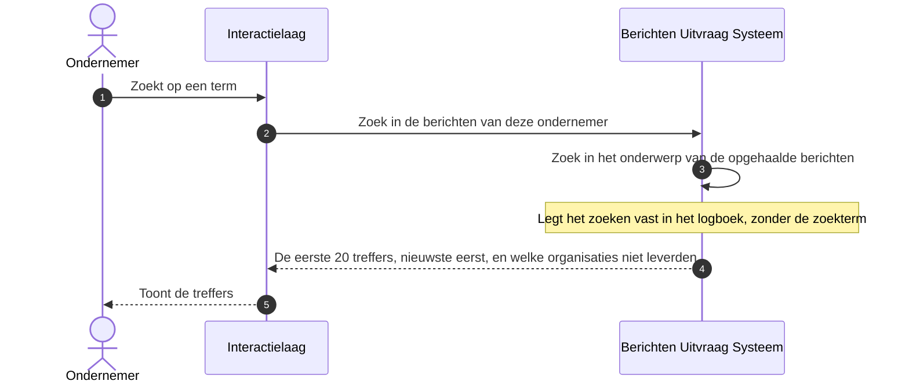

# Use case 4: Zoeken in de eigen berichten

Een ondernemer zoekt in de eigen berichten.

| | |
|---|---|
| **Actor** | Een ondernemer met een geopende berichtenbox |
| **Aanleiding** | De ondernemer zoekt een bericht terug, bijvoorbeeld op "aanslag" |
| **Resultaat** | De ondernemer ziet de berichten waarvan het onderwerp alle woorden van de zoekterm bevat, nieuwste eerst |

## Verloop

1. De ondernemer typt een zoekterm in het portaal.
2. Het portaal vraagt de uitvraag om te zoeken.
3. De uitvraag zoekt in de berichtenlijst die bij het ophalen (use case 2) is samengesteld. Hij
   zoekt alleen in het onderwerp: de tekst van een bericht staat niet in de uitvraag, maar in het
   magazijn van de organisatie.
4. Een bericht is een treffer als elk woord van de zoekterm in het onderwerp voorkomt, los van
   hoofdletters en accenten.
5. De uitvraag geeft de eerste 20 treffers, nieuwste eerst, en zegt welke organisaties bij het
   ophalen niet leverden.
6. Het portaal toont de treffers.

De magazijnen worden bij het zoeken niet bevraagd. Zoeken in de tekst zou betekenen dat de tekst
centraal komt te staan, of dat elk magazijn bij elke zoekvraag bevraagd wordt. Het stelsel kiest
geen van beide: de tekst blijft bij de organisatie.

## Sequence diagram

## Als het misgaat

| Situatie | Wat het stelsel doet | Wat de ondernemer merkt |
|---|---|---|
| De zoekterm is korter dan 2 of langer dan 200 tekens | De uitvraag weigert | Een melding dat de zoekterm niet geldig is |
| De berichten worden nog opgehaald | De uitvraag zoekt nog niet | Het portaal wacht tot het ophalen klaar is |
| Het ophalen is mislukt | De uitvraag zoekt niet | "Probeer het opnieuw"; het portaal haalt opnieuw op |
| Een organisatie leverde bij het ophalen niet | Haar berichten zitten niet in de zoekresultaten | De treffers zeggen welke organisatie ontbreekt |
| Er zijn meer dan 20 treffers | De uitvraag geeft alleen de eerste 20 | De ondernemer moet zijn zoekterm verfijnen |
| De zoekterm staat alleen in de tekst van een bericht | Geen treffer | Het bericht wordt niet gevonden |
| De sessie is verlopen | De uitvraag weigert | "Uw sessie is verlopen. Log opnieuw in." |

## Nog niet gerealiseerd

Het zoeken volgt nu Engelse taalregels, en vindt daardoor niet altijd wat de ondernemer verwacht:

- Een kort Engels woord als "in", "is" of "of" slaat het zoeken over. Zoekt de ondernemer alleen op
  zo'n woord, dan krijgt hij de hele lijst, alsof er niet gezocht is.
- Een zoekterm met een accent of trema, zoals "beëindiging" of "één", vindt niets.
- Een zoekterm van meer woorden, of met een leesteken zoals "BTW-aangifte", vindt niets, ook als
  elk woord apart wel voorkomt.
- Soms vindt een zoekterm ook een verwante vorm ("behandel" vindt "behandeling"), maar het begin van
  een samengesteld woord niet ("subsidie" vindt "Subsidieaanvraag" niet).

## Open vragen

- Moet het zoeken Nederlandse taalregels volgen, en dus ook verwante vormen vinden, of juist alleen
  hele woorden?
- Moet de ondernemer door meer dan 20 treffers kunnen bladeren?
