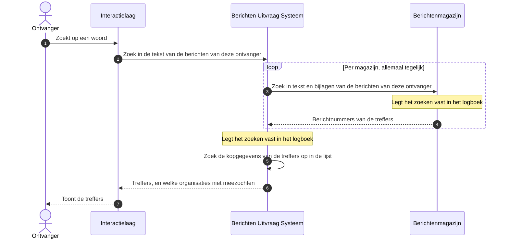

# Use case 4: Zoeken in de tekst van berichten en bijlagen

Een burger of ondernemer (de ontvanger) zoekt een bericht op een woord uit de tekst of uit een
bijlage.

| | |
|---|---|
| **Actor** | Een ontvanger (burger of ondernemer) met een geopende berichtenbox |
| **Aanleiding** | De ontvanger weet een woord uit een bericht, bijvoorbeeld een dossiernummer of een kenteken, maar niet het onderwerp of de afzender |
| **Resultaat** | De ontvanger ziet de berichten van alle organisaties waarin het woord voorkomt, in de tekst of in een bijlage. Kon een organisatie niet meezoeken, dan staat erbij welke |

Filteren en sorteren op onderwerp, afzender, map of datum is een andere use case (use case 12).
Dat kan met de kopgegevens die de berichtenbox al heeft; zoeken in de tekst niet.

## Verloop

De tekst van een bericht en de bijlagen staan alleen in het magazijn van de organisatie die het
verstuurde. Zoeken gebeurt daarom bij de magazijnen zelf: de tekst verlaat het magazijn niet.

1. De ontvanger typt een zoekterm in de berichtenbox.
2. Het portaal vraagt de uitvraag om te zoeken.
3. De uitvraag stuurt de zoekvraag tegelijk naar het magazijn van elke organisatie in de
   berichtenlijst van de ontvanger.
4. Elk magazijn zoekt in de tekst en de bijlagen van de berichten van deze ontvanger, los van
   hoofdletters en accenten, en geeft de berichtnummers van de treffers terug.
5. De uitvraag zoekt de kopgegevens van die berichten op in de lijst van de sessie, en geeft de
   treffers aan het portaal, met de organisaties die niet meezochten.
6. Het portaal toont de treffers. Filteren en sorteren uit use case 12 werken ook op de treffers.

Elk magazijn legt het zoeken vast in zijn logboek, net als de uitvraag. De zoekterm zelf staat
niet in het logboek: die kan persoonsgegevens bevatten.

## Sequence diagram

## Als het misgaat

| Situatie | Wat het stelsel doet | Wat de ontvanger merkt |
|---|---|---|
| Een magazijn antwoordt niet, of niet op tijd | De uitvraag gaat door met de andere magazijnen | De treffers van de andere organisaties staan er, met de organisatie die niet meezocht |
| Er zijn geen treffers | De uitvraag geeft een lege lijst | "Geen berichten gevonden" |
| De zoekterm is te kort of te lang | De uitvraag weigert | Een melding dat de zoekterm niet geldig is |
| Een bijlage is een scan zonder tekst | Het magazijn vindt er niets in | Het bericht wordt niet gevonden op een woord uit die bijlage |
| De berichten zijn nog niet opgehaald | De uitvraag zoekt nog niet | Het portaal wacht tot het ophalen klaar is |

## Nog niet gerealiseerd

Deze use case is nog niet gebouwd ([#1598](https://github.com/MinBZK/MijnOverheidZakelijk/issues/1598)). Eerder besproken in [#1225](https://github.com/MinBZK/MijnOverheidZakelijk/issues/1225), dat zonder realisatie is gesloten.

- De magazijnen kennen geen zoekfunctie, en de stelselafspraken zeggen er niets over.
- De uitvraag heeft nog een eigen zoekfunctie die alleen in het onderwerp zoekt. De berichtenbox
  gebruikt die niet, en die functie wordt opgeheven ([#1287](https://github.com/MinBZK/MijnOverheidZakelijk/issues/1287)).

## Open vragen

- **Waar wordt gezocht?** Bij de magazijnen (dit voorstel) houdt de tekst bij de bron, maar het
  resultaat hangt af van hoeveel magazijnen op tijd antwoorden, en elk magazijn moet het kunnen.
  Alternatieven zijn de tekst tijdens de sessie tijdelijk indexeren in de uitvraag, of de tekst
  naar de browser sturen. Die zetten meer tekst buiten het magazijn.
- **Zoeken in bijlagen.** Daarvoor moet het magazijn de tekst uit een bijlage halen. Hoort dat bij
  elk magazijn, ook een zelf gehost magazijn?
- **Taalregels.** Moet het zoeken Nederlandse taalregels volgen, en dus ook verwante vormen vinden
  ("behandel" vindt "behandeling"), of alleen hele woorden? En vindt een zoekterm van meer woorden
  de berichten waarin elk woord voorkomt?
