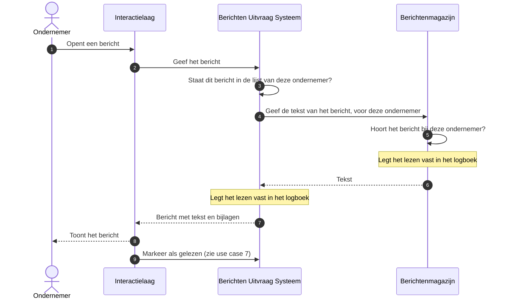

# Use case 5: Bericht lezen

Een ondernemer opent een bericht en leest het.

| | |
|---|---|
| **Actor** | Een ondernemer met een geopende berichtenbox |
| **Aanleiding** | De ondernemer klikt op een bericht in de lijst |
| **Resultaat** | De ondernemer ziet de tekst van het bericht, met de lijst van bijlagen, en het bericht staat als gelezen in het magazijn |

## Verloop

1. De ondernemer klikt op een bericht. Het portaal vraagt het bericht op bij de uitvraag.
2. De uitvraag kijkt of het bericht in de opgehaalde lijst van deze ondernemer staat.
3. De uitvraag vraagt de tekst op bij het magazijn van de organisatie die het bericht stuurde. De
   tekst staat alleen in het magazijn, en wordt bij elk openen opnieuw opgehaald.
4. Het magazijn controleert of het bericht bij deze ondernemer hoort, en geeft de tekst.
5. De uitvraag geeft het bericht aan het portaal, en het portaal toont het.
6. Het portaal markeert het bericht als gelezen, op dezelfde manier als het verplaatsen in use
   case 7.

Uitvraag en magazijn leggen het lezen allebei vast in hun eigen logboek.

## Sequence diagram

## Als het misgaat

| Situatie | Wat het stelsel doet | Wat de ondernemer merkt |
|---|---|---|
| Het bericht bestaat niet, of is van een ander | De uitvraag geeft in beide gevallen hetzelfde antwoord, zodat niemand kan uitproberen welke berichten van anderen bestaan | "Dit bericht is niet (meer) beschikbaar" |
| De ondernemer heeft het bericht zelf verwijderd (use case 8) | De uitvraag onthoudt dat tot hij uitlogt | "U hebt dit bericht verwijderd" |
| Het bericht is buiten de berichtenbox om uit het magazijn verdwenen | Het magazijn kent het niet meer. Het bericht blijft in de lijst staan tot het volgende ophalen | "Dit bericht is niet (meer) beschikbaar" |
| Het magazijn is niet bereikbaar, of antwoordt niet op tijd | De uitvraag geeft het bericht niet | "Probeer het straks nog eens" |
| Er zijn nog geen berichten opgehaald, of het ophalen is mislukt | De uitvraag weigert | Het portaal haalt eerst (opnieuw) op |
| Het markeren als gelezen mislukt | Het bericht blijft ongelezen | Het bericht blijft als ongelezen in de lijst staan |

## Nog niet gerealiseerd

- Wat in het overzicht voor alle use cases staat.
- Het magazijn toetst een verzoek nog niet aan het beleid van de organisatie, inclusief
  machtigingen. Nu controleert het alleen of de ondernemer de ontvanger van het bericht is.
- De logboeken leggen niet vast welk bericht gelezen is, en de logregel van de uitvraag legt niet
  vast of het openen lukte. Zie use case 9.
