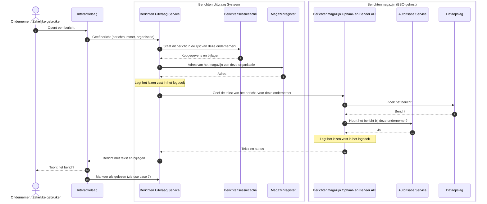

# Use case 5: Bericht lezen

Een ondernemer opent een bericht en leest het.

| | |
|---|---|
| **Actor** | Een ondernemer met een geopende berichtenbox |
| **Aanleiding** | De ondernemer klikt op een bericht in de lijst |
| **Resultaat** | De ondernemer ziet de tekst van het bericht, met de lijst van bijlagen. Het bericht staat daarna als gelezen gemarkeerd |

## Verloop

1. De ondernemer klikt op een bericht. Het portaal vraagt het bericht op bij de uitvraag, met het
   berichtnummer en de organisatie die het stuurde.
2. De uitvraag kijkt of het bericht in de opgehaalde lijst van deze ondernemer staat, en haalt
   daaruit de kopgegevens en de bijlagen.
3. De uitvraag zoekt het magazijn van die organisatie op, en vraagt daar de tekst op. De tekst staat
   alleen in het magazijn en wordt bij elk openen opnieuw opgehaald.
4. Het magazijn controleert of het bericht bij deze ondernemer hoort, en geeft de tekst.
5. De uitvraag voegt kopgegevens en tekst samen en geeft het bericht aan het portaal.
6. Het portaal markeert het bericht als gelezen, met een aparte opdracht (zie use case 7). Het
   openen zelf verandert niets aan het bericht.

Uitvraag en magazijn leggen het lezen allebei vast in hun eigen logboek.

## Sequence diagram

## Als het misgaat

| Situatie | Wat het stelsel doet | Wat de ondernemer merkt |
|---|---|---|
| Het bericht staat niet in de lijst van deze ondernemer: het bestaat niet, of het is van een ander | De uitvraag geeft in beide gevallen hetzelfde antwoord, zodat niemand kan aftasten welke berichten van anderen bestaan | "Dit bericht is niet (meer) beschikbaar" |
| De ondernemer heeft het bericht in deze sessie zelf verwijderd (use case 8) | De uitvraag weet dat tot het einde van de sessie | "U hebt dit bericht verwijderd" |
| Het bericht is intussen in het magazijn verwijderd, vanuit een andere sessie of door de organisatie zelf | Het magazijn kent het niet meer. De uitvraag laat het tot het volgende ophalen in de lijst staan | "Dit bericht is niet (meer) beschikbaar" |
| Het magazijn is onbereikbaar, of antwoordt niet binnen 10 seconden | De uitvraag probeert het niet opnieuw | "Probeer het straks nog eens" |
| Het magazijn geeft een onleesbaar of leeg antwoord | De uitvraag geeft het bericht niet door | "Probeer het straks nog eens" |
| Uitvraag en magazijn zijn het oneens over de eigenaar | Het magazijn weigert | Een melding dat hij geen toegang heeft |
| Er is nog niet opgehaald, of het ophalen is mislukt | De uitvraag weigert | Het portaal haalt eerst (opnieuw) op |
| Het portaal markeert het bericht niet als gelezen | Het bericht blijft ongelezen | Het bericht blijft vet in de lijst |

## Doelarchitectuur

- **Autorisatie.** In het doelbeeld toetst het magazijn elk verzoek aan het beleid van de
  organisatie (AuthZEN), inclusief machtigingen. Nu controleert het alleen of de ondernemer de
  ontvanger van het bericht is.
- **Identiteit en pseudoniem.** Zie use case 2: het magazijn krijgt nu het identificatienummer, in
  het doelbeeld een pseudoniem en een token.

## Technische verwijzing

| Stap | Koppelvlak | Opmerking |
|---|---|---|
| Uitvraag | `GET /api/v1/berichten/{berichtId}?magazijnId=` | `404 bericht-onbekend` (bestaat niet, is van een ander, of `magazijnId` onbekend), `410 bericht-verwijderd` (eigen verwijdering in deze sessie), `409`/`503` als de ophaalronde niet klaar of mislukt is, `502 keten-fout` bij timeout, transportfout of onleesbaar antwoord |
| Magazijn | `GET /api/v1/berichten/{berichtId}` met `X-Ontvanger` | `404` voor een onbekend of verwijderd bericht, `403` voor andermans bericht (`BerichtAutorisatie.vereisOntvanger`) |
| Routering | `MagazijnRouter` via het `Magazijnregister` | Connect-timeout 2s, read-timeout 10s. Geen circuit breaker of retry op dit pad |
| Gelezen | `PATCH /api/v1/berichten/{berichtId}` met `status: gelezen` | Door het portaal, niet door het openen |
| Logboek | Uitvraag `uitvraag-bericht`, magazijn `ophalen-bericht` | Een weigering (4xx) staat in het logboek van de uitvraag als weigering, niet als fout |
