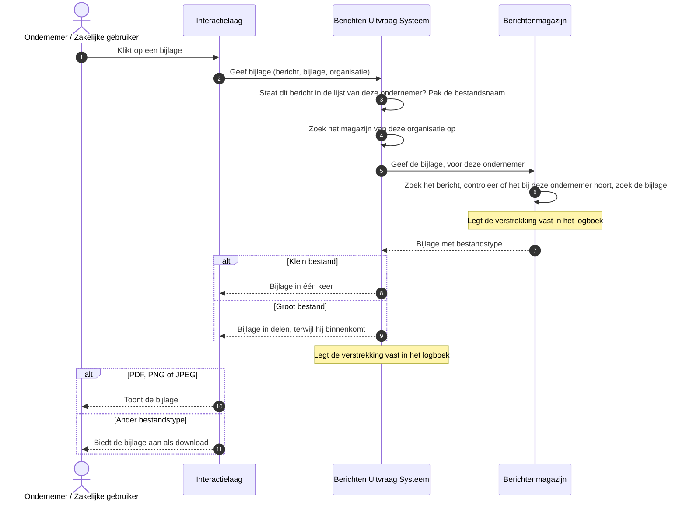

# Use case 6: Bijlage openen of downloaden

Een ondernemer opent of downloadt een bijlage bij een bericht.

| | |
|---|---|
| **Actor** | Een ondernemer die een bericht heeft geopend (use case 5) |
| **Aanleiding** | De ondernemer klikt op een bijlage |
| **Resultaat** | Een PDF of afbeelding opent in het portaal. Andere bestanden worden gedownload, onder de bestandsnaam die de organisatie meegaf |

## Verloop

1. De ondernemer klikt op een bijlage. Het portaal vraagt die op bij de uitvraag.
2. De uitvraag kijkt of het bericht in de lijst van deze ondernemer staat, en haalt daaruit de
   bestandsnaam van de bijlage.
3. De uitvraag vraagt de bijlage op bij het magazijn van de organisatie. Het magazijn controleert,
   via het bericht, of de bijlage bij deze ondernemer hoort.
4. De uitvraag geeft de bijlage door aan het portaal. Een klein bestand in één keer, een groot
   bestand in delen terwijl het binnenkomt.
5. Een PDF, PNG of JPEG mag het portaal direct tonen. Elk ander bestand biedt de browser aan als
   download.

## Sequence diagram

## Als het misgaat

| Situatie | Wat het stelsel doet | Wat de ondernemer merkt |
|---|---|---|
| Het bericht staat niet in de lijst van deze ondernemer, of de bijlage bestaat niet | Hetzelfde antwoord als bij een onbekend bericht (use case 5) | "Deze bijlage is niet (meer) beschikbaar" |
| De ondernemer heeft het bericht verwijderd, en heeft nog een sessie open | De uitvraag weigert | "U hebt dit bericht verwijderd" |
| Het magazijn is onbereikbaar of geeft een fout | De uitvraag geeft niets door | "Probeer het straks nog eens" |
| Het magazijn zegt niet wat voor bestand het is | De uitvraag geeft niets door | "Probeer het straks nog eens" |
| Het bestandstype is onbekend of ongeldig | De uitvraag geeft het door als download, nooit als iets dat het portaal toont | Het bestand wordt gedownload |
| De ondernemer downloadt meer dan 3 grote bestanden tegelijk via dezelfde server van de uitvraag, of er lopen er meer dan 20 op één server | De uitvraag weigert de volgende | "Te veel downloads tegelijk", opnieuw proberen na 30 seconden |
| De verbinding met het magazijn breekt af halverwege een groot bestand | De uitvraag breekt de download af. Het logboek houdt de verstrekking als geslaagd: liever te veel vastgelegd dan te weinig | De download mislukt en moet opnieuw |
| Het portaal leest een minuut lang niets van de download | De uitvraag breekt de download af | De download mislukt |

## Doelarchitectuur

Autorisatie en identiteit wijken af zoals bij use case 5, FSC zoals bij use case 2.

## Technische verwijzing

| Stap | Koppelvlak | Opmerking |
|---|---|---|
| Uitvraag | `GET /api/v1/berichten/{berichtId}/bijlagen/{bijlageId}?magazijnId=` | `404 bericht-onbekend` ook als het magazijn `410` geeft, `410` alleen bij een eigen verwijdering zolang de ondernemer een sessie heeft, `502 keten-fout`, `503 te-veel-gelijktijdige-downloads` met `Retry-After: 30` |
| Magazijn | `GET /api/v1/berichten/{berichtId}/bijlagen/{bijlageId}` met `X-Ontvanger` | Eigenaarscontrole via het bericht |
| Doorgeven | `BijlageDoorgifte` | Tot 1 MiB in één keer, daarboven streaming. Slots per instantie: 3 per ontvanger, 20 in totaal. 60s zonder lezen breekt af |
| Weergave | `Content-Disposition` `inline` alleen voor `application/pdf`, `image/png`, `image/jpeg`, anders `attachment` | Een `inline`-bijlage mag same-origin geframed worden. Bestandsnaam uit de sessiecache |
| Logboek | Uitvraag `uitvraag-bijlage`, magazijn `ophalen-bijlage` | |
