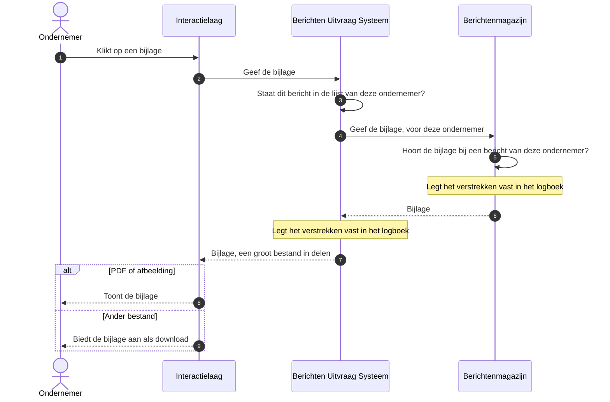

# Use case 6: Bijlage openen of downloaden

Een ondernemer opent of downloadt een bijlage bij een bericht.

| | |
|---|---|
| **Actor** | Een ondernemer die een bericht heeft geopend (use case 5) |
| **Aanleiding** | De ondernemer klikt op een bijlage |
| **Resultaat** | Een PDF of afbeelding opent in het portaal. Andere bestanden worden gedownload, onder de bestandsnaam die de organisatie meegaf |

## Verloop

1. De ondernemer klikt op een bijlage. Het portaal vraagt die op bij de uitvraag.
2. De uitvraag kijkt of het bericht in de lijst van deze ondernemer staat.
3. De uitvraag vraagt de bijlage op bij het magazijn van de organisatie. Het magazijn controleert of
   de bijlage bij een bericht van deze ondernemer hoort.
4. De uitvraag geeft de bijlage door aan het portaal. Een groot bestand gaat in delen, terwijl het
   binnenkomt, zodat de ondernemer niet hoeft te wachten tot alles binnen is.
5. Een PDF of afbeelding mag het portaal direct tonen. Elk ander bestand biedt de browser aan als
   download.

## Sequence diagram

## Als het misgaat

| Situatie | Wat het stelsel doet | Wat de ondernemer merkt |
|---|---|---|
| Het bericht of de bijlage bestaat niet, of is van een ander | Hetzelfde antwoord als bij een onbekend bericht (use case 5) | "Deze bijlage is niet (meer) beschikbaar" |
| De ondernemer heeft het bericht verwijderd | De uitvraag weigert | "U hebt dit bericht verwijderd" |
| Het magazijn is niet bereikbaar | De uitvraag geeft niets door | "Probeer het straks nog eens" |
| Het magazijn zegt niet wat voor bestand het is, of het type is onbekend | De uitvraag biedt het aan als download, nooit als iets dat het portaal toont | Het bestand wordt gedownload |
| De ondernemer downloadt veel grote bestanden tegelijk | De uitvraag weigert de volgende tot er een klaar is | "Te veel downloads tegelijk", even later opnieuw proberen |
| De verbinding met het magazijn breekt af halverwege | De download stopt. Het logboek houdt de bijlage als verstrekt: liever te veel vastgelegd dan te weinig | De download mislukt en moet opnieuw |

## Nog niet gerealiseerd

Wat in het overzicht voor alle use cases staat, en de toets aan het beleid van de organisatie zoals
bij use case 5.
