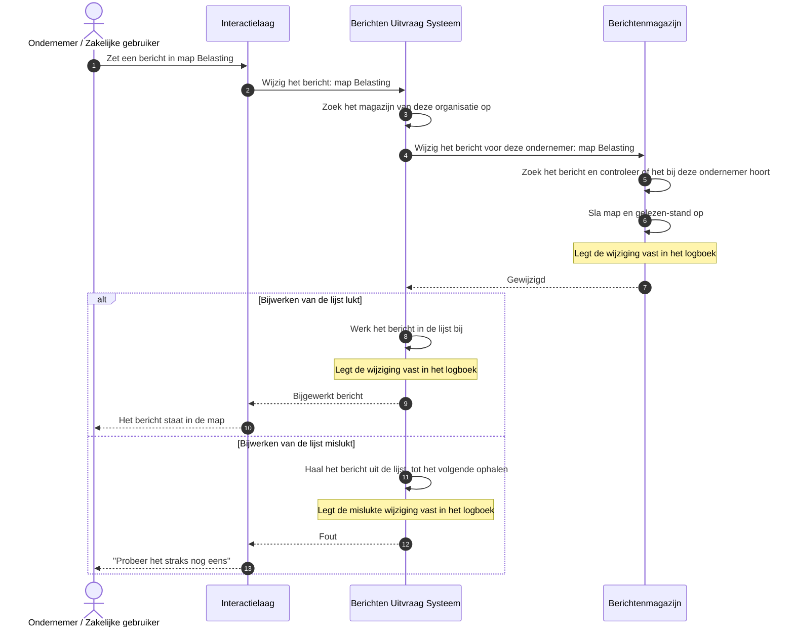

# Use case 7: Bericht verplaatsen of archiveren

Een ondernemer verplaatst een bericht naar een map, of archiveert het. Markeren als gelezen of
ongelezen gaat op dezelfde manier.

| | |
|---|---|
| **Actor** | Een ondernemer met een geopende berichtenbox |
| **Aanleiding** | De ondernemer ordent zijn post: "Belasting", "Te bespreken met adviseur", "Archief" |
| **Resultaat** | Het bericht staat in de gekozen map, bij de organisatie die het verstuurde, en blijft daar ook na uitloggen |

## Verloop

1. De ondernemer kiest een map voor een bericht. Archiveren is verplaatsen naar een map met die
   naam: er is geen aparte archiefstand. Een lege mapnaam zet het bericht terug in het Postvak IN.
2. Het portaal geeft de wijziging door aan de uitvraag.
3. De uitvraag stuurt de wijziging naar het magazijn van de organisatie die het bericht verstuurde.
   Daar staat de map, als eigenschap van het bericht. Er is geen centrale lijst van mappen; zie
   [Mappen horen bij het bericht](https://github.com/MinBZK/moza-poc-fbs-berichtenbox/blob/main/docs/mappen-bij-het-bericht.md).
4. Het magazijn controleert of het bericht bij deze ondernemer hoort, en slaat de map op.
5. Daarna werkt de uitvraag de lijst in de sessie bij, en geeft het bijgewerkte bericht terug.

Eerst het magazijn, dan de lijst: het magazijn is de plek waar de wijziging blijft bestaan. Gaat het
bijwerken van de lijst mis, dan staat de wijziging toch in het magazijn, en klopt de lijst weer na
het volgende ophalen.

## Sequence diagram

## Als het misgaat

| Situatie | Wat het stelsel doet | Wat de ondernemer merkt |
|---|---|---|
| De wijziging is leeg, of de mapnaam bestaat alleen uit spaties | De uitvraag weigert | Een melding dat de wijziging niet geldig is |
| Het bericht bestaat niet in het magazijn | Er verandert niets | "Dit bericht is niet (meer) beschikbaar" |
| Het bericht is van een andere ontvanger | Het magazijn weigert. Bij lezen (use case 5) is dit antwoord gelijk aan dat voor een onbekend bericht; hier niet | Een melding dat hij geen toegang heeft |
| Het bericht is al verwijderd | Er verandert niets | "U hebt dit bericht verwijderd" |
| Het magazijn is onbereikbaar | Er verandert niets | "Probeer het straks nog eens" |
| Het magazijn heeft de wijziging opgeslagen, maar het bijwerken van de lijst mislukt | De uitvraag haalt het bericht uit de lijst, zodat er geen verouderde versie blijft staan. Hij gebruikt daarvoor dezelfde stap als verwijderen, en onthoudt dus ook dat het bericht verwijderd is. Lukt ook dat niet, dan krijgt de beheerder een waarschuwing | Een foutmelding, terwijl de wijziging wel bewaard is. Het bericht is uit de lijst verdwenen, en opent hij het toch, dan hoort hij ten onrechte dat hij het verwijderd heeft. Na opnieuw ophalen staat het bericht in de nieuwe map |
| Het magazijn heeft de wijziging opgeslagen, maar het bericht staat niet in de lijst | De beheerder krijgt een waarschuwing | "Dit bericht is niet (meer) beschikbaar", terwijl de wijziging wel bewaard is |

Een map hernoemen is elk bericht in die map wijzigen, bij elke organisatie waar die berichten staan.
Een lege map bestaat niet. Zie het stuk over mappen hierboven.

## Doelarchitectuur

- **Labels en mappen als stelselafspraak** (open punt, nog niet in het model). Uit het overleg met Logius: magazijnen moeten allerlei
  labels en mappen kunnen opslaan. Dat wordt een eis aan elk magazijn, ook aan zelf gehoste.
- **Autorisatie.** Zie use case 5.

## Technische verwijzing

| Stap | Koppelvlak | Opmerking |
|---|---|---|
| Uitvraag | `PATCH /api/v1/berichten/{berichtId}?magazijnId=`, `application/merge-patch+json` | Velden `status` (`gelezen`, `ongelezen`) en `map` (max 128 tekens, `""` is Postvak IN). Geen veld voor archiveren |
| Magazijn | `PATCH /api/v1/berichten/{berichtId}` met `X-Ontvanger` | `404` onbekend, `403` andermans bericht, `410` verwijderd. Upsert in `bericht_status` |
| Lijst bijwerken | `Sessiecache.werkBerichtBij` | Bij een cachestoring: compenserende invalidatie via `Sessiecache.verwijder` (die ook een tombstone schrijft) en `502`. Mislukt ook die: alert `cache_desync_no_selfheal` |
| Logboek | Uitvraag `uitvraag-patch`, magazijn `bijwerken-bericht-status` | |
