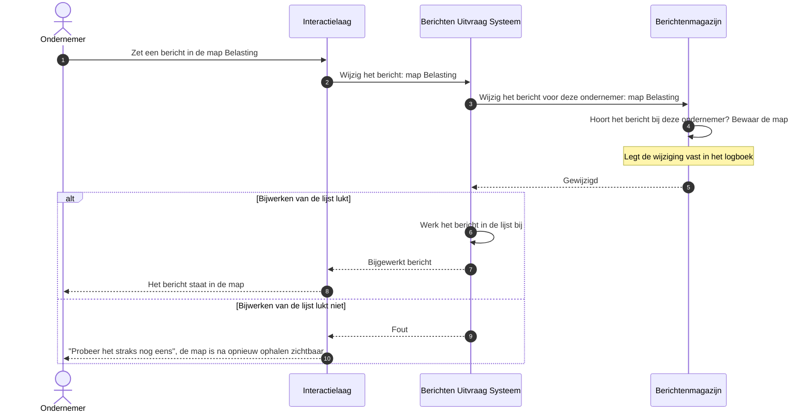

# Use case 7: Bericht verplaatsen of archiveren

Een ondernemer verplaatst een bericht naar een map, of archiveert het. Markeren als gelezen of
ongelezen gaat op dezelfde manier.

| | |
|---|---|
| **Actor** | Een ondernemer met een geopende berichtenbox |
| **Aanleiding** | De ondernemer ordent zijn post: "Belasting", "Te bespreken met adviseur", "Archief" |
| **Resultaat** | Het bericht staat in de gekozen map, en blijft daar ook na uitloggen |

## Verloop

1. De ondernemer kiest een map voor een bericht. Archiveren is verplaatsen naar een map met die
   naam. Zonder map staat het bericht in het Postvak IN.
2. Het portaal geeft de wijziging door aan de uitvraag.
3. De uitvraag stuurt de wijziging naar het magazijn van de organisatie die het bericht verstuurde.
   Daar staat de map, als eigenschap van het bericht. Er is geen centrale lijst van mappen: een map
   bestaat zolang er een bericht in zit.
4. Het magazijn controleert of het bericht bij deze ondernemer hoort, en bewaart de map.
5. De uitvraag werkt de lijst bij, en het portaal toont het bericht in de nieuwe map.

Eerst het magazijn, dan de lijst: in het magazijn blijft de wijziging bestaan. Lukt het bijwerken
van de lijst niet, dan klopt de lijst weer na het volgende ophalen.

Een map hernoemen is elk bericht in die map wijzigen, bij elke organisatie waar die berichten staan.

## Sequence diagram

## Als het misgaat

| Situatie | Wat het stelsel doet | Wat de ondernemer merkt |
|---|---|---|
| De mapnaam is leeg of bestaat alleen uit spaties | De uitvraag weigert | Een melding dat de wijziging niet geldig is |
| Het bericht bestaat niet, of is van een ander | Er verandert niets | "Dit bericht is niet (meer) beschikbaar" |
| Het bericht is al verwijderd | Er verandert niets | "U hebt dit bericht verwijderd" |
| Het magazijn is niet bereikbaar | Er verandert niets | "Probeer het straks nog eens" |
| Het magazijn heeft de wijziging bewaard, maar de lijst bijwerken lukt niet | De wijziging blijft bewaard in het magazijn | Een foutmelding. Na opnieuw ophalen staat het bericht in de nieuwe map |

## Nog niet gerealiseerd

- Lukt het bijwerken van de lijst niet, dan haalt de uitvraag het bericht nu uit de lijst alsof het
  verwijderd is. Opent de ondernemer het daarna, dan hoort hij ten onrechte dat hij het verwijderd
  heeft, tot hij opnieuw ophaalt.
- Is het bericht van een ander, dan antwoordt het magazijn bij wijzigen nu anders dan bij een
  onbekend bericht. Zo valt af te leiden dat het bericht bestaat.
- De toets aan het beleid van de organisatie, zoals bij use case 5.

## Open vragen

- Magazijnen moeten allerlei labels en mappen kunnen bewaren. Dat wordt een eis aan elk magazijn,
  ook aan een zelf gehost magazijn. Dit staat nog niet in de stelselafspraken. (Uit het overleg met
  Logius.)
