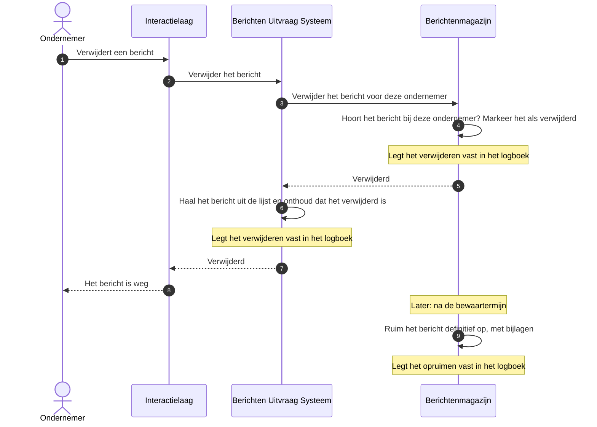

# Use case 8: Bericht verwijderen

Een ondernemer verwijdert een bericht.

| | |
|---|---|
| **Actor** | Een ondernemer met een geopende berichtenbox |
| **Aanleiding** | De ondernemer wil een bericht niet meer in zijn berichtenbox hebben |
| **Resultaat** | Het bericht is uit de berichtenbox verdwenen en komt niet terug. Het magazijn bewaart het nog tot de bewaartermijn verstreken is, en ruimt het dan definitief op |

## Verloop

1. De ondernemer verwijdert een bericht. Het portaal geeft dat door aan de uitvraag.
2. De uitvraag stuurt het verwijderen naar het magazijn van de organisatie die het bericht stuurde.
3. Het magazijn controleert of het bericht bij deze ondernemer hoort, en markeert het als
   verwijderd. Vanaf dan komt het in geen enkele lijst meer voor en is het niet meer op te vragen.
4. De uitvraag haalt het bericht uit de lijst, en onthoudt tot de ondernemer uitlogt dat hij het
   zelf verwijderd heeft.
5. Na de bewaartermijn ruimt het magazijn het bericht definitief op, met de bijlagen, en legt dat
   vast in zijn logboek. De bewaartermijn is nu zeven jaar na ontvangst én zeven jaar na het
   verwijderen.

## Sequence diagram

## Als het misgaat

| Situatie | Wat het stelsel doet | Wat de ondernemer merkt |
|---|---|---|
| Het bericht bestaat niet, of is van een ander | Er verandert niets. Het antwoord is in beide gevallen hetzelfde, zodat niemand kan uitproberen welke berichten van anderen bestaan | "Dit bericht is niet (meer) beschikbaar" |
| Het bericht is al verwijderd | Er verandert niets | Niets: het bericht is weg |
| Het magazijn is niet bereikbaar | Er verandert niets | "Probeer het straks nog eens" |
| Het magazijn heeft verwijderd, maar de lijst bijwerken lukt niet | De uitvraag probeert het nog eens. Lukt dat niet, dan krijgt de stelselbeheerder een waarschuwing | Een foutmelding, terwijl het bericht wel verwijderd is. Bij het volgende ophalen is het weg |
| De ondernemer opent het bericht na uitloggen, bijvoorbeeld via een oude link | De uitvraag weet niet meer dat hij het verwijderd heeft | "Dit bericht is niet (meer) beschikbaar" |
| Het definitief opruimen lukt een keer niet | Het magazijn probeert het de volgende nacht opnieuw | Niets |

## Nog niet gerealiseerd

- Is het bericht van een ander, dan antwoordt het magazijn nu anders dan bij een onbekend bericht.
  Zo valt af te leiden dat het bericht bestaat.
- Het magazijn legt het definitief opruimen nog niet vast in zijn logboek, alleen in zijn
  technische log, en dan zonder de ontvanger.

## Open vragen

- Kan een organisatie een bericht intrekken? De stelselafspraken kennen dat nog niet. Een zelf
  gehost magazijn kan het intern regelen; voor de ondernemer verdwijnt het bericht dan bij het
  volgende ophalen, zonder melding.
- Alle berichten van een ondernemer in één keer wissen, en hoe lang een bericht bewaard blijft dat
  nooit verwijderd is: zie use case 10.
