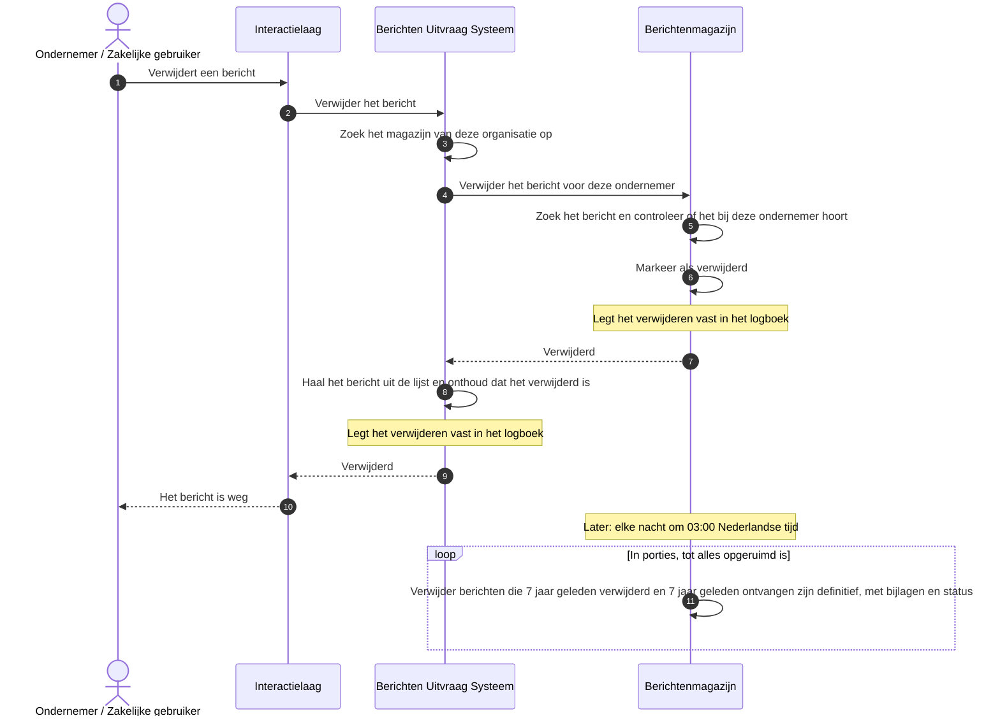

# Use case 8: Bericht verwijderen

Een ondernemer verwijdert een bericht.

| | |
|---|---|
| **Actor** | Een ondernemer met een geopende berichtenbox |
| **Aanleiding** | De ondernemer wil een bericht niet meer in zijn berichtenbox hebben |
| **Resultaat** | Het bericht is uit de berichtenbox verdwenen en komt niet terug. Het magazijn bewaart het nog tot de bewaartermijn verstreken is, en ruimt het dan definitief op |

## Verloop

1. De ondernemer verwijdert een bericht. Het portaal geeft dat door aan de uitvraag.
2. De uitvraag stuurt het verwijderen naar het magazijn van de organisatie die het bericht stuurde.
3. Het magazijn controleert of het bericht bij deze ondernemer hoort, en markeert het als
   verwijderd. Tekst en bijlagen blijven nog staan, maar het bericht komt in geen enkele lijst meer
   voor en is niet meer op te vragen.
4. De uitvraag haalt het bericht uit de lijst, en onthoudt dat de ondernemer het zelf verwijderd
   heeft. Vraagt hij het opnieuw op zolang hij een sessie open heeft, dan hoort hij dat.
5. Elke nacht om 03:00 Nederlandse tijd ruimt het magazijn de berichten definitief op die zowel ten
   minste zeven jaar geleden verwijderd zijn als ten minste zeven jaar geleden ontvangen.

## Sequence diagram

## Als het misgaat

| Situatie | Wat het stelsel doet | Wat de ondernemer merkt |
|---|---|---|
| Het bericht bestaat niet in het magazijn | Er verandert niets | "Dit bericht is niet (meer) beschikbaar" |
| Het bericht is van een andere ontvanger | Het magazijn weigert | Een melding dat hij geen toegang heeft |
| Het bericht is al verwijderd | Het magazijn meldt het verwijderen als geslaagd en verandert niets | Niets |
| Het magazijn is onbereikbaar | Er verandert niets | "Probeer het straks nog eens" |
| Het magazijn heeft verwijderd, maar het bijwerken van de lijst mislukt | De uitvraag probeert het bericht nog eens uit de lijst te halen. Lukt dat niet, dan krijgt de beheerder een waarschuwing | Een foutmelding, terwijl het bericht wel verwijderd is. Bij het volgende ophalen is het weg |
| De ondernemer opent het bericht nadat zijn laatste sessie eindigde, bijvoorbeeld via een oude link | De uitvraag weet niet meer dat hij het verwijderd heeft: dat spoor verdwijnt met de laatste sessie | "Dit bericht is niet (meer) beschikbaar" |
| Het definitief opruimen gaat mis | Het bericht blijft staan tot de volgende nacht | Niets |

## Doelarchitectuur

- **Logboek bij het definitief opruimen.** Het model zegt dat de Retentie Service het definitief
  verwijderen vastlegt in het Logboek Dataverwerkingen. Nu legt hij het alleen vast in de
  technische log voor beheerders (de applicatielog), zonder het nummer van de ontvanger.
- **Organisatie verwijdert een bericht** (open punt, nog niet in het model). Het koppelvlak van het magazijn kent geen manier waarop
  de organisatie zelf een bericht intrekt. Een zelf gehost magazijn kan dat intern regelen; voor de
  ondernemer verdwijnt het bericht dan bij het volgende ophalen, zonder melding.
- **Alle berichten van een ondernemer wissen** (open punt, nog niet in het model). Er is geen manier om alle berichten van één
  ondernemer in één keer te verwijderen. Zie de pagina met beheervragen.

## Technische verwijzing

| Stap | Koppelvlak | Opmerking |
|---|---|---|
| Uitvraag | `DELETE /api/v1/berichten/{berichtId}?magazijnId=` | `204`. Fouten van het magazijn gaan door als `404`, `403`, `502`. Na een geslaagde magazijn-delete en een cachestoring: `502` |
| Magazijn | `DELETE /api/v1/berichten/{berichtId}` met `X-Ontvanger` | Soft-delete: `verwijderd_op` gezet. `204` ook als het al verwijderd was. `404` onbekend, `403` andermans bericht |
| Lijst | `Sessiecache.verwijder` | Haalt het bericht uit de lijst en schrijft een tombstone per ontvanger, tot het einde van zijn laatste sessie. Daarna geven bericht en bijlage `410 bericht-verwijderd` |
| Retentie | `HardDeleteJob`, cron `0 0 3 * * ?` zonder tijdzone: JVM-default, in de image `TZ=Europe/Amsterdam` | Drempels `verwijderd_op` en `tijdstip_ontvangst` allebei ten minste 7 jaar (`P7Y`). Batches van 1000, hooguit 100.000 per run, `SKIP LOCKED` tussen instanties |
| Logboek | Uitvraag `uitvraag-verwijder`, magazijn `verwijderen-bericht`. Retentie: alleen applicatielog | |
