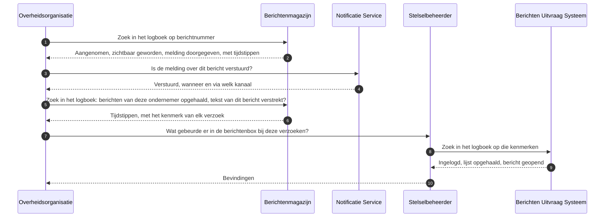

# Use case 9: Nagaan of een ondernemer een bericht heeft kunnen zien

Een organisatie gaat na of een ondernemer een bericht heeft kunnen zien, en of hij er een melding
van kreeg.

| | |
|---|---|
| **Actor** | De overheidsorganisatie die het bericht verstuurde, met hulp van de stelselbeheerder |
| **Aanleiding** | De organisatie heeft een conflict met een ondernemer over een belangrijk bericht. De ondernemer zegt het nooit ontvangen te hebben |
| **Resultaat** | De organisatie weet wanneer het bericht is aangenomen en zichtbaar werd, of de melding is verstuurd, wanneer de ondernemer daarna zijn berichten ophaalde, en of hij het bericht geopend heeft |

## Verloop

Er is geen centrale plek die bijhoudt wat er met een bericht gebeurd is. Elke dienst legt alleen
zijn eigen deel vast, in zijn eigen logboek. Het antwoord komt dus uit meerdere logboeken.

1. De organisatie zoekt met het berichtnummer in het logboek van haar eigen magazijn: wanneer is
   het bericht aangenomen, wanneer werd het zichtbaar, en wanneer is de melding doorgegeven aan de
   Notificatie Service?
2. De organisatie vraagt de Notificatie Service of de melding verstuurd is, wanneer, en via welk
   kanaal.
3. In hetzelfde logboek van het magazijn zoekt de organisatie wanneer de uitvraag daarna de
   berichten van deze ondernemer ophaalde, en of de tekst van dit bericht is verstrekt. Elk verzoek
   draagt een kenmerk dat ook in het logboek van de uitvraag staat.
4. Met die kenmerken vraagt de organisatie de stelselbeheerder wat er in de berichtenbox gebeurde.
   De stelselbeheerder zoekt in het logboek van de uitvraag: was de ondernemer ingelogd, is zijn
   lijst getoond, en heeft hij dit bericht geopend?
5. De organisatie legt de antwoorden naast elkaar.

## Sequence diagram

## Als het misgaat

| Situatie | Wat het stelsel doet | Wat de organisatie merkt |
|---|---|---|
| Het magazijn weigerde het bericht | Het logboek van het magazijn toont de weigering | De organisatie kreeg de weigering al bij het aanleveren (use case 1) |
| De Notificatie Service was te lang niet bereikbaar | Het logboek van het magazijn toont de mislukte pogingen om de melding door te geven | Er is geen melding verstuurd |
| De ondernemer heeft na de publicatie niet ingelogd | Er is geen ophaalverzoek na de publicatie | Het bericht was zichtbaar, maar de ondernemer heeft niet gekeken |
| Het magazijn leverde niet toen de ondernemer zijn berichten ophaalde | Het logboek van het magazijn toont op dat moment geen verstrekte lijst | De ondernemer heeft het bericht toen niet kunnen zien (zie use case 11) |
| De logboekregels zijn al opgeruimd | Niets meer na te gaan | Geen antwoord |

## Nog niet gerealiseerd

- De logregels van aanleveren en openen bevatten het berichtnummer niet. Welk bericht het was,
  blijkt nu alleen bij benadering, uit tijdstippen.
- De uitvraag legt een geweigerde poging om een bericht te openen net zo vast als een geslaagde.
  Alleen de regel van het magazijn laat zien of de tekst echt verstrekt is.
- De uitvraag legt alleen vast hoeveel organisaties niet leverden, niet welke.
- Een bericht is nu al vóór zijn publicatiedatum te zien (use case 1). Dat maakt het lastiger om te
  zeggen vanaf wanneer de ondernemer het kon zien.
- Voor de logboekregels is nog geen bewaartermijn ingesteld.

## Open vragen

- **Moet vastgelegd worden welke berichten de ondernemer te zien kreeg?** Nu blijkt alleen dat het
  magazijn op een moment zijn lijst afgaf, en dat het bericht toen al bestond. Dat het in de lijst
  zat en dat het portaal het liet zien, staat nergens. Per getoond bericht een regel vastleggen
  kost veel: één regel per bericht per keer inloggen, verspreid over de logboeken van alle
  magazijnen en de uitvraag. Bij een ondernemer die een natuurlijk persoon is, bevat elke regel
  zijn nummer. Meer vastleggen staat zo op gespannen voet met dataminimalisatie; een pseudoniem in
  het logboek in plaats van het nummer verzacht dat.
- Hoe lang moeten logboekregels bewaard worden om zo'n vraag te kunnen beantwoorden?
