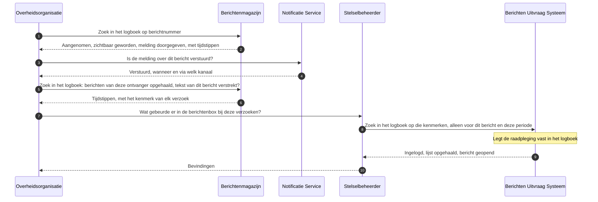

# Use case 9: Nagaan of een ontvanger een bericht heeft kunnen zien

Een organisatie gaat na of de ontvanger, een burger of ondernemer, een bericht heeft kunnen zien,
en of er een melding van verstuurd is.

| | |
|---|---|
| **Actor** | De overheidsorganisatie die het bericht verstuurde, met hulp van de stelselbeheerder |
| **Aanleiding** | De organisatie heeft een conflict met de ontvanger over een belangrijk bericht. De ontvanger zegt het nooit ontvangen te hebben |
| **Resultaat** | De organisatie weet wanneer het bericht is aangenomen en zichtbaar werd, of de melding is verstuurd, wanneer de ontvanger daarna de berichten ophaalde, en of de ontvanger het bericht geopend heeft |

## Verloop

Er is geen centrale plek die bijhoudt wat er met een bericht gebeurd is. Elke dienst legt alleen
het eigen deel vast, in het eigen logboek. Het antwoord komt dus uit meerdere logboeken.

1. De organisatie zoekt met het berichtnummer in het logboek van haar eigen magazijn: wanneer is
   het bericht aangenomen, wanneer werd het zichtbaar, en wanneer is de melding doorgegeven aan de
   Notificatie Service?
2. De organisatie vraagt de Notificatie Service of de melding verstuurd is, wanneer, en via welk
   kanaal.
3. In hetzelfde logboek van het magazijn zoekt de organisatie wanneer de uitvraag daarna de
   berichten van deze ontvanger ophaalde, en of de tekst van dit bericht is verstrekt. Elk verzoek
   draagt een kenmerk dat ook in het logboek van de uitvraag staat.
4. Met die kenmerken vraagt de organisatie de stelselbeheerder wat er in de berichtenbox gebeurde.
   De stelselbeheerder zoekt in het logboek van de uitvraag: was de ontvanger ingelogd, is de
   berichtenlijst getoond, en is dit bericht geopend? De stelselbeheerder zoekt alleen naar dit
   bericht en deze periode, en legt de raadpleging zelf ook vast in het logboek: ook dat is een
   verwerking.
5. De organisatie legt de antwoorden naast elkaar.

## Sequence diagram

## Als het misgaat

| Situatie | Wat het stelsel doet | Wat de organisatie merkt |
|---|---|---|
| Het magazijn weigerde het bericht | Het logboek van het magazijn toont de weigering | De organisatie kreeg de weigering al bij het aanleveren (use case 1) |
| De Notificatie Service was te lang niet bereikbaar | Het logboek van het magazijn toont de mislukte pogingen om de melding door te geven | Er is geen melding verstuurd |
| De ontvanger heeft na de publicatie niet ingelogd | Er is geen ophaalverzoek na de publicatie | Het bericht was zichtbaar, maar de ontvanger heeft niet gekeken |
| Het magazijn leverde niet toen de ontvanger de berichten ophaalde | Het logboek van het magazijn toont op dat moment geen verstrekte lijst | De ontvanger heeft het bericht toen niet kunnen zien (zie use case 11) |
| De logboekregels zijn al opgeruimd | Niets meer na te gaan | Geen antwoord |

## Nog niet gerealiseerd

- De logregels van aanleveren en openen bevatten het berichtnummer niet. Welk bericht het was,
  blijkt nu alleen bij benadering, uit tijdstippen ([#1592](https://github.com/MinBZK/MijnOverheidZakelijk/issues/1592)).
- De logregel van de uitvraag bij het openen legt niet vast of het openen lukte. Alleen de regel
  van het magazijn laat zien of de tekst echt verstrekt is ([#1592](https://github.com/MinBZK/MijnOverheidZakelijk/issues/1592), [#1381](https://github.com/MinBZK/MijnOverheidZakelijk/issues/1381)).
- De uitvraag legt alleen vast hoeveel organisaties niet leverden, niet welke ([#1592](https://github.com/MinBZK/MijnOverheidZakelijk/issues/1592)).
- Een bericht is nu al vóór zijn publicatiedatum te zien (use case 1). Dat maakt het lastiger om te
  zeggen vanaf wanneer de ontvanger het kon zien ([#1586](https://github.com/MinBZK/MijnOverheidZakelijk/issues/1586)).
- Voor de logboekregels is nog geen bewaartermijn ingesteld ([#1595](https://github.com/MinBZK/MijnOverheidZakelijk/issues/1595)).

## Open vragen

- **Moet vastgelegd worden welke berichten de ontvanger te zien kreeg?** Nu blijkt alleen dat het
  magazijn op een moment de lijst afgaf, en dat het bericht toen al bestond. Dat het in de lijst
  zat en dat het portaal het liet zien, staat nergens. Per getoond bericht een regel vastleggen
  kost veel: één regel per bericht per keer inloggen, verspreid over de logboeken van alle
  magazijnen en de uitvraag. Bij een burger, en bij een ondernemer zonder rechtspersoonlijkheid,
  is het nummer in elke regel een persoonsgegeven, vaak het BSN. Meer vastleggen staat zo op
  gespannen voet met dataminimalisatie; een pseudoniem in het logboek in plaats van het nummer
  verzacht dat.
- Hoe lang moeten logboekregels bewaard worden om zo'n vraag te kunnen beantwoorden?
- **Op welke grondslag mag de stelselbeheerder gegevens uit het logboek van de uitvraag aan de
  organisatie geven, en hoeveel?** Het logboek is bijgehouden voor verantwoording, niet voor een
  geschil met de ontvanger. Gebruik voor dit nieuwe doel vraagt een toets of dat verenigbaar is.
