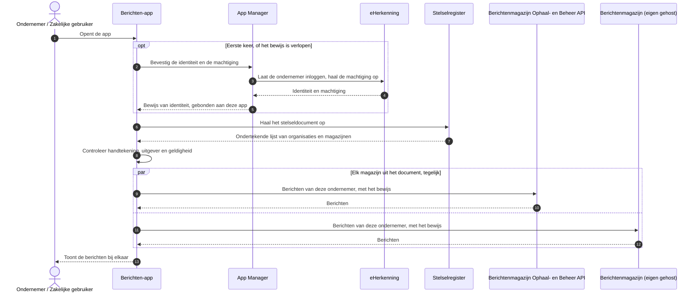

# Use case 9: Rechtstreeks ophalen

Een burger of ondernemer haalt berichten met een app rechtstreeks bij de magazijnen op, zonder
portaal en zonder uitvraag ertussen.

| | |
|---|---|
| **Actor** | Een burger of een ondernemer, met een berichten-app op een eigen apparaat |
| **Aanleiding** | De gebruiker opent de app om zijn berichten te zien |
| **Resultaat** | De app toont de berichten van alle deelnemende organisaties. Een magazijn dat niet antwoordt, toont de app als niet bereikbaar |

Van deze use case is alleen het Stelselregister gebouwd. De app, de App Manager en het ophalen bij
een magazijn volgens BK Connect zijn doelbeeld; welke variant daarvoor geldt, is nog niet gekozen.

## Verloop

1. De gebruiker opent de app.
2. De eerste keer laat de app de identiteit van de gebruiker bevestigen door de App Manager. Die laat
   de burger inloggen met DigiD, of de ondernemer met eHerkenning, en geeft de app een bewijs van
   die identiteit, gebonden aan de app. Daarna hergebruikt de app dat bewijs.
3. De app haalt het stelseldocument op bij het Stelselregister: de lijst van deelnemende
   organisaties en het adres van hun magazijn, ondertekend door de stelselbeheerder. De app
   controleert de handtekening en de geldigheid voordat hij de lijst gebruikt.
4. De app vraagt de berichten op bij elk magazijn uit de lijst, tegelijk, met het bewijs van de
   identiteit.
5. Elk magazijn controleert het bewijs, en voor een ondernemer ook namens welke onderneming hij
   handelt, en geeft de berichten.
6. De app toont de berichten bij elkaar.

## Sequence diagram

Voor een burger is het verloop hetzelfde, met DigiD in plaats van eHerkenning en zonder machtiging.

Het architectuurmodel toont hetzelfde verloop als genummerd overzicht:

## Als het misgaat

| Situatie | Wat er gebeurt | Wat de gebruiker merkt |
|---|---|---|
| De handtekening, de uitgever of de geldigheid van het stelseldocument klopt niet | De app weigert het document. Wat hij daarna doet, bijvoorbeeld een eerder geaccepteerd en nog geldig exemplaar blijven gebruiken, ligt bij de app; het profiel schrijft alleen de weigering voor | Zonder geldig document kan de app geen magazijnen bevragen |
| Het stelseldocument is ouder dan het laatst geaccepteerde exemplaar | De app weigert het, zodat niemand een oude lijst kan terugspelen | Niets |
| Een organisatie is uit het register gehaald | Ze staat nog hooguit 24 uur in een document dat de app al had | De app bevraagt haar magazijn nog even |
| Een magazijn antwoordt niet | De app gaat door met de andere | De app toont dat magazijn als niet bereikbaar |
| Het bewijs van identiteit is verlopen | De app laat de gebruiker opnieuw inloggen | Opnieuw inloggen |

## Doelarchitectuur

Deze hele use case is doelbeeld, op het Stelselregister na. Open is:

- welke variant van BK Connect het ophalen bij een magazijn volgt;
- hoe de eHerkenning-machtiging, inclusief ketenmachtiging, in het bewijs komt, zodat een magazijn
  kan zien namens welke onderneming iemand handelt.

## Technische verwijzing

| Stap | Koppelvlak | Opmerking |
|---|---|---|
| Stelseldocument | `GET /stelseldocument` op het Stelselregister (`stelselregister-api.yaml`) | JWS, ES256. 24 uur geldig, elk uur een nieuw exemplaar. De zes verificatiestappen staan in het toepassingsprofiel van het stelseldocument (`docs/stelseldocument-toepassingsprofiel.md`) |
| Ophalen bij een magazijn | Volgens BK Connect | Nog niet gebouwd |
