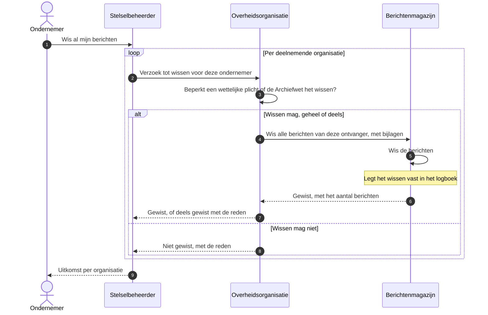

# Use case 10: Alle berichten van een ondernemer wissen

Een ondernemer laat al zijn berichten wissen, met een beroep op het recht op gegevenswissing.

| | |
|---|---|
| **Actor** | Een ondernemer die een natuurlijk persoon is, met de stelselbeheerder en de verzendende organisaties |
| **Aanleiding** | De ondernemer wil dat al zijn berichten, met bijlagen, uit het stelsel verdwijnen |
| **Resultaat** | Elke organisatie heeft de berichten in haar magazijn gewist, of uitgelegd waarom ze dat (deels) niet mag. De ondernemer krijgt per organisatie de uitkomst, en het wissen is vastgelegd |

## Verloop

1. De ondernemer dient één verzoek in bij de stelselbeheerder.
2. Niemand weet centraal in welke magazijnen berichten van deze ondernemer staan: er is geen
   centrale opslag van berichten. De stelselbeheerder stuurt het verzoek daarom naar elke
   deelnemende organisatie.
3. Elke organisatie is verantwoordelijk voor de berichten in haar eigen magazijn, en beslist zelf
   over het verzoek. Ze toetst of een wettelijke plicht of de Archiefwet het wissen beperkt.
4. Mag de organisatie wissen, dan geeft ze haar magazijn opdracht om alle berichten van deze
   ontvanger te wissen, met bijlagen. Het magazijn wist ze en legt dat vast in zijn logboek.
5. De organisatie meldt de stelselbeheerder de uitkomst: gewist, deels gewist met de reden, niet
   gewist met de reden, of geen berichten gevonden. Organisaties aan wie ze de gegevens zelf
   verstrekte, brengt ze op de hoogte.
6. De stelselbeheerder meldt de ondernemer de uitkomst per organisatie.

De uitvraag hoeft niets te wissen: hij bewaart de berichtenlijst alleen zolang de ondernemer
ingelogd is. Wat wel blijft, zijn de regels in de logboeken. Die verdwijnen na hun eigen
bewaartermijn. Ook het bewijs van het wissen is zo'n regel, met het nummer van de ondernemer.

## Sequence diagram

## Als het misgaat

| Situatie | Wat het stelsel doet | Wat de ondernemer merkt |
|---|---|---|
| Een organisatie reageert niet | De stelselbeheerder herinnert haar eraan, en meldt de ondernemer welke organisatie nog niet geantwoord heeft | Een uitkomst met een open plek |
| Een magazijn is niet bereikbaar | De organisatie wist zodra het magazijn weer werkt | De uitkomst van die organisatie komt later |
| Een wettelijke plicht of de Archiefwet verbiedt het wissen | De organisatie wist niet, of alleen een deel | De reden, per organisatie |
| De ontvanger is een rechtspersoon, zoals een bv of nv | Het recht op wissing geldt niet voor de onderneming zelf. Het geldt wel voor personen over wie een bericht gaat | De stelselbeheerder legt dat uit |
| De ondernemer is ingelogd tijdens het wissen | Zijn lijst klopt pas weer na het volgende ophalen | Gewiste berichten staan nog in de lijst, maar zijn niet meer te openen |

## Nog niet gerealiseerd

Deze use case is nog niet gebouwd en nog niet afgesproken.

- Een magazijn heeft geen opdracht om alle berichten van één ontvanger in één keer te wissen. De
  ondernemer kan alleen berichten één voor één verwijderen (use case 8), en dat is markeren, geen
  wissen: het magazijn ruimt ze pas na de bewaartermijn op.
- Er is geen werkwijze voor de stelselbeheerder om een verzoek door te zetten en de uitkomsten te
  verzamelen.
- Het definitief opruimen staat nog niet in het logboek van het magazijn (use case 8).
- Voor de logboekregels is nog geen bewaartermijn ingesteld.

## Open vragen

- **Loopt het verzoek via de stelselbeheerder, of per organisatie?** De AVG legt het verzoek bij
  elke verantwoordelijke organisatie. Via de stelselbeheerder hoeft de ondernemer niet te weten
  welke organisaties berichten hebben, maar dan krijgt de stelselbeheerder een coördinerende rol
  die nog nergens is vastgelegd.
- **Wie heeft dit recht?** Het hangt aan de rechtsvorm, niet aan het type nummer: een ondernemer
  met een BSN, een eenmanszaak, en de vennoten van een vof of maatschap, of die nu via het
  KVK-nummer of het RSIN zijn aangeschreven.
- **Wat gebeurt er bij een wissing met de logboekregels?** Daar is een bewaartermijn en een
  afspraak voor nodig.
- Laat een privacyjurist of de functionaris gegevensbescherming meekijken voordat deze use case
  naar Logius gaat.
