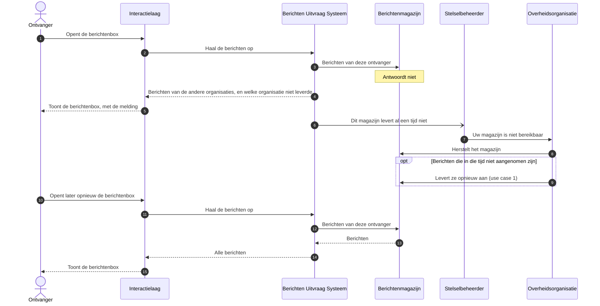

# Use case 11: Een magazijn is langere tijd onbereikbaar

Het magazijn van een organisatie ligt langere tijd plat. De ontvanger, een burger of ondernemer,
mist daardoor berichten.

| | |
|---|---|
| **Actor** | De ontvanger, de stelselbeheerder en de organisatie van het magazijn |
| **Aanleiding** | Een magazijn antwoordt niet meer, bijvoorbeeld door een storing of onderhoud |
| **Resultaat** | De ontvanger ziet de berichten van de andere organisaties, en weet welke organisatie ontbreekt. De organisatie weet van de storing. Na het herstel ziet de ontvanger weer alle berichten |

## Verloop

1. De ontvanger opent de berichtenbox (use case 2). Het magazijn antwoordt niet. De ontvanger
   ziet de berichten van de andere organisaties, en de melding welke organisatie niet leverde.
2. Faalt het magazijn steeds, dan slaat de uitvraag het telkens even over. Zo blijft de
   berichtenbox voor iedereen snel.
3. De stelselbeheerder ziet dat het magazijn al een tijd niet levert, en meldt dat aan de
   organisatie.
4. De organisatie herstelt haar magazijn. Berichten die ze in die tijd wilde versturen, kon het
   magazijn niet aannemen (use case 1). Ze levert die opnieuw aan, of stuurt ze langs een andere
   weg.
5. Na het herstel haalt de uitvraag bij de volgende keer inloggen ook de berichten van dit magazijn
   weer op.

Vraagt de ontvanger de stelselbeheerder om toch bij de berichten te kunnen, dan kan de
stelselbeheerder niet helpen: er is geen kopie van de berichten buiten het magazijn. Alleen de
organisatie zelf kan een bericht langs een andere weg bij de ontvanger krijgen.

## Sequence diagram

## Als het misgaat

| Situatie | Wat het stelsel doet | Wat de ontvanger merkt |
|---|---|---|
| De ontvanger heeft een melding van een bericht uit dit magazijn, en het magazijn leverde niet bij het ophalen | Het bericht staat niet in de lijst, en de uitvraag kan het niet openen | Een melding van een bericht dat niet in de berichtenbox staat, en de melding dat deze organisatie niet leverde |
| Het magazijn valt uit nadat de berichten zijn opgehaald | Het bericht staat in de lijst, maar de uitvraag kan de tekst niet ophalen | "Probeer het straks nog eens" |
| Het magazijn antwoordt traag in plaats van niet | De uitvraag wacht hooguit tien seconden, en behandelt het dan als niet geleverd | Als hierboven |
| Het magazijn van een organisatie is niet bekend bij de uitvraag | De uitvraag bevraagt het niet | Berichten van die organisatie ontbreken (zie use case 2) |

## Nog niet gerealiseerd

- De uitvraag waarschuwt de stelselbeheerder nog niet als een magazijn langere tijd niet levert.
  De stelselbeheerder merkt het nu pas als iemand het meldt ([#1480](https://github.com/MinBZK/MijnOverheidZakelijk/issues/1480), [#1478](https://github.com/MinBZK/MijnOverheidZakelijk/issues/1478)).
- De uitvraag legt alleen vast hoeveel organisaties niet leverden, niet welke ([#1592](https://github.com/MinBZK/MijnOverheidZakelijk/issues/1592)).
- Opent de ontvanger een bericht uit een magazijn dat bij het ophalen niet leverde, bijvoorbeeld
  via een link in de melding, dan verschijnt nu "Dit bericht is niet (meer) beschikbaar". De
  ontvanger kan dan denken dat het bericht weg is ([#1591](https://github.com/MinBZK/MijnOverheidZakelijk/issues/1591)).

## Open vragen

- Moet het stelsel een kopie van berichten bewaren buiten het magazijn, voor als een magazijn lang
  plat ligt? Dat botst met het uitgangspunt dat er geen centrale opslag van berichten is.
- Wat gebeurt er met termijnen in een bericht dat de ontvanger door een storing niet kon openen?
  Dat is aan de organisatie, maar de stelselafspraken kunnen er iets over zeggen.
- Moet de ontvanger een melding krijgen als de berichten weer beschikbaar zijn?
