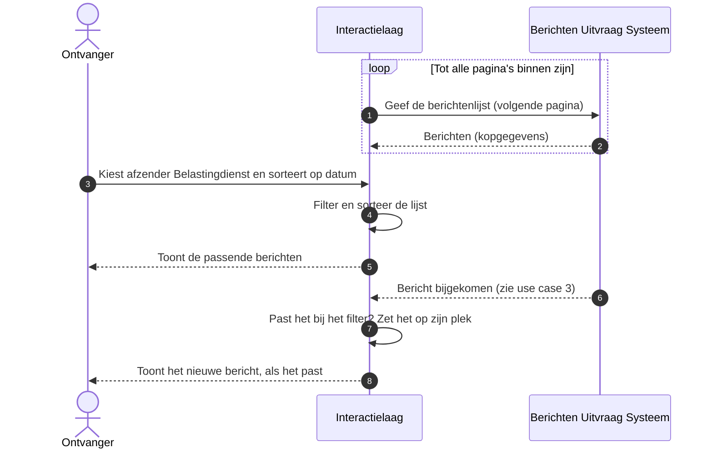

# Use case 12: Berichten filteren en sorteren

De ontvanger, een burger of ondernemer, filtert en sorteert de eigen berichten op de kopgegevens:
onderwerp, afzender, map en datum.

| | |
|---|---|
| **Actor** | De ontvanger, met een geopende berichtenbox |
| **Aanleiding** | De ontvanger zoekt een bericht terug, bijvoorbeeld alles van de Belastingdienst, alles in de map "Belasting", of een bericht met "aanslag" in het onderwerp |
| **Resultaat** | De berichtenbox toont alleen de berichten die bij het filter passen, in de gekozen volgorde. Ontbreekt een organisatie, dan is te zien dat het resultaat onvolledig is |

Zoeken in de tekst van berichten en bijlagen is een andere use case (use case 4).

## Verloop

Filteren en sorteren gebeuren in de berichtenbox zelf, over de volledige lijst die bij het
ophalen is samengesteld (use case 2). De lijst bevat alleen kopgegevens: afzender, onderwerp,
datum, map en of het bericht gelezen is.

1. Na het ophalen haalt het portaal de volledige berichtenlijst op bij de uitvraag, in een paar
   pagina's.
2. De ontvanger typt een woord uit het onderwerp, of kiest een afzender of een map. De keuze aan
   afzenders en mappen leidt het portaal af uit de berichten zelf.
3. De ontvanger kiest een volgorde: op datum (nieuwste of oudste eerst), op afzender of op
   onderwerp.
4. Het portaal toont het resultaat meteen, zonder de uitvraag of de magazijnen opnieuw te vragen.
   Filter, zoekterm en volgorde zijn te combineren.
5. Komt er een nieuw bericht binnen terwijl de berichtenbox openstaat (use case 3), dan verschijnt
   het alleen als het bij het filter past, op de plek die bij de volgorde hoort.

## Sequence diagram

## Als het misgaat

| Situatie | Wat het stelsel doet | Wat de ontvanger merkt |
|---|---|---|
| Een organisatie leverde niet bij het ophalen | Haar berichten zitten niet in de lijst, dus ook niet in het resultaat | De berichtenbox meldt dat het resultaat onvolledig is, en welke organisatie ontbreekt |
| Een organisatie heeft meer dan 500 berichten voor deze ontvanger | De uitvraag neemt er 500 mee | De berichtenbox meldt dat er meer berichten zijn dan getoond |
| Geen bericht past bij het filter | Het portaal toont een lege lijst | "Geen berichten gevonden" |
| Een nieuw bericht past niet bij het filter | Het portaal voegt het toe aan de lijst, maar toont het niet | Het bericht verschijnt zodra het filter het toelaat |
| De ontvanger zoekt een map waar geen bericht meer in zit | Een map bestaat alleen zolang er een bericht in zit (use case 7) | De map staat niet in de keuzelijst |

## Nog niet gerealiseerd

- Het nieuwe MOZa-portaal meldt niet welke organisaties niet leverden. Een gefilterde lijst ziet er
  dan volledig uit terwijl die dat niet is ([#1453](https://github.com/MinBZK/MijnOverheidZakelijk/issues/1453)).

## Open vragen

- Blijft filteren in de browser houdbaar als een ontvanger berichten van veel organisaties
  ontvangt? De lijst is begrensd op 500 berichten per organisatie, zonder tekst.
