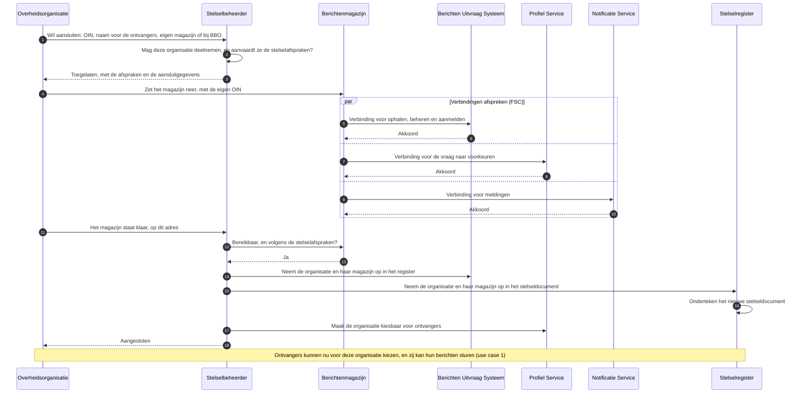

# Use case 13: Een organisatie sluit aan op het stelsel

Een overheidsorganisatie wil berichten versturen via de berichtenbox. Ze zet een berichtenmagazijn
neer, en de stelselbeheerder neemt haar op in het stelsel.

| | |
|---|---|
| **Actor** | Een overheidsorganisatie, met de stelselbeheerder |
| **Aanleiding** | De organisatie wil burgers of ondernemers berichten sturen die in hun berichtenbox verschijnen |
| **Resultaat** | De organisatie heeft een werkend magazijn dat in het stelsel bekend is. Ontvangers kunnen kiezen voor berichten van deze organisatie, en vanaf dat moment kan de organisatie hun berichten sturen (use case 1) |

## Verloop

1. De organisatie meldt zich bij de stelselbeheerder. Ze geeft haar OIN (het nummer waarmee de
   overheid organisaties herkent) en de naam die ontvangers bij elk bericht zien. Ze kiest of ze
   het magazijn zelf host of afneemt bij BBO.
2. De stelselbeheerder controleert of de organisatie mag deelnemen, en of ze de stelselafspraken
   aanvaardt. De organisatie krijgt de afspraken en de gegevens die ze nodig heeft om aan te
   sluiten.
3. De organisatie zet haar magazijn neer, of laat BBO dat doen. Het magazijn draagt de OIN van de
   organisatie: zo weet elk ander onderdeel van wie het is, en het neemt alleen berichten aan van
   die organisatie.
4. Het magazijn maakt afspraken over verbindingen (FSC) met de diensten waarmee het praat: met de
   uitvraag, die er berichten ophaalt en beheert en waar het nieuwe berichten aanmeldt; met de
   Profiel Service, die zegt of een ontvanger berichten van deze organisatie wil; en met de
   Notificatie Service, die de ontvanger een melding stuurt. Elke afspraak is door beide kanten
   ondertekend.
5. Is de ontvanger een burger of een ondernemer met een BSN, dan krijgt het magazijn een eigen
   pseudoniem van die persoon. Daarvoor wordt het magazijn als eigen dienst aangemeld voor de
   pseudoniemen.
6. De organisatie meldt de stelselbeheerder dat het magazijn klaarstaat, met het adres.
7. De stelselbeheerder controleert dat het magazijn bereikbaar is en de stelselafspraken volgt.
8. De stelselbeheerder neemt de organisatie en haar magazijn op in het register. Vanaf dan bevraagt
   de uitvraag dit magazijn als een ontvanger voor deze organisatie gekozen heeft (use case 2).
   Het Stelselregister neemt de organisatie op in het ondertekende overzicht van deelnemers.
9. De stelselbeheerder maakt de organisatie bekend bij de Profiel Service. Ontvangers kunnen
   daarna in het portaal kiezen of ze berichten van deze organisatie via de berichtenbox willen
   ontvangen.
10. De stelselbeheerder meldt de organisatie dat ze is aangesloten.

Een bericht dat de organisatie daarna aanlevert, neemt het magazijn alleen aan voor ontvangers die
voor haar gekozen hebben (use case 1). Kort na het aansluiten zijn dat er nog weinig.

## Sequence diagram

## Als het misgaat

| Situatie | Wat het stelsel doet | Wat de organisatie merkt |
|---|---|---|
| De organisatie heeft al een magazijn in het stelsel | Het register kent per organisatie één magazijn, en weigert een tweede | De stelselbeheerder legt uit dat ze haar bestaande magazijn gebruikt |
| Het adres van het magazijn is niet beveiligd (geen https) | Het register neemt het niet op | De stelselbeheerder vraagt om een beveiligd adres |
| Het magazijn is niet bereikbaar bij de controle | De stelselbeheerder neemt het nog niet op | De aansluiting wacht tot het magazijn bereikbaar is |
| Een verbinding (FSC) is nog niet afgesproken | Het magazijn kan de dienst aan de andere kant niet bereiken: zonder Profiel Service neemt het geen berichten aan, zonder Notificatie Service krijgen ontvangers geen melding, en zonder uitvraag verschijnt niets in de berichtenbox | Aanleveren mislukt, of berichten blijven onzichtbaar |
| De organisatie levert aan voordat ontvangers voor haar gekozen hebben | Het magazijn weigert het bericht (use case 1) | Een weigering per bericht. Ze stuurt het bericht langs een andere weg |
| Een ontvanger kiest voor de organisatie voordat haar magazijn in het register staat | De uitvraag slaat de organisatie over (use case 2) | Niets; de ontvanger ziet geen berichten van haar |
| Uitvraag en Stelselregister hebben een andere lijst | Een app die rechtstreeks ophaalt ziet andere organisaties dan de berichtenbox | Niets; de ontvanger mist berichten in een van beide |

## Nog niet gerealiseerd

- De stelselbeheerder kan het register niet zelf bijwerken. Het register is een instelling van de
  uitvraag en van het Stelselregister, elk apart. Een organisatie opnemen vraagt een nieuwe
  uitrol van beide, en niet te herleiden is wie wat wanneer wijzigde ([#1484](https://github.com/MinBZK/MijnOverheidZakelijk/issues/1484), [#1485](https://github.com/MinBZK/MijnOverheidZakelijk/issues/1485)).
- De stelselbeheerder kan niet zien welke magazijnen zijn opgenomen, en of uitvraag en
  Stelselregister dezelfde lijst gebruiken ([#1483](https://github.com/MinBZK/MijnOverheidZakelijk/issues/1483)).
- Een organisatie kan een magazijn nog niet met één handeling neerzetten en aanmelden. Op Fundament
  wordt dat beproefd als plug-in ([#1538](https://github.com/MinBZK/MijnOverheidZakelijk/issues/1538)).
- Het magazijn controleert nog niet dat een bericht van de eigen organisatie komt ([#1587](https://github.com/MinBZK/MijnOverheidZakelijk/issues/1587)).
- Een ontvanger die voor een organisatie kiest waarvan het magazijn niet in het register staat,
  krijgt daar geen melding van ([#1591](https://github.com/MinBZK/MijnOverheidZakelijk/issues/1591)).
- De verbindingen via FSC en de pseudoniemen per magazijn zijn nog niet gebouwd (zie "Wat voor
  alle use cases geldt").

## Open vragen

- **Wie is de stelselbeheerder, en welke aansluitvoorwaarden gelden?** De aansluitvoorwaarden van
  Logius voor beheer zijn het uitgangspunt, maar moeten nog voor dit stelsel worden vastgelegd.
- **Welke dienst is de bron van het register?** Nu houden de uitvraag en het Stelselregister elk
  een eigen kopie bij ([#1484](https://github.com/MinBZK/MijnOverheidZakelijk/issues/1484)).
- **Hoe weet het portaal uit welke organisaties een ontvanger kan kiezen?** Een voorkeur in de
  Profiel Service noemt de organisatie aan haar OIN. Of de Profiel Service een lijst van
  deelnemende organisaties bijhoudt, of het portaal die uit het register leest, is nog niet
  afgesproken.
- **Moet de Notificatie Service de organisatie kennen?** Bijvoorbeeld om haar naam in de melding te
  tonen. Nu krijgt ze bij elke melding alleen de OIN.
- **Hoe toetst de stelselbeheerder dat een magazijn de stelselafspraken volgt?** Een vaste proef,
  zoals een testbericht door de hele keten, bestaat nog niet.
