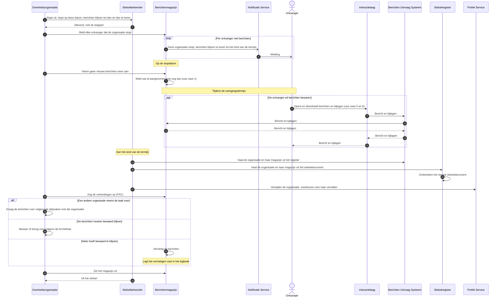

# Use case 14: Een organisatie stapt uit het stelsel

Een overheidsorganisatie stopt met het versturen van berichten via de berichtenbox, bijvoorbeeld
omdat ze opgeheven wordt of haar taak overgaat naar een andere organisatie. Haar magazijn gaat uit
het stelsel.

| | |
|---|---|
| **Actor** | Een overheidsorganisatie, met de stelselbeheerder |
| **Aanleiding** | De organisatie wil of moet stoppen met het versturen van berichten via het stelsel |
| **Resultaat** | De organisatie en haar magazijn staan niet meer in het stelsel. Ontvangers zijn op tijd ingelicht en konden hun berichten nog lezen en bewaren. Wat er met de berichten in het magazijn gebeurt, is volgens de wet geregeld |

## Verloop

1. De organisatie meldt de stelselbeheerder dat ze uitstapt. Ze noemt de datum waarop ze stopt met
   versturen, en hoe lang ontvangers daarna nog bij hun berichten kunnen (de overgangstermijn).
2. De organisatie laat haar ontvangers via haar magazijn en de Notificatie Service weten dat ze
   stopt, en tot wanneer hun berichten nog in de berichtenbox staan. Zo kunnen ze berichten die ze
   willen houden, met bijlagen, downloaden.
3. Op de stopdatum neemt het magazijn geen nieuwe berichten meer aan. Wat al aangenomen was, wordt
   nog aangemeld en gemeld (use case 1).
4. Tijdens de overgangstermijn blijft het magazijn in het stelsel. Ontvangers zien hun berichten
   en kunnen ze openen, downloaden en verwijderen, zoals altijd.
5. Aan het eind van de termijn haalt de stelselbeheerder de organisatie en haar magazijn uit het
   register. De uitvraag bevraagt het magazijn niet meer, en het Stelselregister laat de
   organisatie weg uit het ondertekende overzicht van deelnemers.
6. De stelselbeheerder laat de organisatie verwijderen bij de Profiel Service. Ontvangers kunnen
   haar niet meer kiezen, en hun voorkeur voor deze organisatie vervalt.
7. De verbindingen (FSC) tussen het magazijn en de andere diensten worden opgezegd.
8. De organisatie beslist wat er met de berichten in haar magazijn gebeurt: overdragen aan de
   organisatie die haar taak overneemt, bewaren of overbrengen volgens de Archiefwet, of
   vernietigen. Daarna zet ze het magazijn uit. De regels in de logboeken blijven tot het einde
   van hun eigen bewaartermijn.
9. De stelselbeheerder bevestigt de organisatie dat ze uit het stelsel is.

Stapt de organisatie over naar een ander magazijn, bijvoorbeeld van een eigen magazijn naar een
magazijn bij BBO, dan is dat geen uitstappen: de organisatie blijft deelnemen, alleen het adres van
haar magazijn verandert. Dat staat bij de open vragen.

## Sequence diagram

## Als het misgaat

| Situatie | Wat het stelsel doet | Wat de organisatie en de ontvanger merken |
|---|---|---|
| De organisatie levert na de stopdatum nog een bericht aan | Het magazijn weigert het | De organisatie krijgt een weigering, en stuurt het bericht langs een andere weg. De ontvanger krijgt het bericht niet via de berichtenbox |
| Een bericht is aangenomen met een publicatiedatum na de stopdatum | Het magazijn meldt het nog aan op die datum, mits die in de overgangstermijn valt | Ligt de datum erna, dan trekt de organisatie het bericht in en stuurt het langs een andere weg |
| De ontvanger is ingelogd als de organisatie uit het register gaat | De lijst klopt pas weer na het volgende ophalen | Berichten van deze organisatie staan nog in de lijst, maar zijn niet meer te openen |
| Een app die rechtstreeks ophaalt heeft nog een ouder stelseldocument | De app kent de organisatie tot het document verloopt, uiterlijk 24 uur | De app probeert het magazijn nog; zolang het draait antwoordt het, daarna niet |
| Het magazijn staat uit voordat de organisatie uit het register is | De uitvraag behandelt het als een onbereikbaar magazijn (use case 11) | De ontvanger ziet de melding dat deze organisatie niet leverde |
| De ontvanger heeft de melding niet gezien | Na de termijn zijn de berichten niet meer via de berichtenbox te lezen | De ontvanger moet zich tot de organisatie, of tot wie haar taak overnam, wenden |

## Nog niet gerealiseerd

Deze use case is nog niet gebouwd en nog niet afgesproken ([#1682](https://github.com/MinBZK/MijnOverheidZakelijk/issues/1682)).

- De stelselbeheerder kan een organisatie niet zelf uit het register halen; dat vraagt een nieuwe
  uitrol van uitvraag en Stelselregister ([#1485](https://github.com/MinBZK/MijnOverheidZakelijk/issues/1485)).
- Een magazijn kan niet op een datum stoppen met aannemen, terwijl ophalen en beheren blijven
  werken ([#1683](https://github.com/MinBZK/MijnOverheidZakelijk/issues/1683)).
- Een organisatie kan al haar ontvangers geen melding sturen dat ze stopt ([#1684](https://github.com/MinBZK/MijnOverheidZakelijk/issues/1684)).
- Vervalt een voorkeur, dan verdwijnen ook de berichten die de organisatie eerder rechtmatig
  stuurde uit de berichtenbox ([#1413](https://github.com/MinBZK/MijnOverheidZakelijk/issues/1413)).
- Het vernietigen van berichten staat nog niet in het logboek van het magazijn (use case 8) ([#549](https://github.com/MinBZK/MijnOverheidZakelijk/issues/549)).

## Open vragen

- **Hoe lang is de overgangstermijn?** En is die voor elke organisatie gelijk, of bepaalt de
  organisatie die zelf?
- **Wie licht de ontvangers in?** De organisatie via haar magazijn, zoals hier beschreven, of de
  stelselbeheerder? Alleen de Profiel Service weet welke ontvangers voor de organisatie kozen;
  het magazijn weet alleen wie er berichten heeft.
- **Wat gebeurt er met de berichten bij een overname van de taak?** Gaan ze naar het magazijn van
  de organisatie die de taak overneemt, en blijven ze dan zichtbaar voor de ontvanger? En gaat de
  voorkeur van de ontvanger dan mee?
- **Hoe verloopt een overstap naar een ander magazijn?** Daarvoor moeten de berichten mee naar het
  nieuwe magazijn, of moet het oude een tijd naast het nieuwe blijven bestaan. Het register kent
  nu één magazijn per organisatie.
- **Hoe verhoudt het vernietigen zich tot de Archiefwet?** Een selectielijst bepaalt per soort
  bericht hoe lang het bewaard moet worden. Dat is aan de organisatie, maar de stelselafspraken
  kunnen eisen dat ze het vastlegt voordat ze uitstapt.
- **Moet de stelselbeheerder een organisatie ook uit het stelsel kunnen zetten?** Bijvoorbeeld als
  ze de stelselafspraken niet nakomt. Dan begint het verloop bij de stelselbeheerder in plaats van
  bij de organisatie.
