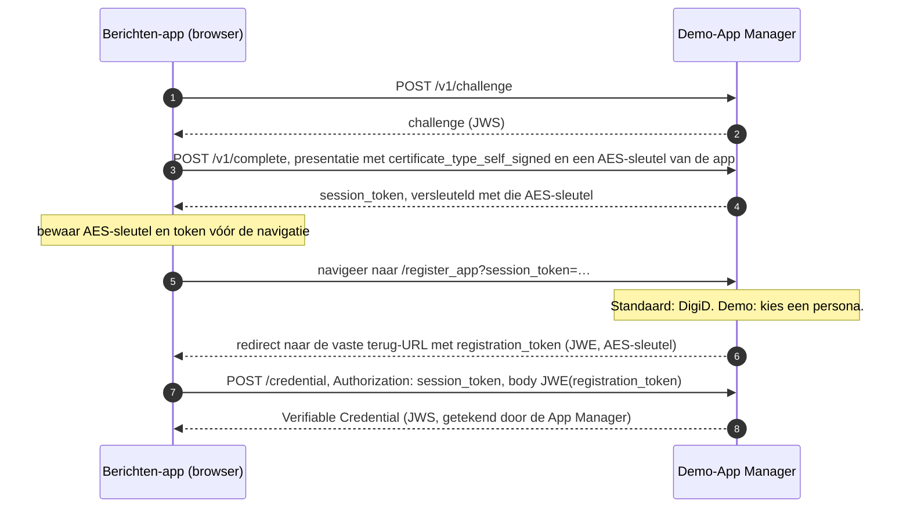
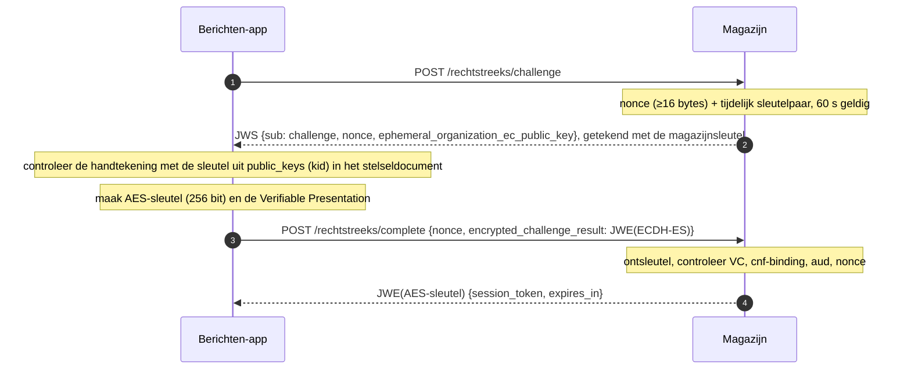
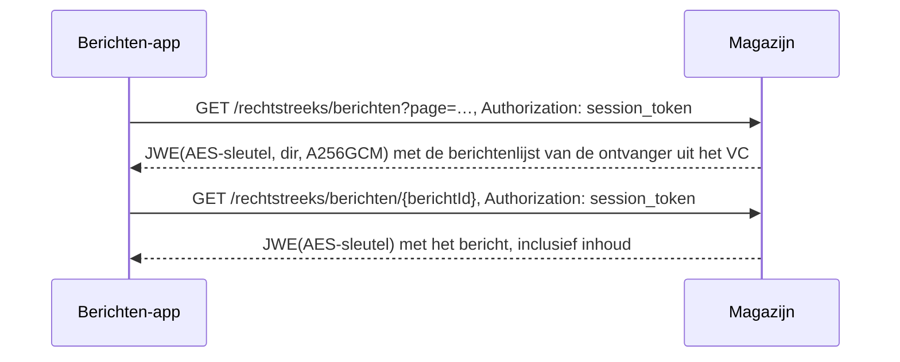

# Rechtstreeks ophalen via de Blauwe Knop: ontwerp

**Status:** Concept

Issues: MinBZK/MijnOverheidZakelijk#1213, #1214, #1215, #1216, onder #947.

## Context

In de beproeving **Berichten via de Blauwe Knop** haalt een app in de browser de berichten van
een ondernemer zelf bij elk magazijn op, zonder uitvraagsysteem ertussen. Dat volgt het model van
VORijk: een App Manager bevestigt de identiteit en bindt die aan een sleutel die de app niet kan
kopiëren, en elk magazijn controleert dat bewijs zelf. In de architectuur heet deze route
**Rechtstreeks ophalen** (views `RechtstreeksOphalen*` in `docs/architecture/workspace.dsl`).

Het stelseldocument (#1212) staat er al: de app leest daar welke magazijnen meedoen. Dit ontwerp
beschrijft de rest van de keten: de sleutel, het bewijs, de sessie met een magazijn en het
ophalen. Het is de leidraad voor een reeks kleine PR's (zie "Opdeling"). Na deze PR liggen het
protocol en het contract van de tweede ingang vast, zodat de stappen daarna deels tegelijk kunnen
lopen.

Eerste sprint, zoals de issues hem afbakenen: alleen berichten lezen (lijst en inhoud), eerst in
de simulator, voor één persona. Bijlagen, status en het echte magazijn volgen.

### Welke standaard

Bij de start van het stelseldocument heette de conceptstandaard *BK Connect draft-00*. Het adres
daarvan (`https://vorijk.nl/standaard/connect/draft-bk-connect-00.html`) verwijst nu met een 301
door naar **FSC voor Burgers** (`https://docs.fsc4b.nl/specs/protocol/`), werkversie 13 oktober
2026, redactie Team Mijn Betaaloverzicht (CJIB). Daarin staan dezelfde begrippen
(Activatiedienst/App Manager, `app_managers`, `bk-connect://app/`). Of het de opvolger is,
vragen we na (zie open vragen). Dit ontwerp volgt die werkversie; sectienummers hieronder
verwijzen ernaar. Het toepassingsprofiel van het stelseldocument noemt nog draft-00. Dat werken
we bij in de PR die het stelseldocument uitbreidt (PR 2).

De standaard kent twee varianten waarmee een app zich bij een organisatie aanmeldt: HTTPS-JWT
(`CreateSession`, 4.3.4) en HTTPS-OpenID4VP (4.3.5). **We kiezen HTTPS-JWT**; zie ontwerpkeuze 1.

## De rollen

| Rol in de standaard | Bij ons | Waar |
|---|---|---|
| App | **Berichten-app**: een webpagina in de browser van de ondernemer, op een eigen origin | nieuwe demo-module `demo/berichten-app` |
| Activatiedienst (App Manager), Credential Issuer | **Demo-App Manager**: geeft per persona een bewijs uit; de persona-keuze vervangt het inloggen | nieuwe demo-module `demo/app-manager` |
| Verifier, Dienst | **Magazijn**: controleert het bewijs en levert berichten. Eerst de simulator, daarna het echte magazijn | `demo/magazijn-simulator`, later `services/berichtenmagazijn` |
| Stelselbeheerder | **Stelselregister**: publiceert de magazijnen, hun sleutels en de App Manager | `services/stelselregister` |
| (gedeeld) | De Verifier-kant van het protocol, één keer gebouwd | nieuwe library `libraries/fbs-rechtstreeks` |

In de standaard zijn zowel de App Manager (bij het activeren) als het magazijn (bij elke sessie)
een Verifier van hetzelfde `CreateSession`-protocol. Ze delen dus dezelfde code. Demo-modules
mogen van een library afhangen; andersom niet (`.github/scripts/demo-grens.sh`).

## Hoe het werkt

Vier stappen. Stap 1 en 2 gebeuren eenmalig per browser, stap 3 en 4 bij elk ophalen, per
magazijn en parallel.

### 1. De app maakt een sleutel

De Berichten-app maakt met WebCrypto een ECDSA-sleutelpaar op P-256 (toegestaan in 3.1; JWS met
`ES256`) met `extractable: false`, en bewaart het `CryptoKey`-object in IndexedDB. Script op
dezelfde origin kan de sleutel gebruiken om te tekenen, maar kan hem niet uitlezen: `exportKey`
weigert. Dit is de **root app key**: de sleutel waaraan de App Manager straks de identiteit
bindt. Waarom deze route en geen passkey: zie "Verkenning".

### 2. De App Manager bindt een identiteit aan die sleutel (activeren, 4.4.1)

- `CreateSession` met een **self-signed certificaat** bewijst dat de app de private key bezit van
  de public key die in het bewijs komt, nog vóór iemand weet wie de gebruiker is.
- In de standaard logt de gebruiker in met DigiD. In de demo kiest hij een persona; de App
  Manager neemt die als vastgestelde identiteit. Dat is de enige ingekorte stap in het
  activeren: keten-brede authenticatie is uitgesteld.
- De "universal link" van een mobiele app is hier een redirect naar **één vaste terug-URL uit de
  configuratie** van de App Manager. Er is geen parameter waarmee een aanroeper hem kan kiezen;
  anders kan een aanvaller een slachtoffer laten activeren en het `registration_token` naar zich
  toe laten sturen.
- Tokens blijven uit URL's die gelogd worden. Een aanvaller kan een slachtoffer naar
  `/register_app` lokken met zijn eigen `session_token`; lekt het `registration_token` dat
  daarna terugkomt, dan zet hij de identiteit van het slachtoffer op zijn eigen sleutel. Daarom:
  - de App Manager wisselt `?session_token=` bij de eerste `GET` om voor een `HttpOnly`-cookie
    en stuurt met een `303` door naar een adres zonder token; het token werkt één keer;
  - het `registration_token` komt terug in het fragment (`#registration_token=…`), dat de server
    van de app nooit ziet, en de app wist het meteen met `history.replaceState`;
  - App Manager en app zetten `Referrer-Policy: no-referrer`.
- De pagina van de Berichten-app verdwijnt tijdens de navigatie. De app bewaart de AES-sleutel
  daarom vooraf als niet-exporteerbare AES-GCM-`CryptoKey` in IndexedDB, en het `session_token`
  in `sessionStorage`.
- Het **Verifiable Credential** (VC, 4.3.1) is een JWS van de App Manager. Er staan in: de public
  key van de app (`cnf.jwk`), de scope, de OIN van de App Manager (`iss`), de geldigheid (`iat`,
  `nbf`, `exp`, ten hoogste 24 uur) en de ontvanger (zie ontwerpkeuze 7).
- Met het `registration_token` haalt de app later een vers VC op zonder opnieuw te kiezen. De App
  Manager onthoudt bij het eerste activeren de thumbprint (RFC 7638) van de root app key, en
  geeft op dat token alleen een VC uit voor diezelfde sleutel. Zonder die regel kan wie het token
  te pakken krijgt, een VC met de identiteit van het slachtoffer op een eigen sleutel laten zetten.
  De standaard legt die binding en de bescherming van de tokens hierboven niet vast; we melden
  dat als aanvulling.
- De paden van de App Manager volgen de standaard letterlijk (`/v1/challenge`, `/v1/complete`,
  `/register_app`, `/credential`). Het is een demo-dienst en geen API van het stelsel.

### 3. Sessie met een magazijn (`CreateSession`, 4.3.4)

De **Verifiable Presentation** (4.3.4.1) bevat het VC, de AES-sleutel voor de sessie, en een JWS
waarmee de app de nonce tekent met zijn root app key (`sub: challenge_response`, `aud`: OIN van
het magazijn). De app versleutelt dat geheel naar de tijdelijke public key van het magazijn
(JWE, `ECDH-ES`, `A256GCM`). Alleen dat magazijn kan het openen.

### 4. Berichten ophalen binnen de sessie

Het magazijn leidt de ontvanger af uit de sessie, en dus uit het gecontroleerde VC. Er is geen
`X-Ontvanger`-header. Elk antwoord is versleuteld met de AES-sleutel van de sessie, bovenop TLS.

De app doet stap 3 en 4 parallel voor elk magazijn uit het stelseldocument, voegt de lijsten
samen, sorteert ze op publicatietijdstip en toont welke magazijnen niet of te laat antwoordden.

### Wat elke controle tegenhoudt

| Controle | Houdt tegen |
|---|---|
| Handtekening van de App Manager op het VC, met de sleutel die `iss` en `kid` aanwijzen in een geverifieerd stelseldocument | Een zelfgemaakt bewijs van identiteit |
| Alleen de afgesproken algoritmen; geen sleutel uit een JWS- of JWE-header; punt op de curve voor `cnf.jwk` en `epk` | Een aanvaller die zijn eigen sleutel of een zwak algoritme meestuurt; invalid-curve-aanvallen |
| `nbf`/`exp` van het VC; `iat` niet in de toekomst, `nbf` niet vóór `iat`, `exp − iat` ten hoogste 24 uur; sleutel van de App Manager geldig op `iat` (4.6.2) | Een oud bewijs, en een bewijs dat met een gelekte App Manager-sleutel ver vooruit is uitgegeven |
| Het magazijn accepteert alleen `app_manager_jwt_certificate`; de library heeft voor de twee certificaattypen aparte ingangen | Een self-signed presentatie, zonder vastgestelde identiteit, bij een magazijn |
| `scope` van het VC | Een bewijs voor een andere dienst dat hier wordt aangeboden |
| Nonce getekend met de sleutel uit `cnf.jwk` | Een gestolen VC zonder de sleutel uit de browser: het VC is niet overdraagbaar |
| `registration_token` gebonden aan de thumbprint van de root app key | Een gestolen token dat een VC op een andere sleutel oplevert |
| `aud` in de getekende nonce, gelijk aan de OIN van het aangesproken magazijn | Een magazijn dat de presentatie doorspeelt aan een ander magazijn |
| Nonce eenmalig, 60 seconden, en verbruikt ook als een controle faalt | Een opgenomen `complete`-verzoek opnieuw afspelen; sleutelherstel door herhaald proberen |
| Nonces en sessies opgeslagen per OIN van het magazijn | In de simulator: een token of nonce van magazijn A dat bij magazijn B werkt |
| Challenge getekend met een niet-verlopen magazijnsleutel uit het stelseldocument | Een nepmagazijn dat zich als een echt voordoet |
| Presentatie versleuteld naar een tijdelijke sleutel | Meelezen van VC en AES-sleutel, ook als TLS ergens onderweg wordt opengebroken |
| Antwoorden versleuteld met de AES-sleutel van de sessie | Een gestolen sessietoken waarmee je alleen ciphertext krijgt |
| Vaste terug-URL, tokens in fragment en cookie, `no-referrer` | Een aanvaller die het `registration_token` van een slachtoffer naar zich toe laat sturen of uit een log haalt |

Wat geen controle in het protocol tegenhoudt, is script dat al in de origin van de app draait
(XSS). Dat kan tekenen zolang de pagina open staat. Ontwerpkeuze 12 gaat daarover.

## Ontwerpkeuzes

1. **HTTPS-JWT (`CreateSession`), niet OpenID4VP.** Per magazijn zijn er twee verzoeken nodig,
   en bij tot 100 magazijnen telt dat. OpenID4VP vraagt per magazijn een OAuth-ronde (JAR,
   versleutelde response, token request). Daarnaast gebruikt het activeren bij de App Manager
   ook `CreateSession` (4.4.1): met één protocol dekken we beide.

2. **Zelf bouwen, geen VORijk-onderdelen.** De VORijk-referentieonderdelen voor een
   bronorganisatie vragen per organisatie eigen diensten en databases. De simulator speelt 3 tot
   100 organisaties in één service; daar past dat niet in. We volgen de berichten van de
   standaard wel letterlijk (veldnamen, JWS- en JWE-vormen), zodat de vergelijking eerlijk blijft.
   Een bestaande VORijk-app kan niet zonder meer aansluiten: de scope, de claims in het VC en de
   paden wijken af (zie "Afwijkingen").

3. **Browsersleutel: WebCrypto, P-256, niet-exporteerbaar, in IndexedDB.** Past precies in de
   standaard. Zie "Verkenning" voor de afweging met passkeys.

4. **Eén library voor de Verifier-kant: `libraries/fbs-rechtstreeks`.** Bevat het maken van een
   challenge, de controle van presentatie en VC, en het beheer van sessies.
   - **JOSE.** Gebouwd op `jose4j` (in de Quarkus-BOM), dat JWS `ES256`, JWE `ECDH-ES` en
     `dir`/`A256GCM` kan. Het stelselregister gebruikt `jose4j` alleen in zijn tests, als
     onafhankelijke controle van zijn eigen handtekening; hier wordt het een productie-dependency.
     De tests van de library spelen de app daarom met de JCA (`java.security`, `javax.crypto`)
     in plaats van jose4j, en toetsen de Concat KDF van die testapp aan de vector uit RFC 7518
     bijlage C.
   - **Strikt.** Per stap staan de toegestane algoritmen vast (`AlgorithmConstraints`). Een
     sleutel komt nooit uit een header (`jwk`, `jku`, `x5u`, `x5c`) en een header met `crit`
     wordt geweigerd. Voor elke publieke EC-sleutel van buiten wordt gecontroleerd dat het punt
     op de curve ligt. In `cnf.jwk` tellen alleen `kty`, `crv`, `x` en `y`; een `epk` mag niets
     anders bevatten, omdat jose4j hem bij de key agreement zelf opnieuw inleest. Omdat jose4j
     headerwaarden zonder controle naar tekst cast, staat ook het type van elke headerwaarde vast;
     anders wordt een getal in `kid` een `500` in plaats van een `401`. `nbf` (en daarmee `iat`) mag
     60 seconden vooruit liggen, voor klokverschil met de App Manager (stap 6 van het
     toepassingsprofiel); van `exp` moet juist nog ten minste 60 seconden resteren. Nonce en sessie
     lopen op de eigen klok en hebben geen marge.
   - **Zonder CDI.** De kern is gewone Kotlin, zoals `fbs-kern`; de diensten bedraden hem zelf.
     De library leest JSON met jose4j. Wat versleuteld terug moet, krijgt hij als tekst van de
     dienst, die het met zijn eigen `ObjectMapper` maakt, zodat `non_null` ook daar geldt; alleen
     het antwoord op `complete` bouwt hij zelf.
   - **Opslag.** Nonces en sessies staan achter een interface, met als sleutel de OIN van het
     magazijn plus de nonce of het token. De opslag in het geheugen is begrensd, met `503` en
     `Retry-After` daarboven, en ruimt bij elke aanroep op:
     - challenges per magazijn en client-adres, zodat één browser bij 100 gesimuleerde magazijnen
       tegelijk een challenge kan vragen, met een plafond per client over alle magazijnen samen;
     - sessies met credential per app-sleutel, niet per adres: achter één kantooradres of CGNAT
       werken veel ondernemers, en zo'n sessie vraagt al een geldig bewijs. Dat werkt alleen als
       een bewijs iets kost (inloggen met DigiD); bij de demo-App Manager kost het niets. Daarom
       houden plafonds over alle magazijnen samen, per app-sleutel en (ruim) per adres, één
       aanvaller met veel bewijzen binnen de perken;
     - self-signed sessies (activeren) per adres, en korter geldig (10 minuten), omdat ze niets
       kosten;
     - een totaal dat het geheugen beschermt. Wie met veel adressen tegelijk komt, kan het vullen;
       daartegen helpt alleen de stateless nonce hieronder.

     Het client-adres komt achter een ingress van de vertrouwde proxy: de láátste waarde van
     `X-Forwarded-For`, en alleen als het verzoek van een geconfigureerd proxy-netwerk komt. Niet
     `quarkus.http.proxy.proxy-address-forwarding`, dat de eerste waarde neemt; die kiest de client
     zelf zolang de router de header aanvult, wat de OpenShift-router standaard doet. Zonder
     vertrouwde proxy deelt iedereen het adres van de proxy. Een IPv6-adres telt per /64. Een verlopen sessie weigert de Verifier ook als een lopend verzoek hem nog vasthoudt; de
     sleutel wordt niet gewist, want dan zou zo'n verzoek onder nullen versleutelen. Voor de
     simulator en de App Manager, die met één instantie draaien, is dit aanvaardbaar. Het echte
     magazijn draait met meer replica's.
     Daar komt geen database-write per anonieme challenge: de nonce wordt stateless. De tijdelijke
     private key gaat, versleuteld en geauthenticeerd met een inpaksleutel, mee in de nonce (die
     daarom tot 256 tekens mag zijn), met een korte lijst van verbruikte nonces die alle
     replica's delen (TTL ten minste 120 seconden). De inpaksleutel staat alleen in het geheugen,
     rouleert elke paar minuten en wordt na twee keer de levensduur van een nonce vernietigd.
     Zo blijft de forward secrecy van de tijdelijke sleutels beperkt tot dat venster. Sessies
     bewaren de AES-sleutel versleuteld, in een opslag met TTL zonder back-up. Daarvoor krijgen
     de opslag-interfaces dan de nonce en de serialisatie van een sessie in handen (`TODO(#1215)`
     in `ChallengeOpslag` en `SessieOpslag`).
   - **Logging.** De library logt zelf niets. Een afwijzing draagt alleen een `Afwijzing`-reden, en
     van een oorzaak uit jose4j alleen het type: jose4j neemt soms invoer letterlijk op in zijn
     melding. De aanroeper logt de reden, nooit claims of de waarde van `ontvanger`.

5. **Een eigen contract naast de magazijn-spec:
   `services/berichtenmagazijn/src/main/resources/openapi/rechtstreeks-ophalen-api.yaml`.** Zou
   de tweede ingang in `berichtenmagazijn-api.yaml` staan, dan publiceert het echte magazijn
   endpoints die het pas sprints later levert. Uit een eigen bestand genereert de simulator eerst,
   en het echte magazijn neemt het over zodra het de ingang bouwt. Beide ingangen delen
   basisadres en `API-Version`, dus `info.version` loopt gelijk met die van de magazijn-spec. Het
   berichtmodel is gedeeld: de payloads verwijzen naar `BerichtenLijst` en `Bericht` in
   `berichtenmagazijn-api.yaml`. In PR 3 genereert de simulator alleen de tag
   `RechtstreeksOphalen` uit dit bestand, met de bestaande modellen via `schemaMappings` (anders
   overschrijft de tweede generatie die van de eerste), en kopieert de contracttest beide
   spec-bestanden. `challenge` en `complete` antwoorden `200`, zoals de standaard: er ontstaat
   geen resource met een eigen adres. De `CreatedStatusFilter` van simulator en `fbs-common`
   maakt van elke geslaagde `POST` een `201` en slaat daarom `/rechtstreeks/` over.

6. **Paden onder `/api/v1/rechtstreeks/`.** De standaard zet `challenge` en `complete` op
   `/v1/challenge` en `/v1/complete` van een sessie-dienst die een app via de
   vindbaarheidsconfiguratie vindt (4.2). Die laag hebben we niet: het stelseldocument wijst met
   `magazijn_url` rechtstreeks naar het magazijn (bestaande afwijking). We houden het
   `/api/v1`-prefix van de API Design Rules aan en geven de route één eigen subtree. Dat vraagt de
   codegenerator ook: zou het basispad van een tag de routes van een andere tag afvangen, dan laat
   de generator dat basispad vallen en antwoordt Quarkus REST met 405 (zie het commentaar boven
   `tags` in `berichtenmagazijn-api.yaml`). Een proefgeneratie levert één interface
   `RechtstreeksOphalenApi` op `@Path("/rechtstreeks")`.

7. **Identiteit in het VC: alleen `ontvanger`, en eigen scope.** De standaard schrijft `bsn`,
   `given_name` en `family_name` voor; dat zijn burgers. Niet elke ontvanger is een burger: een
   onderneming heet met een KVK-nummer of RSIN, een eenmanszaak soms met een BSN. We nemen
   `ontvanger` op in dezelfde vorm als de `X-Ontvanger`-header (`<TYPE>:<WAARDE>`, zoals
   `KVK:12345678`, zonder `OIN`). Dan beslist het magazijn met de bestaande regels
   (`Identificatienummer`, `BerichtAutorisatie`). Waar de eerste ingang `403` of `410` geeft,
   geeft deze ingang `404`: de app is de eindgebruiker zelf, en die hoeft niet te kunnen afleiden
   dat andermans bericht bestaat. Een naam neemt het VC niet op: het magazijn heeft
   hem niet nodig, en bij een eenmanszaak is het de naam van een persoon die anders naar tot 100
   organisaties gaat. De scope is `nl.rijksoverheid.moz.fbs.berichten`. De sleutel van de App
   Manager zoekt een Verifier op met `iss` en `kid` in `app_managers` van het stelseldocument;
   4.3.3 laat die regel per scope aan het toepassingsprofiel, en daar komt hij in PR 2. Hoe een
   eHerkenning-machtiging in het VC komt, blijft open; de demo slaat dat over, net als het
   inloggen.

8. **Sessie: 15 minuten vast, niet te verlengen; een self-signed sessie bij de App Manager
   10 minuten.** De standaard zegt niets over de levensduur. Een
   korte, vaste geldigheid is het eenvoudigst, en een nieuwe sessie kost twee verzoeken. Een
   sessie duurt nooit langer dan het VC: `expires_in` is het minimum van 900 seconden en de tijd
   tot `exp`, en een VC dat binnen 60 seconden verloopt, levert geen sessie op (de app ververst
   het eerst, 4.3.4.1). Krijgt de app een `401`, dan begint hij opnieuw bij de challenge. Het token is 32
   willekeurige alfanumerieke tekens (de eis is ten minste 22, 4.3.4.2 stap 26) en gaat zonder
   schema in `Authorization` (4.4.1 stap 20). In de code heet dit de **magazijnsessie**, met
   opzet anders dan de inlogsessie van de uitvraag (#943, `X-Sessie`). Die twee hebben niets met
   elkaar te maken. Het token alleen is een bearer-token. Voor lezen is dat genoeg, want elk
   antwoord is versleuteld met de AES-sleutel van de sessie. Een verzoek dat iets verandert
   (status, verwijderen) moet straks zelf een JWE onder die sleutel dragen, met methode, pad,
   `berichtId`, `iat` en een `jti`; het token alleen heeft dan geen effect. Dat volgt met #1215.

9. **AES-sleutel van 256 bit.** De standaard spreekt zichzelf tegen: de controle van de
   presentatie eist 16 bytes (4.3.4.1), maar stap 13 en de JWE-header (3.4: `A256GCM`, `dir`)
   eisen 256 bit. Wij volgen 256 bit en melden het aan de auteurs.

10. **Sleutels van de magazijnen en de App Manager in het stelseldocument.** De app moet de
    challenge van een magazijn kunnen controleren (4.3.4.2, stap 10–12), en elke publieke sleutel
    moet een verloopdatum hebben (4.6). Elke organisatie en elke App Manager krijgt daarom een
    lijst `public_keys`, elk met `kid` en `exp`, zodat een nieuwe sleutel kan overlappen met de
    oude; het voorbeeld in 4.1.1.1 noemt één `public_key`. De app kiest de magazijnsleutel op de
    `kid` uit de challenge en controleert dat hij niet verlopen is (4.6.1). Het magazijn toetst de
    sleutel van de App Manager op het moment `iat` van het VC (4.6.2). Voor de simulator maakt `genereer-magazijnen.py` per OIN een sleutelpaar: de public keys
    gaan in het register, de private keys in de set van de simulator. In het magazijnregister is
    het veld optioneel, zodat de uitvraag, die het niet gebruikt, geen sleutels hoeft te
    configureren.

11. **Waar het vertrouwen vandaan komt.** Een magazijn accepteert een VC alleen van een App
    Manager uit een stelseldocument dat het zelf heeft geverifieerd, met de zes stappen uit het
    toepassingsprofiel (vastgelegde root, `environment`, tijd). De demo-App Manager authenticeert
    niemand. Hij staat daarom alleen in documenten met `environment: demo`. Het echte magazijn haalt
    het stelseldocument op terwijl het draait, dus de controle hoort bij elke verversing, niet bij
    het opstarten: in `%prod`, `%staging` en `%acceptatie` weigert het een document met de OIN van
    de demo-App Manager of met een andere `environment`. Het houdt dan het vorige exemplaar en
    meldt dat met een alert-token, naar het voorbeeld van `LdvEndpointValidator` en
    `RedisVerbindingValidator`, die zonder klep weigeren. Een App
    Manager die uit het document verdwijnt, blijft geaccepteerd tot het magazijn een nieuw
    exemplaar heeft opgehaald: uiterlijk 24 uur plus het verversinterval.

12. **De Berichten-app: een eigen demo-module, een eigen origin, en geen script van buiten.**
    `demo/berichten-app` toont de route nu al; de planning van de proeftuin-berichtenbox ligt
    buiten onze hand. Persona's dubbel bijhouden levert niets op, dus we kiezen de route met een
    knop, niet per persona (#1211). De app laat onvertrouwde inhoud van tot 100 organisaties zien
    op de origin waar de sleutel woont. Script dat daar binnenkomt, kan voor elk magazijn een
    sessie opzetten en alles lezen; dat de sleutel niet te exporteren is, helpt dan niet. Daarom:
    - de app draait op een eigen host, niet op een pad naast het bedieningspaneel of de proeftuin;
    - alles uit magazijnen en het stelseldocument gaat via `textContent` de pagina in, nooit via
      `innerHTML`;
    - een strikte CSP als response-header (in een `<meta>` werkt `frame-ancestors` niet):
      `default-src 'none'; script-src 'self'; style-src 'self'; connect-src <stelselregister>
      <App Manager> <magazijnen>; frame-ancestors 'none'; base-uri 'none'; form-action 'none';
      require-trusted-types-for 'script'`, zonder inline script. `connect-src` komt per omgeving
      uit de configuratie; de lokale stack draait op `http://localhost`;
    - JOSE in de browser via `jose` (panva), als ESM-bestand met een vaste versie meegeleverd in
      de module, niet van een CDN. Die library kan JWS en JWE `ECDH-ES` met WebCrypto-sleutels,
      ook niet-exporteerbare;
    - bijlagen worden later gedownload, niet inline getoond op de origin van de app.

13. **CORS op de tweede ingang en de App Manager.** De app draait op een andere origin dan de
    magazijnen en de App Manager. Toegang hangt aan het sessietoken in `Authorization`, niet aan
    cookies, dus een open origin (`*`, zonder credentials) geeft een aanvaller niets wat hij niet
    al heeft. `Authorization` en `Content-Type: application/json` vragen een preflight:
    - op elk antwoord, ook een foutantwoord: `Access-Control-Allow-Origin: *` en
      `Access-Control-Expose-Headers: API-Version, WWW-Authenticate, Retry-After`. Zonder die
      header op een `401` ziet de app een netwerkfout en weet hij niet dat hij opnieuw moet
      beginnen;
    - op de preflight (`OPTIONS`), zonder token: `204` met `Access-Control-Allow-Methods: GET,
      POST`, `Access-Control-Allow-Headers: Authorization, Content-Type` (een `*` dekt
      `Authorization` niet) en `Access-Control-Max-Age: 600`.

    Het magazijn heeft CORS nu uit (`quarkus.http.cors.enabled=false`), en `/api/v1/openapi.json`
    zet zijn ene header zelf in `SpecificatieResource` en beantwoordt geen preflight. Voor
    `/rechtstreeks/*` komt er een padgebonden handler op de Vert.x-laag, naar het voorbeeld van
    `SecurityHeadersRegistratie`, zodat ook foutantwoorden uit een exception mapper de headers
    krijgen. In de simulator moet de preflight langs `MagazijnPadFilter`. De eerste ingang blijft
    zonder CORS; een test bewijst dat.

## Afwijkingen van de standaard

Deze tabel gaat als terugkoppeling naar de auteurs, net als die in het toepassingsprofiel.

| Eis | Stand bij ons | Reden |
|---|---|---|
| VC bevat `bsn`, `given_name`, `family_name` (4.3.1, 4.3.1.1 stap 3) | Alleen `ontvanger` (`<TYPE>:<WAARDE>`) | Niet elke ontvanger is een burger; het magazijn heeft geen naam nodig |
| Sleutel van de App Manager opzoeken per scope (4.3.3, alleen voor `nl.vorijk.oauth_scope.blauwe_knop` uitgewerkt) | Eigen scope `nl.rijksoverheid.moz.fbs.berichten`; opzoeken met `iss` en `kid` in `app_managers` | De regel komt in het toepassingsprofiel (PR 2) |
| Identificatie met DigiD bij activeren (4.4.1, stap 6–7) | Keuze van een persona | Keten-brede authenticatie is uitgesteld |
| Universal link terug naar de app (4.4.1, stap 14) | Redirect naar één vaste terug-URL van de Berichten-app | Web, geen mobiele app |
| `registration_token` is niet aan de sleutel van de app gebonden (4.4.1) | Gebonden aan de thumbprint van de root app key | Aanvulling: anders is een gestolen token een VC op elke sleutel |
| `session_token` in de query van `/register_app` (4.4.1 stap 3), `registration_token` in de query van de universal link (stap 14) | Eenmalig, direct omgewisseld voor een cookie; `registration_token` in het fragment; `no-referrer` | Aanvulling: anders lekken ze via logs, geschiedenis en `Referer` |
| `public_key` per organisatie (voorbeeld in 4.1.1.1) | Lijst `public_keys` met `kid` en `exp` | Sleutelwissel met overlap; verloopdatum per sleutel (4.6) |
| `challenge`/`complete` op `/v1/…` van een sessie-dienst uit de vindbaarheidsconfiguratie (4.2, 4.3.4.2) | Onder `<magazijn_url>/api/v1/rechtstreeks/` | Geen vindbaarheidsconfiguratie; zie ontwerpkeuze 6 |
| `session_aes_key` van 16 bytes (4.3.4.1) | 32 bytes | De standaard spreekt zichzelf tegen; zie ontwerpkeuze 9 |
| Hybride ML-KEM-768 met ECIES ZOU MOETEN (3.3) | Alleen `ECDH-ES` | WebCrypto kent geen ML-KEM |
| Revocatie van VC's met een Token Status List, en van de sleutels van Issuers en Verifiers (4.5) | Niet; een VC is ten hoogste 24 uur geldig, een sleutel verdwijnt met een nieuw stelseldocument | Buiten de eerste sprint |
| TLS 1.3 (3.5) | Eis aan de ingress, niet in de dienst afgedwongen | Zoals bij het stelselregister |
| Vorm en levensduur van het antwoord op `complete` en van de sessie | JWE met `session_token` en `expires_in`; 15 minuten, niet langer dan het VC; self-signed bij de App Manager 10 minuten | De standaard noemt het token, niet de vorm van het antwoord |
| Levensduur van een nonce | 60 seconden, eenmalig | De standaard noemt geen levensduur |

## Afwijkingen van de API Design Rules

| Regel | Afwijking | Reden |
|---|---|---|
| `/encryption/jwe`: `application/jose+json`, `RSA-OAEP` met `A256GCM`, `typ` `JWE`, sleutel uit een X.509-certificaat | `application/jose` (compact), `ECDH-ES` en `dir` met `A256GCM`; de JWE op `complete` zit in een JSON-envelop | Opgelegd door FSC voor Burgers (3.4, 4.3.4.2 stap 20) |
| camelCase, Nederlands | Engelse veldnamen in snake_case, ook in `MagazijnsessieUitgegeven` | De standaard gebruikt die vorm; één stijl binnen het protocol |
| `Authorization` met een schema (RFC 9110, RFC 6750) | Token zonder schema | Opgelegd door de standaard (4.4.1 stap 20) |
| `/core/naming-resources`: zelfstandige naamwoorden als resource | `challenge` en `complete` | Namen uit de standaard (4.3.4.2 stap 2 en 20) |
| `/core/publish-openapi` | `/api/v1/openapi.json` beschrijft de tweede ingang nog niet | Twee bronbestanden tot het magazijn de ingang levert (ontwerpkeuze 5) |
| `servers` met een absolute https-URL | Relatief `/api/v1` | Zoals de andere API's in deze repository |

## Verkenning: passkey of browsersleutel

#1213 vraagt om een korte verkenning van de passkey-route, met de browsersleutel als terugval.
Dit is een **bureauverkenning**: gebaseerd op de WebAuthn-specificatie en de standaard, niet
gemeten in een browser. Wat ze opleverde:

1. **Een passkey-handtekening is geen JWS.** WebAuthn tekent `authenticatorData` plus de hash van
   `clientDataJSON` (met de challenge, de origin en het type). Het veld `app_nonce_signature` moet
   een JWS zijn (3.1, 4.3.4.1). Elk magazijn moet dan een tweede handtekeningvorm leren
   controleren, met een WebAuthn-library.
2. **Elke handtekening vraagt een handeling van de gebruiker.** `navigator.credentials.get()`
   toont steeds een dialoog: vingerafdruk, pincode of op zijn minst een klik. Een sessie met 100
   magazijnen betekent dan 100 bevestigingen. Werkbaar wordt het alleen als de passkey één keer
   een kortlevende browsersleutel tekent, die daarna de nonces tekent. Dat is een eigen
   certificaatketen die verder afwijkt van de standaard, en de nonces worden dan toch weer
   getekend met een sleutel buiten de beveiligde chip.
3. **Ook een passkey is niet altijd onkopieerbaar.** Passkeys in iCloud-sleutelhanger of
   Google Wachtwoordbeheer worden via de cloud naar andere apparaten gekopieerd. Afdwingen dat
   een passkey aan één apparaat vastzit, vraagt attestation, en die geven gesynchroniseerde
   passkeys doorgaans niet.
4. **De browsersleutel past precies, met bekende grenzen.** ES256 met een sleutel die script niet
   kan exporteren. Maar hij zit niet in een beveiligde chip: hij staat in het browserprofiel op
   schijf, dus malware of wie het profiel kopieert, kan hem klonen. Script op dezelfde origin kan
   er ongemerkt mee tekenen (ontwerpkeuze 12). En de browser kan de opslag wissen; Safari doet dat
   na zeven dagen zonder bezoek. Dan activeert de app opnieuw bij de App Manager, en dat is in de
   demo één klik.

**Besluit:** de browsersleutel. Een passkey heeft één echt voordeel: elke handtekening vraagt een
gebaar van de gebruiker en is gebonden aan de origin, dus script kan niet ongemerkt tekenen. Maar
met 100 magazijnen is dat voordeel alleen te houden als de passkey een browsersleutel tekent, en
dan is het weg. Voor de magazijnen is het in beide gevallen een gewone ES256-sleutel. Wel
interessant voor VORijk: een passkey als **inlogmiddel bij de App Manager**, in plaats van DigiD
bij elke herregistratie. Dat raakt de magazijnen niet en kan later.

## Opdeling in PR's

Elke PR gaat los naar main en is op zichzelf te testen. Deze opdeling wijkt af van het eerste
voorstel (vijf PR's): de App Manager gebruikt bij het activeren hetzelfde `CreateSession` als het
magazijn, dus de Verifier-library komt eerst.

| PR | Inhoud | Issue | Aantoonbaar met |
|---|---|---|---|
| **0. Ontwerp + contract** | Dit document, `rechtstreeks-ophalen-api.yaml`, gekozen variant in de architectuur | #1213 (keuze vastleggen) | Review; Spectral op de spec; proefgeneratie |
| **1. Verifier-library** | `libraries/fbs-rechtstreeks`: challenge maken, presentatie en VC controleren (beide certificaattypen), sessies, begrensde opslag in het geheugen | #1213, #1215 | Unit- en property-based tests met een Kotlin-testclient in de rol van app: elke rij uit "Wat elke controle tegenhoudt" als afwijzing, plus een token van magazijn A bij magazijn B |
| **2. Sleutel + demo-App Manager** | `demo/app-manager` (activeren volgens 4.4.1, persona-keuze, VC uitgeven en verversen, binding van het `registration_token`, vaste terug-URL); App Manager en sleutels in het stelseldocument en het toepassingsprofiel; `demo/berichten-app` met de sleutel en het activeren | #1213, #1214 | Een VC per persona; een VC met een andere sleutel faalt; een `registration_token` met een andere sleutel faalt; de sleutel is niet te exporteren (browsertest) |
| **3. Magazijnsessie in de simulator** | Sleutel per gesimuleerd magazijn (register, stelseldocument, `genereer-magazijnen.py`); `challenge`/`complete`; CORS met preflight | #1215 | Geldig VC geeft een sessie; ongeldig VC, verkeerde handtekening, verkeerde `aud` of hergebruikte nonce geeft `401`; volle nonce-opslag geeft `503`; CORS-headers ook op `401`; contracttest op alle statussen, plus de compacte string tegen het patroon van `CompactJws`/`CompactJwe` en de payload na verifiëren tegen het `x-payload`-schema (de validator slaat `application/jose` over); `challenge` en `complete` geven `200` |
| **4. Berichten lezen in de simulator** | `GET /rechtstreeks/berichten` en `/{berichtId}`, versleuteld, alleen voor de ontvanger uit de sessie | #1215 (deels) | Alleen de berichten van de eigen ontvanger; een bericht van een ander of een verwijderd bericht geeft `404`; een verlopen of onbekende sessie geeft `401`; het 200-antwoord valideert na ontsleutelen tegen het `x-payload`-schema |
| **5. Berichten-app: ophalen en samenvoegen** | Stelseldocument ophalen en controleren, parallel bij elk magazijn ophalen, samenvoegen en sorteren, niet-reagerende magazijnen tonen | #1216 | Eén gesorteerde lijst voor een persona; een gestopt magazijn wordt bij naam getoond; de CSP staat geen inline script toe en noemt in `connect-src` alleen de geconfigureerde adressen |

Na PR 0 kunnen PR 1 en de pagina-kant van PR 5 tegelijk beginnen; PR 5 eerst tegen een stub van
het contract. #1215 gaat na PR 4 niet dicht (bijlagen, status en het echte magazijn volgen); daar
gebruiken we `Refs`.

## Raakvlakken met #943 (PR #393)

Geen afhankelijkheid: #943 gaat over de inlogsessie tussen portaal en uitvraag, en deze route
gebruikt de uitvraag niet. Wel drie raakvlakken:

- **Naam.** "Magazijnsessie" en `Authorization`, niet "sessie" en `X-Sessie`.
- **`fbs-common`.** PR #393 zet `WWW-Authenticate` per dienst, met een responsfilter in de
  uitvraag. In `fbs-common` voegt hij sessie-foutcodes en `Retry-After` op een 4xx toe, en laat
  `CreatedStatusFilter` actiepaden (laatste segment begint met `_`) overslaan. Het echte magazijn
  krijgt een eigen filter voor zijn `401`, en `/rechtstreeks/` komt als tweede uitzondering in
  `CreatedStatusFilter`. De simulator hangt bewust niet aan
  `fbs-common`.
- **Proeftuin-berichtenbox.** Kiezen we die later toch, dan raakt de knop dezelfde code als de
  moza-poc-kant van #393.

## Buiten de eerste sprint

- Bijlagen, status (gelezen, verwijderd) en verwijderen via de tweede ingang, met verzoeken die
  zelf onder de sessiesleutel versleuteld zijn (#1215).
- De tweede ingang in het echte magazijn, met stateless nonces, sessies in een opslag met TTL en
  een regel in het Logboek Dataverwerkingen per ophaalactie (#1215, #1218).
- Revocatie (Token Status List, 4.5).
- Afmelden: deregistratie bij de App Manager (4.4.1.2) en het wissen van sleutel en VC in de app.
- Nieuwe berichten zien zonder uitvraag (#1217), de demo naast elkaar (#1219) en meten tot 100
  organisaties (#1220).
- De vindbaarheidsconfiguratie per organisatie (4.2).

## Open vragen

- **Waar komt de knop?** In de proeftuin-berichtenbox, in het bedieningspaneel, of alleen in de
  eigen Berichten-app. De sleutel blijft hoe dan ook op de origin van de Berichten-app. Hangt af
  van afstemming met het proeftuinteam.
- **Is FSC voor Burgers de opvolger van BK Connect?** De doorverwijzing wijst erop. Bevestigen
  bij VORijk, samen met de afwijkingen hierboven.

## Verificatie

- PR 0: Spectral met de ADR-ruleset op `rechtstreeks-ophalen-api.yaml` (alleen de
  `servers-use-https`-waarschuwing die de magazijn-spec ook heeft), `openapi-generator validate`,
  een proefgeneratie met `jaxrs-spec` en `useTags` (één interface `RechtstreeksOphalenApi` op
  `@Path("/rechtstreeks")`), en review van dit document.
- Elke volgende PR: de tests in de kolom "Aantoonbaar met" hierboven, plus de gebruikelijke gates
  (JaCoCo 90 % voor stelsel en simulator, detekt). Vanaf PR 3 ook de contracttest per status en
  een rookproef op de demo-stack.
- Bruno: de afspraak is een `.bru` per nieuw endpoint. Hier komen ze met de implementatie (PR 3
  en 4), omdat er nu niets is om ze tegen te draaien. `challenge` is een kaal verzoek;
  `complete` en de `berichten`-paden vragen versleuteling en krijgen een pre-request-script.
