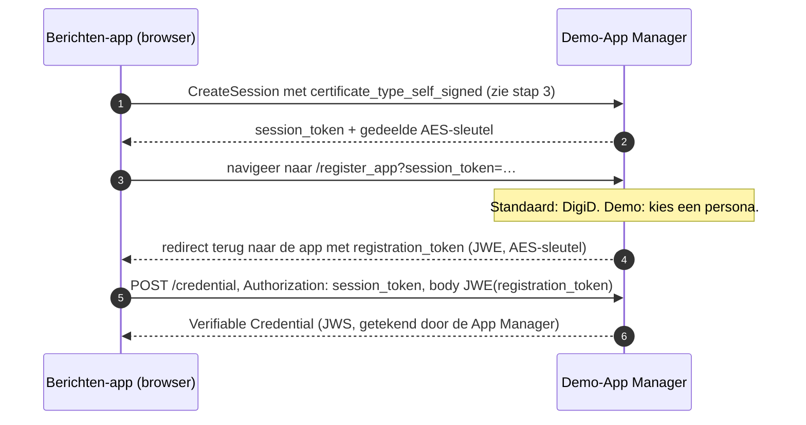
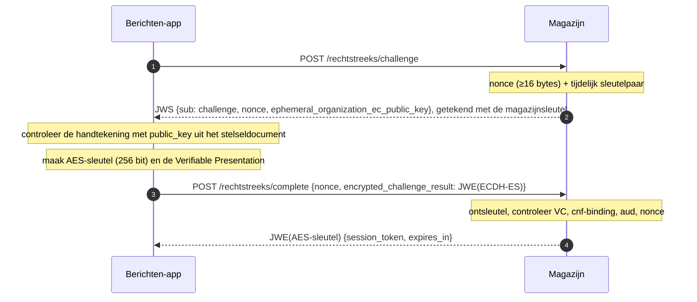
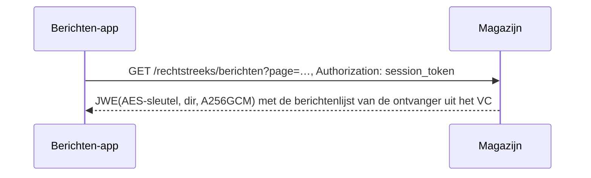

# Rechtstreeks ophalen via de Blauwe Knop: ontwerp

**Status:** Concept

Issues: MinBZK/MijnOverheidZakelijk#1213, #1214, #1215, #1216, onder #947.

## Context

In de beproeving **Berichten via de Blauwe Knop** haalt een app in de browser de berichten van
een ondernemer zelf bij elk magazijn op, zonder uitvraagsysteem ertussen. Dat volgt het model van
VORijk: een App Manager bevestigt de identiteit, en bindt die aan een sleutel die de app niet kan
kopiëren. Elk magazijn controleert dat bewijs zelf. In de architectuur heet deze route
**Rechtstreeks ophalen** (views `RechtstreeksOphalen*` in `docs/architecture/workspace.dsl`).

Het stelseldocument (#1212) staat er al: de app leest daar welke magazijnen meedoen. Dit ontwerp
beschrijft de rest van de keten: de sleutel, het bewijs, de sessie met een magazijn en het
ophalen. Het is de leidraad voor een reeks kleine PR's (zie "Opdeling"). Na deze PR is het
protocol op papier en het contract van de tweede ingang vastgelegd, zodat de stappen daarna deels
tegelijk kunnen lopen.

Eerste sprint, zoals de issues hem afbakenen: alleen berichten lezen, eerst in de simulator,
voor één persona. Bijlagen, status en het echte magazijn volgen.

### Welke standaard

De conceptstandaard heette bij de start van het stelseldocument *BK Connect draft-00*. Het adres
daarvan (`https://vorijk.nl/standaard/connect/draft-bk-connect-00.html`) verwijst inmiddels door
naar **FSC voor Burgers** (`https://docs.fsc4b.nl/specs/protocol/`), werkversie 13 oktober 2026,
redactie Team Mijn Betaaloverzicht (CJIB). Dezelfde begrippen (Activatiedienst/App Manager,
`app_managers`, `bk-connect://app/`) staan erin, dus we lezen dit als de opvolger. Dit ontwerp
volgt die werkversie; sectienummers hieronder verwijzen ernaar. Het toepassingsprofiel van het
stelseldocument noemt nog draft-00. Dat werken we bij in de PR die het stelseldocument uitbreidt
(PR 2).

De standaard kent twee varianten om een app bij een organisatie te laten inloggen: HTTPS-JWT
(`CreateSession`, 4.3.4) en HTTPS-OpenID4VP (4.3.5). **We kiezen HTTPS-JWT**; zie ontwerpkeuze 1.

## De rollen

| Rol in de standaard | Bij ons | Waar |
|---|---|---|
| App | **Berichten-app**: een webpagina in de browser van de ondernemer | nieuwe demo-module `demo/berichten-app` |
| Activatiedienst (App Manager), Credential Issuer | **Demo-App Manager**: geeft per persona een bewijs uit; de persona-keuze vervangt het inloggen | nieuwe demo-module `demo/app-manager` |
| Verifier, Dienst | **Magazijn**: controleert het bewijs en levert berichten. Eerst de simulator, daarna het echte magazijn | `demo/magazijn-simulator`, later `services/berichtenmagazijn` |
| Stelselbeheerder | **Stelselregister**: publiceert magazijnen, hun sleutels en de App Manager | `services/stelselregister` |
| (gedeeld) | De Verifier-kant van het protocol, één keer gebouwd | nieuwe library `libraries/fbs-rechtstreeks` |

De library bevat de controle van bewijs en sessie. Zowel de App Manager (bij het activeren) als
het magazijn (bij elke sessie) is in de standaard een Verifier van hetzelfde `CreateSession`-
protocol. Ze delen dus dezelfde code. Demo-modules mogen van een library afhangen; andersom niet
(`.github/scripts/demo-grens.sh`).

## Hoe het werkt

Vier stappen. Stap 1 en 2 gebeuren eenmalig per browser, stap 3 en 4 bij elk ophalen, per
magazijn en parallel.

### 1. De app maakt een sleutel

De Berichten-app maakt met WebCrypto een ECDSA-sleutelpaar op P-256 (`ES256`, 3.1) met
`extractable: false`, en bewaart het `CryptoKey`-object in IndexedDB. Pagina's van dezelfde
origin kunnen de sleutel gebruiken om te tekenen, maar niemand kan hem uitlezen: `exportKey`
weigert. Dit is de **root app key**: de sleutel waaraan de App Manager straks de identiteit bindt.
Waarom deze route en geen passkey: zie "Verkenning".

### 2. De App Manager bindt een identiteit aan die sleutel (activeren, 4.4.1)

- Het `CreateSession`-protocol met een **self-signed certificaat** bewijst dat de app de
  private key bezit van de public key die in het bewijs komt, nog vóór iemand weet wie de
  gebruiker is.
- In de standaard logt de gebruiker in met DigiD. In de demo kiest hij een persona; de App
  Manager neemt die als vastgestelde identiteit. Dat is de enige plek waar we de standaard
  inkorten, en het past bij het uitstellen van authenticatie in de hele PoC.
- De "universal link" van een mobiele app is hier een gewone redirect naar de URL van de
  Berichten-app.
- Het **Verifiable Credential** (VC, 4.3.1) is een JWS van de App Manager. Er staan in: de public
  key van de app (`cnf.jwk`), de scope, de OIN van de App Manager (`iss`), de geldigheid (`iat`,
  `nbf`, `exp`) en de identiteit van de ontvanger (zie ontwerpkeuze 7).
- Met het `registration_token` haalt de app later een vers VC op zonder opnieuw te kiezen.

### 3. Sessie met een magazijn (`CreateSession`, 4.3.4)

De **Verifiable Presentation** (4.3.4.1) bevat het VC, de AES-sleutel voor de sessie, en een JWS
waarmee de app de nonce tekent met zijn root app key (`sub: challenge_response`, `aud`: OIN van
het magazijn). De app versleutelt dat geheel naar de tijdelijke public key van het magazijn
(JWE, `ECDH-ES`, `A256GCM`). Alleen dat magazijn kan het openen.

### 4. Berichten ophalen binnen de sessie

Het magazijn leidt de ontvanger af uit de sessie, en dus uit het gecontroleerde VC. Er is geen
`X-Ontvanger`-header. Het antwoord is versleuteld met de AES-sleutel van de sessie, bovenop TLS.

De app doet stap 3 en 4 parallel voor elk magazijn uit het stelseldocument, voegt de lijsten
samen, sorteert ze op publicatietijdstip en toont welke magazijnen niet of te laat antwoordden.

### Wat elke controle tegenhoudt

| Controle | Houdt tegen |
|---|---|
| Handtekening van de App Manager op het VC, `iss` in `app_managers` van het stelseldocument | Een zelfgemaakt bewijs van identiteit |
| `nbf`/`exp` van het VC | Een oud of nog niet geldig bewijs |
| `scope` van het VC | Een bewijs voor een andere dienst dat hier wordt aangeboden |
| Nonce getekend met de sleutel uit `cnf.jwk` | Een gestolen VC zonder de sleutel uit de browser: het bewijs is niet overdraagbaar |
| `aud` in de getekende nonce | Een magazijn dat de presentatie doorspeelt aan een ander magazijn |
| Nonce eenmalig en kortlevend | Een opgenomen `complete`-verzoek opnieuw afspelen |
| Challenge getekend met de magazijnsleutel uit het stelseldocument | Een nepmagazijn dat zich als een echt voordoet |
| Presentatie versleuteld naar een tijdelijke sleutel | Meelezen van VC en AES-sleutel, ook als TLS ergens onderweg wordt opengebroken |

## Ontwerpkeuzes

1. **HTTPS-JWT (`CreateSession`), niet OpenID4VP.** Per magazijn zijn er twee verzoeken nodig.
   Bij tot 100 magazijnen telt dat. OpenID4VP vraagt per magazijn een OAuth-ronde (JAR,
   versleutelde response, token request). Daarnaast gebruikt het activeren bij de App Manager
   zelf ook `CreateSession` (4.4.1): met één protocol dekken we beide.

2. **Zelf bouwen, geen VORijk-onderdelen.** De VORijk-referentieonderdelen voor een
   bronorganisatie vragen per organisatie eigen diensten en databases. De simulator speelt 3 tot
   100 organisaties in één service; daar past dat niet in. We volgen wel de berichten van de
   standaard letterlijk (veldnamen, JWS/JWE-vormen), zodat de vergelijking eerlijk blijft en een
   echte VORijk-app in principe zou kunnen aansluiten.

3. **Browsersleutel: WebCrypto, P-256, niet-exporteerbaar, in IndexedDB.** Past precies in de
   standaard (ES256 JWS). Zie "Verkenning" voor de afweging met passkeys.

4. **Eén library voor de Verifier-kant: `libraries/fbs-rechtstreeks`.** Bevat het maken van een
   challenge, de controle van presentatie en VC, en het beheren van sessies. Gebouwd op `jose4j`,
   dat het stelselregister al gebruikt: dat kan JWS ES256, JWE `ECDH-ES` en `dir`/`A256GCM`. De
   kern is gewone Kotlin zonder CDI, zoals `fbs-kern`: de diensten bedraden hem zelf. De opslag
   van nonces en sessies staat achter een interface. De simulator en de App Manager draaien met
   één instantie en krijgen een opslag in het geheugen. Het echte magazijn draait met meer
   replica's en krijgt later een opslag in PostgreSQL.

5. **Een eigen contract naast de magazijn-spec:
   `services/berichtenmagazijn/src/main/resources/openapi/rechtstreeks-ophalen-api.yaml`.** Zou
   de tweede ingang in `berichtenmagazijn-api.yaml` staan, dan publiceert het echte magazijn
   endpoints die het pas sprints later implementeert. In een eigen bestand kan de simulator er
   eerst uit genereren (tweede generator-executie). Het echte magazijn neemt het over zodra het de
   ingang bouwt. Het berichtmodel is gedeeld: het contract verwijst naar de schema's in
   `berichtenmagazijn-api.yaml`.

6. **Paden onder `/api/v1/rechtstreeks/`.** De standaard zet `challenge` en `complete` op
   `/v1/challenge` en `/v1/complete` van een sessie-dienst, die een app via de
   vindbaarheidsconfiguratie vindt (4.2). Die laag hebben we niet: het stelseldocument wijst met
   `magazijn_url` rechtstreeks naar het magazijn (bestaande afwijking). We houden het
   `/api/v1`-prefix van de API Design Rules aan en geven de route één eigen subtree. Dat is ook
   wat de codegenerator vraagt: een tag die geen eigen pad-prefix heeft, kan de routes van een
   andere tag afvangen (zie het commentaar boven `paths` in `berichtenmagazijn-api.yaml`).

7. **Identiteit in het VC: claim `ontvanger` in plaats van `bsn`.** De standaard schrijft `bsn`,
   `given_name` en `family_name` voor; dat zijn burgers. Een ondernemer heeft een KVK-nummer of
   RSIN. We nemen `ontvanger` op in dezelfde vorm als de `X-Ontvanger`-header (`<TYPE>:<WAARDE>`,
   zoals `KVK:12345678`) en `name` (IANA-geregistreerd) voor de weergavenaam. Dan beslist het
   magazijn met de bestaande regels (`Identificatienummer`, `BerichtAutorisatie`). Hoe een
   eHerkenning-machtiging in het VC komt, blijft open; de demo slaat dat over, net als het
   inloggen.

8. **Sessie: 15 minuten vast, niet te verlengen.** De standaard zegt niets over de levensduur. Een
   korte, vaste geldigheid is het eenvoudigst, en een nieuwe sessie kost één rondgang. Krijgt de
   app een `401`, dan doet hij `CreateSession` opnieuw. Het token is 32 willekeurige alfanumerieke
   tekens (de eis is ten minste 22) en gaat zonder schema in `Authorization` (4.4.1, stap 20). In
   de code heet dit de **magazijnsessie**, met opzet anders dan de inlogsessie van de uitvraag
   (#943, `X-Sessie`). Die twee hebben niets met elkaar te maken.

9. **AES-sleutel van 256 bit.** De standaard spreekt zichzelf tegen: de controle van de
   presentatie eist 16 bytes (4.3.4.1), maar stap 13 en de JWE-header (3.4: `A256GCM`, `dir`)
   eisen 256 bit. Wij volgen 256 bit en melden het aan de auteurs.

10. **Sleutels van de magazijnen in het stelseldocument.** De app moet de challenge van een
    magazijn kunnen controleren (4.3.4.2, stap 10–12). Elk magazijn krijgt daarom een
    `public_key` (JWK, met een verloopdatum: 4.6) in het magazijnregister en in het
    stelseldocument. Voor de simulator maakt `genereer-magazijnen.py` per OIN een sleutelpaar: de
    public keys gaan in het register, de private keys in de set van de simulator. De App Manager
    komt op dezelfde manier in `app_managers`.

11. **CORS: elke origin, zonder credentials, alleen op `/rechtstreeks/*`.** De app draait in een
    browser op een andere origin dan de magazijnen. Toegang hangt aan het sessietoken in de
    `Authorization`-header, niet aan cookies. Een open origin geeft een aanvaller dus niets wat hij
    niet al heeft. De bestaande ingang (via FSC) houdt zijn huidige policy. In het echte magazijn
    loopt dit via de Vert.x-laag, zoals de headers voor `/api/v1/openapi.json`.

12. **Berichtenbox: een eigen demo-module, `demo/berichten-app`.** De planning van de
    proeftuin-berichtenbox ligt buiten onze hand. Een eigen eenvoudige pagina toont de route nu
    al. Die pagina is ook de origin waar de sleutel woont. Volgens de comment op #1211 kiezen we
    met een knop, niet per persona. Waar die knop komt (in de proeftuin-box naast de
    uitvraag-route, of in het bedieningspaneel) stemmen we af met het proeftuinteam; zie open
    vragen.

13. **JOSE in de browser: `jose` (panva), als ESM-bestand meegeleverd in de module.** Deze
    library kan JWS en JWE `ECDH-ES` met WebCrypto-sleutels, ook met niet-exporteerbare. We
    leveren hem mee met een vaste versie en laden hem niet van een CDN: de pagina die de sleutel
    gebruikt, laadt dan geen code van een derde.

## Afwijkingen van de standaard

Deze tabel gaat als terugkoppeling naar de auteurs, net als die in het toepassingsprofiel.

| Eis | Stand bij ons | Reden |
|---|---|---|
| VC bevat `bsn`, `given_name`, `family_name` (4.3.1) | `ontvanger` (`<TYPE>:<WAARDE>`) en `name` | Ondernemers hebben een KVK-nummer of RSIN |
| Identificatie met DigiD bij activeren (4.4.1, stap 6–7) | Keuze van een persona | Authenticatie is in de hele PoC uitgesteld |
| Universal link terug naar de app (4.4.1, stap 14) | Redirect naar de URL van de Berichten-app | Web, geen mobiele app |
| `challenge`/`complete` op `/v1/…` van een sessie-dienst uit de vindbaarheidsconfiguratie (4.2, 4.3.4.2) | Onder `<magazijn_url>/api/v1/rechtstreeks/` | Geen vindbaarheidsconfiguratie; zie ontwerpkeuze 6 |
| `session_aes_key` van 16 bytes (4.3.4.1) | 32 bytes | De standaard spreekt zichzelf tegen; zie ontwerpkeuze 9 |
| Hybride ML-KEM-768 met ECIES ZOU gebruikt moeten worden (3.3) | Alleen `ECDH-ES` | WebCrypto kent geen ML-KEM; de eis is een ZOU, geen MOET |
| Revocatie van VC's met een Token Status List (4.5) | Nog niet; een VC is kort geldig | Buiten de eerste sprint |
| TLS 1.3 (3.5) | Eis aan de ingress, niet in de dienst afgedwongen | Zoals bij het stelselregister |
| Formaat en levensduur van het antwoord op `complete` | JWE met `session_token` en `expires_in` | De standaard noemt het token, niet de vorm van het antwoord |

## Verkenning: passkey of browsersleutel

#1213 vraagt om een korte verkenning van de passkey-route, met de browsersleutel als terugval.
Dit is een **bureauverkenning**: gebaseerd op de WebAuthn-specificatie en de standaard, niet
gemeten in een browser. Wat ze opleverde:

1. **Een passkey-handtekening is geen JWS.** WebAuthn tekent `authenticatorData` plus de hash van
   `clientDataJSON` (waar de challenge, de origin en het type in staan). Het veld
   `app_nonce_signature` moet een JWS zijn (3.1, 4.3.4.1). Elk magazijn moet dan een tweede
   handtekeningvorm leren controleren, met een WebAuthn-library.
2. **Elke handtekening vraagt een handeling van de gebruiker.** `navigator.credentials.get()`
   toont steeds een dialoog: vingerafdruk, pincode of op zijn minst een klik. Een sessie met 100
   magazijnen betekent dan 100 bevestigingen. Werkbaar wordt het alleen als de passkey één keer
   een kortlevende browsersleutel tekent, die daarna de nonces tekent. Dat is een eigen
   certificaatketen die verder afwijkt van de standaard, en de magazijnen tekenen dan toch weer
   met een sleutel buiten de beveiligde chip.
3. **"Niet te kopiëren" geldt niet voor elke passkey.** Passkeys in iCloud-sleutelhanger of
   Google Wachtwoordbeheer worden via de cloud naar andere apparaten gekopieerd. Afdwingen dat
   een passkey aan één apparaat vastzit, vraagt attestation, en die geven gesynchroniseerde
   passkeys doorgaans niet.
4. **De browsersleutel past precies.** ES256 met een sleutel die niet te exporteren is. De
   beperkingen zijn bekend: hij zit niet in een beveiligde chip, en script op dezelfde origin kan
   er wel mee tekenen (dus XSS moet uitgesloten zijn; daarom ook geen code van een CDN). En de
   browser kan de opslag wissen. Safari doet dat na zeven dagen zonder bezoek. Dan activeert de
   app opnieuw bij de App Manager, en dat is in de demo één klik.

**Besluit:** de browsersleutel. De passkey levert de magazijnen in deze opzet niets op: zij zien
in beide gevallen een gewone ES256-sleutel. De gebruiker krijgt er wel veel bevestigingen bij. Wel
interessant voor VORijk: een passkey als **inlogmiddel bij de App Manager**, in plaats van
DigiD bij elke herregistratie. Dat raakt de magazijnen niet en kan later.

## Opdeling in PR's

Elke PR gaat los naar main en is op zichzelf te testen. Deze opdeling wijkt af van het eerste
voorstel (vijf PR's): de App Manager gebruikt bij het activeren hetzelfde `CreateSession` als
het magazijn. De Verifier-library komt daarom eerst.

| PR | Inhoud | Issue | Aantoonbaar met |
|---|---|---|---|
| **0. Ontwerp + contract** | Dit document, `rechtstreeks-ophalen-api.yaml`, gekozen variant in de architectuur | #1213 (keuze vastleggen) | Review; Spectral op de spec |
| **1. Verifier-library** | `libraries/fbs-rechtstreeks`: challenge maken, presentatie en VC controleren (beide certificaattypen), sessies, opslag in het geheugen | #1213, #1215 | Unit- en eigenschapstests met een Kotlin-testclient in de rol van app, vooral de afwijzingen uit "Wat elke controle tegenhoudt" |
| **2. Sleutel + demo-App Manager** | `demo/app-manager` (activeren volgens 4.4.1, persona-keuze, VC uitgeven en verversen); App Manager in `app_managers` van het stelseldocument; `demo/berichten-app` met de sleutel en het activeren | #1213, #1214 | Een bewijs per persona; een bewijs met een andere sleutel faalt; de sleutel is niet te exporteren (browsertest) |
| **3. Magazijnsessie in de simulator** | Sleutel per gesimuleerd magazijn (register, stelseldocument, `genereer-magazijnen.py`); `challenge`/`complete`; CORS | #1215 | Geldig bewijs geeft een sessie; ongeldig bewijs, verkeerde handtekening, verkeerde `aud` of hergebruikte nonce geeft `401` |
| **4. Berichten lezen in de simulator** | `GET /rechtstreeks/berichten`, versleuteld, alleen voor de ontvanger uit de sessie | #1215 (deels) | Een app krijgt alleen de berichten van zijn ontvanger; een verlopen of onbekende sessie geeft `401` |
| **5. Berichten-app: ophalen en samenvoegen** | Stelseldocument ophalen en controleren, parallel bij elk magazijn ophalen, samenvoegen en sorteren, niet-reagerende magazijnen tonen | #1216 | Eén gesorteerde lijst voor een persona; een gestopt magazijn wordt bij naam getoond |

Na PR 0 kunnen PR 1 en de pagina-kant van PR 5 tegelijk beginnen; PR 5 eerst tegen een stub van
het contract. #1215 gaat na PR 4 niet dicht (bijlagen, status en het echte magazijn volgen); daar
gebruiken we `Refs`.

## Raakvlakken met #943 (PR #393)

Geen afhankelijkheid: #943 gaat over de inlogsessie tussen portaal en uitvraag, deze route
gebruikt de uitvraag niet. Wel:

- **Naam.** "Magazijnsessie" en `Authorization`, niet "sessie" en `X-Sessie`.
- **`fbs-common`.** PR #393 voegt `401` met `WWW-Authenticate` toe aan de gedeelde
  foutafhandeling. Het echte magazijn kan dat hergebruiken; de simulator hangt bewust niet aan
  `fbs-common`.
- **Proeftuin-berichtenbox.** Kiezen we die later toch, dan raakt de knop dezelfde code als de
  moza-poc-kant van #393.

## Buiten de eerste sprint

- Bijlagen en status (gelezen, verwijderd) via de tweede ingang (#1215).
- De tweede ingang in het echte magazijn, met sessies in PostgreSQL en een `Logboek
  Dataverwerkingen`-regel per ophaalactie (#1215, #1218).
- Revocatie van VC's (Token Status List, 4.5) en een verloopdatum op de sleutel van de App Manager.
- Nieuwe berichten zien zonder uitvraag (#1217), de demo naast elkaar (#1219) en meten tot 100
  organisaties (#1220).
- De vindbaarheidsconfiguratie per organisatie (4.2).

## Open vragen

- **Waar komt de knop (#1211)?** In de proeftuin-berichtenbox, in het bedieningspaneel, of
  alleen in de eigen Berichten-app. Hangt af van afstemming met het proeftuinteam.
- **Is FSC voor Burgers de opvolger van BK Connect?** De doorverwijzing wijst erop. Bevestigen
  bij VORijk, samen met de afwijkingen hierboven.

## Verificatie

- PR 0: Spectral met de ADR-ruleset op `rechtstreeks-ophalen-api.yaml` (alleen de
  `servers-use-https`-waarschuwing die de magazijn-spec ook heeft), een proefgeneratie met
  `jaxrs-spec` en `useTags` (één interface `RechtstreeksOphalenApi` op `@Path("/rechtstreeks")`,
  plus de payload-modellen), en review van dit document.
- Bruno: de requests komen met de implementatie (PR 3 en 4). `challenge` is een kaal verzoek;
  `complete` en `berichten` vragen versleuteling, en krijgen een pre-request-script of blijven
  aan de geautomatiseerde tests.
- Elke volgende PR: de tests in de kolom "Aantoonbaar met" hierboven, plus de gebruikelijke gates
  (JaCoCo 90 % voor stelsel en simulator, detekt). Vanaf PR 3 ook een rookproef op de
  demo-stack.
